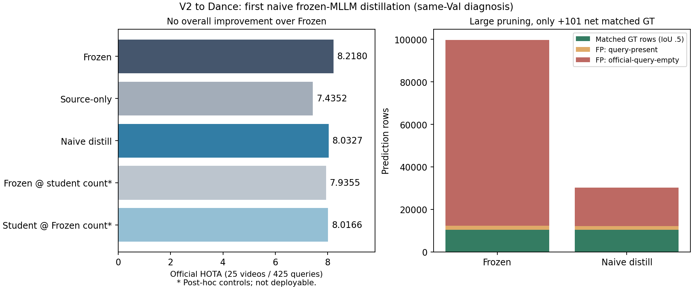

# MLLM Distillation：完整首轮结果与科研验收

2026-10-29，`LYQ1107/TTA-RMOT`；分支`research/v2dance-mllm-naive-distill-20261028`。

结论：**Naive蒸馏HOTA 8.0327，低于Frozen8.2180，未通过进入Ours的科研门槛。**
不是“教师完全无用”：全量及非教师锚点的分数可分性改善；但同帧语义排序、正目标覆盖和轨迹关联没有形成一致最终收益。

## 1. 实际完成范围与数据隔离

按用户“40Train没有的话先用val”，这是25Val同集无标签离线蒸馏开发诊断，不是40Train→25Val，不是盲测，也不是Source-Free Online TTA。
40Train图像/表达存在，匹配官方DETR+NeuralSORT的预测MOT缺失；本轮没有用GT框/ID或替代检测器补造。P1及旧UDA/TTA结果未改写。
目标GT打开尝试在教师、学生训练和推理均为0；全部425预测及GT-free数量对照封存后，独立CPU进程才读取GT。没有GT调阈值、prompt、采样或checkpoint。
官方协议复核：25视频×17表达=425；40表达序列有官方GT、385无官方GT，212541个GT观测；mark=1/class=1，一基帧号/偏移0，框为top-left xywh。
“官方无GT”不等于画面中语义上绝对不存在目标；不能用这些离线分组作为在线存在性标签。Qwen完整预训练样本不公开，潜在同源视频重叠未知。

## 2. 完整官方RMOT

| 方法 | HOTA | DetA | AssA | DetRe | DetPr | IDF1 | IDSW | 输出行 |
|---|---:|---:|---:|---:|---:|---:|---:|---:|
| FROZEN | 8.2180 | 3.1937 | 21.1470 | 4.5441 | 9.6868 | 4.4414 | 269 | 99704 |
| SOURCE_REHEARSAL | 7.4352 | 1.9669 | 28.1110 | 2.3022 | 11.8740 | 2.8658 | 119 | 41211 |
| MLLM_DISTILL | 8.0327 | 4.1579 | 15.5420 | 4.5571 | 31.9620 | 5.1028 | 314 | 30304 |
| FROZEN_AT_MLLM_COUNT | 7.9355 | 4.1558 | 15.1750 | 4.5547 | 31.9450 | 5.1160 | 344 | 30304 |
| MLLM_AT_FROZEN_COUNT | 8.0166 | 3.0935 | 20.7760 | 4.4059 | 9.3921 | 4.1775 | 302 | 99704 |

Source-only经过12项协议逐项复核，可复用同源计划/seed17/初始化/容量/8973步/优化器/源验证选择的既有结果，其历史成本不记为免费。
历史Mean Teacher HOTA8.2494仅作参考：其3锚点/全候选/EMA损失与本轮5锚点/每次≤4/外部MLLM监督不同，不是公平同预算教师对照。

## 3. 数量匹配和视频级不确定性

两种Count-Matched都不读GT构造：Frozen按学生实际逐帧k取top-k；学生按Frozen实际逐帧k取top-k。它们依赖另一系统已知输出数量，是POST-HOC DIAGNOSTIC，不是可部署TTA或GT阈值优化。

| 配对差值 | ΔHOTA | 视频级95%区间 | 提升/下降/持平视频 |
|---|---:|---|---|
| MLLM_DISTILL_vs_FROZEN | -0.185373 | [-6.621116, +5.474385] | 14/8/3 |
| MLLM_DISTILL_vs_SOURCE_REHEARSAL | +0.597498 | [-6.234589, +7.452156] | 14/7/4 |
| MLLM_DISTILL_vs_FROZEN_AT_MLLM_COUNT | +0.097180 | [-0.080762, +0.309415] | 5/8/12 |
| MLLM_AT_FROZEN_COUNT_vs_FROZEN | -0.201463 | [-0.815774, -0.017816] | 4/10/11 |

完整视频作为聚类单位，2000次配对bootstrap/seed0，使用TrackEval未舍入HOTA充分统计重新合并。不是几十万独立帧，也不是训练种子复核或盲测显著性。
学生相对Frozen的数量减少与收益/损失不是线性可加的因果比例；不能计算“多少百分比提升来自剪枝”。本轮没有触发预注册的seed0/42和E4–E7扩展。

## 4. 排序、文本敏感性与未标注帧

| 范围 | Frozen AUROC / AP | 学生 AUROC / AP |
|---|---|---|
| all425_official | 0.650204 / 0.093446 | 0.754863 / 0.160565 |
| GT_present_frame_queries | 0.539649 / 0.640229 | 0.660466 / 0.699409 |
| direct_teacher_pairs | 0.644122 / 0.100557 | 0.743832 / 0.192743 |
| non_teacher_anchor_frames | 0.650364 / 0.093508 | 0.754987 / 0.160561 |
| non_teacher_anchor_frames_GT_present | 0.539706 / 0.639998 | 0.660627 / 0.699259 |

这些跨帧/表达池化分数受视频难度和query存在性影响，不等同同帧排序。下表一对一R@K包括没有MOT候选的GT帧，按GT帧表达宏平均：

| 方法 | Recall@1 | Recall@3 | Recall@5 |
|---|---:|---:|---:|
| FROZEN | 0.156803 | 0.437121 | 0.678148 |
| SOURCE_REHEARSAL | 0.151279 | 0.429747 | 0.670902 |
| MLLM_DISTILL | 0.151534 | 0.438237 | 0.671445 |

另一个旧版“top1”指标指至少命中一个正候选的hit rate，并非按GT数量归一化的一对一召回，不能与此表混用。
复用既有真实文本互换/视觉偏置评测器：视觉对照为同候选17表达分数的均值，不是独立视觉模型；其它真实表达未必为负，另报GT不相交及非空不相交对照。

| 方法 | 正确文本top1 hit | 随机hit | 视觉偏置hit | 其它文本hit | 混合正负同帧AUROC |
|---|---:|---:|---:|---:|---:|
| FROZEN | 0.614788 | 0.578299 | 0.576131 | 0.573785 | 0.559705 |
| SOURCE_REHEARSAL | 0.610638 | 0.578299 | 0.577654 | 0.575540 | 0.553064 |
| MLLM_DISTILL | 0.613076 | 0.578299 | 0.579014 | 0.576261 | 0.564259 |

同帧query相对视觉偏置AUROC优势的增量+0.001731，25视频95%区间[-0.020806843758798634, 0.03461650540174756]，没有稳定独立语义排序提升证据。
非锚点AP/AUROC提升说明并非仅记住教师样本；但非锚点一对一R@1/3/5与标注帧分开保存在`dense_ranking_transfer.json`，不能靠全局AUC替代未标注帧召回。

## 5. Query-Present/官方-Empty与逐行错误归因

| 组别 | 表达数 | Frozen/学生召回 | Frozen/学生FP行 | Frozen/学生非空预测率 |
|---|---:|---|---|---|
| query_present | 40 | 0.048635 / 0.049111 | 1996 / 1727 | 0.800000 / 0.675000 |
| query_empty | 385 | N/A (无GT) | 87371 / 18139 | 0.400000 / 0.228571 |

恢复GT7797、丢失7696，净+101；新增预测FP行16147、删除85655，另有7个共有行因匹配重分配成为FP、0个反向变化，净FP变化−69501。
这里为独立离线IoU0.5逐帧匹配；官方CLEAR的跨时序匹配TP为10328→10428/FP89376→19876，数值不同是协议定义差别，不是跳样本或改指标。

存在性为整段封存视频的离线统计，不是因果在线规则，不学习新阈值：

| 固定统计量 | Frozen AUROC / AUPRC | 学生 AUROC / AUPRC |
|---|---|---|
| mean_margin | 0.660260 / 0.162801 | 0.754026 / 0.263081 |
| p90_margin | 0.671688 / 0.168148 | 0.787597 / 0.318928 |
| mean_frame_max_margin | 0.674545 / 0.167241 | 0.776948 / 0.297376 |
| max_margin | 0.725779 / 0.199373 | 0.823701 / 0.448431 |
| positive_fraction | 0.695065 / 0.170642 | 0.734058 / 0.301884 |

随机presence AUPRC为40/425=0.094118；存在性信号改善不代表最终空目标决策、语义选择或轨迹连续性已解决。

## 6. 教师覆盖、概率校准与学生拟合

8381实际有效配对全部以原始软概率训练，0硬POS/NEG，0无效响应；未询问3580064个候选-表达观测不自动变NEG。
P1原阈值UNKNOWN只是旧筛选状态，其中有效原始概率仍保留；当前未做硬阈值筛选。以下p>.5只作独立离线诊断，不是训练规则。
教师实际配对AUROC0.962424/AP0.604148；980个p>.5的官方匹配精度0.426531，已采样正候选发现召回0.861856。
这些精度以官方不完备指代GT定义，不能断言所有未匹配者语义上都是错误。没有明确硬NEG，因此硬NEG误标率为N/A；低于等于.5的有效soft组里有67个官方正候选。
1102个固定锚点GT观测分解：97无MOT，523有MOT但未采样，66已采样可恢复却被教师打低分，416被高分教师一对一覆盖；四项恰好1102。
高分教师覆盖固定锚点37.7495%，覆盖全视频GT0.1957%；两种分母不同。全时域MOT可恢复197385/212541，但稀疏采样不能当全时域教师召回。
原软概率对官方标签固定10bins诊断：Brier0.063750、ECE100.070110、log-loss0.382829。未在目标GT上拟合温度/阈值，排序强不意味着原概率校准正确。
学生教师锚点BCE1.340922→0.345800/MSE0.129064→0.078107，但对980个教师高分配对预测为正仅4.59%→4.80%；不能用整体负例占优的agreement代替正例拟合。
8973步KD梯度均有限非零；52.00%步骤源/KD方向为负，但余弦10/50/90%为[-0.0780721540897704, -0.0021232499052753653, 0.0679786295957314]，中位数几乎正交，不能据此认定冲突为主因。
KD/source梯度范数比中位60.21，KD已占优；不应盲目增加lambda。24,576参数LoRA容量不足尚未被实验证明；本轮不以目标GT结果选择新容量/阈值。

## 7. 真实计算成本与模型来源

本轮学生训练1544.73s/0.429092GPUh，24576参数/8973步；四worker推理累计3357.92s/0.932755GPUh，实际调度墙钟1073.20s。
峰值训练5.975GiB、推理4.913GiB；调度query-frameFPS404.059，活动原视频frameFPS23.768，两者相差17表达因子。
物理GPU1/0/3/4，先审计显存，按进程数/可放显存共享，不停止其他项目；四worker已正常退出。逐workerFPS、GPU UUID、显存与墙钟见`per_worker_compute.csv`。
本轮新MLLM调用0不等于教师免费：继承P1的8381次整句单帧判断、483.7811秒分摊forward成本，另依赖既有Frozen候选分数库。原P1完整调用/图像输入/失败预算保留于P1报告，缓存命中不算新标签。
Source-only历史训练0.255297GPUh+推理0.827119GPUh，MeanTeacher参考0.807551+0.496812GPUh；历史Frozen旧逐表达流水线3.726946GPUh/墙钟7729.72s，含原覆盖和等价性工作。
不同旧/新query-batch实现及共享负载不构成受控速度基准，不能把这些时间比值冒称算法加速。Count-Matched是CPU派生，但总依赖成本包含两套完整模型输出，不是零GPU的独立RMOT系统。
训练1544.73s和推理1073.20s不包含准备/失败smoke/CPU评估；所有尝试单独保留。官方五组CPU TrackEval总墙钟24.11s，实际成本边界见compute_cost与日志。

V2初始化SHA `71dbd691e7633a3d20facb1ebc405908863aff786e5af30899d4cb666250d613`。
Qwen revision `89644892e4d85e24eaac8bacfd4f463576704203`，BF16/无量化/无adapter/冻结；YesTrack官方V2 LoRA未取得，按用户允许不使用替代权重。
学生source-val-only选择step8973、CE0.87920851；checkpoint SHA `eaa6b8477cc314efe813fd56a4bd1f70e64615e152b184ba67774548a5f47954`，不是按Dance指标选出的最优。

## 8. 科研判决与恢复

判决：`NO_GO_FIRST_NAIVE_BASELINE_COMPLETE_FAILURE_DIAGNOSIS`。保留代码、可分性正向信号和完整HOTA负结果；不宣称新算法成立，不推出Positive-Support Recovery，不把研究整体判死。
后续只注册小规模GT-free固定配对拟合/容量诊断，详见`MLLM_DISTILLATION_NEXT_DIAGNOSTIC.md`；本轮不启动新完整训练，不同时改变容量、损失、采样、阈值。
所有5组各425预测/收据、8973步完整训练trace、教师原始soft标签与输入manifest压缩副本、失败和恢复日志、完整官方CSV/汇总与离线分析均保留并发布。
23项相关测试通过，compileall与diff空白检查通过；交付回归第一次的临时目录假设错误单独保留，修正测试隔离后全通过，不修改生产预测或放宽验收。
大型checkpoint、图像、原始SQLite和完整candidate score库留服务器；每个分数文件SHA/path及恢复命令见`results/mllm_distillation/recovery_index.json`和`full/candidate_score_bank_index.json`。

