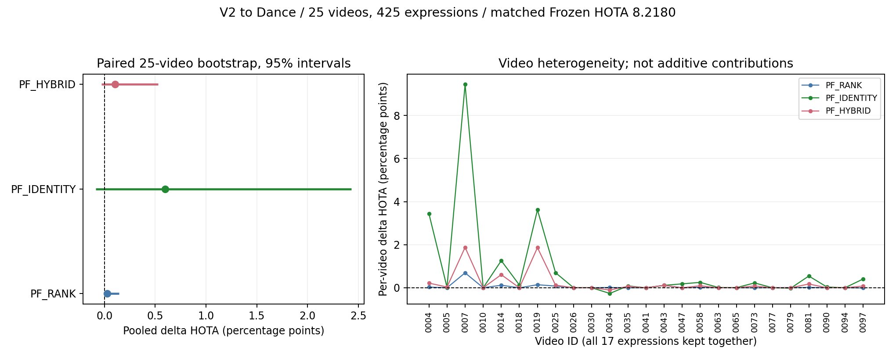

# FlexHook V2→Dance Positive-Free TTA：完整实验报告

全部六种方法均已完成 25 视频 / 425 表达。主 TTA 最优：PF_IDENTITY，HOTA 8.8179，相对匹配基线 +0.5999 个百分点。
含冻结基线和无梯度/保留消融在内，全部方法中最高 HOTA 为 PF_IDENTITY: 8.8179。

最优主 TTA 的 HOTA 与净 GT 恢复点估计为正，但配对视频聚类95%区间下限未大于0；现有证据不足以支持稳定的正向收益，不能据此宣布科研成功或跨模态语义恢复。

## 固定协议与基线

- 执行项目仅为 `LYQ1107/TTA-RMOT`，目录 `/data2/user/FlexHook-TTA`，与 LocateMOT/GroundJEV 无关。
- 固定官方 Refer-KITTI-V2 源 checkpoint，SHA256 `71dbd691e7633a3d20facb1ebc405908863aff786e5af30899d4cb666250d613`；不使用 Dance 第二阶段权重。
- Dance 专用官方 DETR+NeuralSORT MOT：25 文件、211,085 条固定框/ID；每视频 17 表达，共 3,588,445 个候选-表达分数，完整时序。
- Source-Free 指第二阶段 FlexHook 适应不读取源数据和目标 GT；候选来自目标域专用官方跟踪器，不能将本实验表述为整套检测跟踪系统完全无目标域监督。
- 默认 rank=4、lr=5e-5、update_interval=4、min_history=3、min_separation=0.6、seed=0、FP32；每 episode 重置可训练状态。没有源端重训或外部教师。
- 用户授权显存足够时共享 GPU，最多同时四张物理卡，优先少进程；24 GiB/worker 的 PyTorch 分配器预算加 8 GiB 入场余量不是跨用户显存预留。
- 原 Frozen 漏掉 692 个轨迹末观测。用户明确批准补齐全候选并重建匹配 Frozen；历史 HOTA 8.2060 不用于本轮增益计算。原文件、补充分数与失败记录均保留。
- 完整 ZERO_UPDATE 的真实 FP32 margin 构成后续全部方法共用的 Frozen 参考。对历史近零翻号逐项比较未缓存原始前向与缓存前向；有实际选择差异则阻止继续。
- 全部 Frozen 分数独立 CPU 回放必须逐行复现 425 个 ZERO_UPDATE 预测；它不是独立第二次 GPU 推理，不能据此夸大模型复现证据。
- 在线过程不读目标 GT、不使用未来帧、不改 MOT；预测完整封存后才由独立 TrackEval 和错误归因读取 GT。这是开发性目标域实验，不是独立盲测。

## 官方全量指标

指标百分数范围为 0–100；Δ 是相对完整匹配 ZERO_UPDATE 的百分点变化。

| 方法 | HOTA | ΔHOTA | DetA | AssA | DetRe | DetPr | IDF1 | IDSW |
|---|---:|---:|---:|---:|---:|---:|---:|---:|
| ZERO_UPDATE | 8.2180 | +0.0000 | 3.1937 | 21.1470 | 4.5441 | 9.6868 | 4.4414 | 269 |
| RELATIVE_ONLY | 7.5705 | -0.6475 | 4.1857 | 13.7120 | 11.1040 | 6.2855 | 5.5746 | 829 |
| PF_RANK | 8.2433 | +0.0253 | 3.2336 | 21.0150 | 4.6120 | 9.7458 | 4.4947 | 269 |
| PF_RANK_GUARD | 8.2444 | +0.0264 | 3.2342 | 21.0160 | 4.6134 | 9.7455 | 4.4956 | 269 |
| PF_IDENTITY | 8.8179 | +0.5999 | 4.0132 | 19.3760 | 5.9354 | 11.0030 | 5.4476 | 347 |
| PF_HYBRID | 8.3213 | +0.1033 | 3.4393 | 20.1330 | 4.9570 | 10.0800 | 4.7114 | 300 |

## 召回、误检与候选排序归因

下表仅为固定 IoU≥0.5 的离线逐帧最大基数匹配诊断，不替代官方 HOTA；重复框作为 FP。恢复/丢失均按 GT 观测计数。

| 方法 | 选中行 | 选中 ID（episode 累计） | 恢复 GT | 丢失 GT | 新增 FP 行 | 移除 FP 行 | Gate recall | AUROC | Top1 |
|---|---:|---:|---:|---:|---:|---:|---:|---:|---:|---:|
| ZERO_UPDATE | 99704 | 1769 | 0 | 0 | 0 | 0 | 0.050695 | 0.650204 | 0.614788 |
| RELATIVE_ONLY | 375483 | 8014 | 14873 | 0 | 260897 | 0 | 0.123635 | 0.650204 | 0.614788 |
| PF_RANK | 100582 | 1773 | 158 | 3 | 750 | 28 | 0.051455 | 0.648328 | 0.615468 |
| PF_RANK_GUARD | 100613 | 1773 | 158 | 0 | 750 | 0 | 0.051470 | 0.648328 | 0.615468 |
| PF_IDENTITY | 114648 | 1968 | 3247 | 24 | 12445 | 735 | 0.066501 | 0.642678 | 0.613686 |
| PF_HYBRID | 104521 | 1823 | 986 | 1 | 3861 | 35 | 0.055526 | 0.647115 | 0.615491 |

固定候选的可检索 GT 召回上界（逐 GT any-IoU）为 0.959373；所有方法的候选全集相同。
Top1 随机选择对照 0.578299；Top3/Top5、每表达计数和完整 AUROC 见各方法 `offline_attribution.json`。
GT 仅计官方 nonzero mark 且 pedestrian class=1 的行。新增 FP 指新加入选择集且未匹配的行；完整 FP 净变化另存 JSON，不能假设它恒等于新增减移除 FP（已有行的匹配状态也可能改变）。

固定 425 个 episode 中 385 个 GT 为空（按本协议视为无匹配），其余 40 个有有效 GT。全部保留，绝不改成仅评正目标的子集。

| 方法 | GT 空 episode 上的 FP | 有 GT episode 上的 FP |
|---|---:|---:|
| ZERO_UPDATE | 87371 | 1996 |
| RELATIVE_ONLY | 337014 | 13259 |
| PF_RANK | 88057 | 2033 |
| PF_RANK_GUARD | 88085 | 2033 |
| PF_IDENTITY | 97792 | 3296 |
| PF_HYBRID | 90852 | 2347 |

GT 空组只用于封存后的错误解释，未反馈到在线阈值、损失或超参数。候选排序在有目标帧上的改善不能单独证明无匹配拒识已改善。

## Query-Present / Query-Empty：单独验收

下表召回为离线 IoU≥0.5 最大基数匹配的 GT 观测微平均，包含无候选 GT；不是官方跨阈值 DetRe。空组无 GT，HOTA 不具备有效召回解释，不将它改成正目标子集。

| 方法 | Present / Empty episodes | Present GT recall | Present FP | Empty FP | Empty 非空预测 episode 比例 |
|---|---:|---:|---:|---:|---:|
| ZERO_UPDATE | 40 / 385 | 4.8635% | 1996 | 87371 | 40.0000% |
| RELATIVE_ONLY | 40 / 385 | 11.8612% | 13259 | 337014 | 100.0000% |
| PF_RANK | 40 / 385 | 4.9365% | 2033 | 88057 | 40.2597% |
| PF_RANK_GUARD | 40 / 385 | 4.9379% | 2033 | 88085 | 40.2597% |
| PF_IDENTITY | 40 / 385 | 6.3799% | 3296 | 97792 | 42.5974% |
| PF_HYBRID | 40 / 385 | 5.3270% | 2347 | 90852 | 40.5195% |

多目标 Recall@K 与旧 TopK any-hit 分开：前者是在可检索目标帧内 topK 覆盖的正候选比例的帧宏平均；后者只要求 topK 至少命中一个正候选。两者均不衡量空查询拒识。

| 方法 | Source Recall@1 / 3 / 5 | Adapted Recall@1 / 3 / 5 |
|---|---:|---:|
| ZERO_UPDATE | 0.157999 / 0.447421 / 0.697658 | 0.157999 / 0.447421 / 0.697658 |
| RELATIVE_ONLY | 0.157999 / 0.447421 / 0.697658 | 0.157999 / 0.447421 / 0.697658 |
| PF_RANK | 0.157999 / 0.447421 / 0.697658 | 0.158504 / 0.447335 / 0.697676 |
| PF_RANK_GUARD | 0.157999 / 0.447421 / 0.697658 | 0.158504 / 0.447335 / 0.697676 |
| PF_IDENTITY | 0.157999 / 0.447421 / 0.697658 | 0.156160 / 0.446019 / 0.694546 |
| PF_HYBRID | 0.157999 / 0.447421 / 0.697658 | 0.158359 / 0.447475 / 0.697892 |

每方法 JSON 另存四个 episode 活跃帧进度区间的负预测比例，检查是否随时间持续抑制输出；它不是独立帧显著性检验。
所有方法保持原MOT物理ID不变；AssA/IDSW变化来自被选中观测和评测对应关系的变化，不代表修复或改写了上游跟踪器ID。
身份诊断仅统计 query-GT 可见、间隔≤2帧的物理ID对应GT匹配身份变化及可能更新机会；遮挡/重叠时匹配重分配也可能产生变化，不能当作真实MOT身份错误率。它不覆盖未标注非目标人、GT缺口，也不证明所有正对可靠。在线记忆的 max_gap=2 无法独立识别短间隔 ID 互换；这些 GT 诊断从未参与训练。

## 视频级收益分布与不确定性

成对 bootstrap 以25个完整视频为聚类单位，每次保留视频内全部表达与帧，2000次重采样、seed0；重新池化官方HOTA充分统计量，不平均视频HOTA。区间只描述本开发集的视频抽样不确定性，不是独立盲测或训练种子显著性。

| 比较 | ΔHOTA | 视频聚类95%区间 | 提升 / 下降 / 不变视频 | Query-Present ΔHOTA |
|---|---:|---:|---:|---:|
| RELATIVE_ONLY_vs_ZERO_UPDATE | -0.647552 | [-2.105309, +2.373998] | 20 / 5 / 0 | +2.188848 |
| PF_RANK_vs_ZERO_UPDATE | +0.025268 | [-0.008807, +0.142421] | 11 / 8 / 6 | +0.040748 |
| PF_RANK_GUARD_vs_ZERO_UPDATE | +0.026352 | [-0.008558, +0.144534] | 11 / 8 / 6 | +0.042486 |
| PF_IDENTITY_vs_ZERO_UPDATE | +0.599863 | [-0.083812, +2.430322] | 17 / 2 / 6 | +0.878350 |
| PF_HYBRID_vs_ZERO_UPDATE | +0.103265 | [-0.030775, +0.527028] | 14 / 5 / 6 | +0.176088 |
| PF_HYBRID_vs_PF_RANK | +0.077997 | [-0.026526, +0.397497] | 13 / 5 / 7 | +0.135340 |
| PF_HYBRID_vs_PF_IDENTITY | -0.496598 | [-1.953786, +0.068879] | 3 / 15 / 7 | -0.702262 |

图中为三种预先定义的主TTA；六组完整数值均保留在前表。逐视频HOTA差值不能相加成总体HOTA差值。
- Rank影响较大的视频 dancetrack0065：单视频ΔHOTA -0.002145；去掉该视频后总体ΔHOTA +0.060659。HOTA非线性，不能把单视频差值当可加贡献。
- Rank影响较大的视频 dancetrack0007：单视频ΔHOTA +0.692424；去掉该视频后总体ΔHOTA +0.002743。HOTA非线性，不能把单视频差值当可加贡献。

## 有效证据与计算收益

| 方法 | 每副本可训练参数 | 更新机会 | 有证据机会覆盖 | 接受更新 / 机会 |
|---|---:|---:|---:|---:|
| ZERO_UPDATE | 0 | 0 | N/A | N/A |
| RELATIVE_ONLY | 0 | 0 | N/A | N/A |
| PF_RANK | 24576 | 108154 | 97.9816% | 97.9816% |
| PF_RANK_GUARD | 24576 | 108154 | 97.9816% | 97.9816% |
| PF_IDENTITY | 24576 | 108154 | 99.9214% | 80.1431% |
| PF_HYBRID | 24576 | 108154 | 99.9214% | 99.7365% |

| 方法 | Present接受更新 | Empty接受更新 | Present回滚 | Empty回滚 |
|---|---:|---:|---:|---:|
| ZERO_UPDATE | 0 | 0 | 0 | 0 |
| RELATIVE_ONLY | 0 | 0 | 0 | 0 |
| PF_RANK | 10805 | 95166 | 0 | 0 |
| PF_RANK_GUARD（复用Rank） | 10805 | 95166 | 0 | 0 |
| PF_IDENTITY | 8630 | 78048 | 2352 | 19039 |
| PF_HYBRID | 10862 | 97007 | 120 | 80 |

证据覆盖仅指注册规则下存在可计算的排序对/物理ID历史，不代表语言匹配正确。GT分组只用于封存后的诊断，绝不充当在线更新门禁。各episode重置，因此空组更新不会向其他有目标episode传递已学状态；空组仍可能通过减少误检获益，必须看实际FP而不是自动认定所有更新无效。

Rank 的 105,971 次更新消耗 5.1463 GPU小时、wall 5541.59s，仅得到 +0.0253 个HOTA百分点，且AUROC/AssA下降，当前证据不支持它具有突出的收益成本比。

## Hybrid 互补性验收

Hybrid 未超过较强单模块 PF_IDENTITY，未显示整体HOTA互补收益，不因两个loss而选择它为最终方法。
Hybrid相对较强单模块以DetRe下降换取AssA上升，不能描述为所需的目标召回互补。

## 梯度、有效证据与回滚

| 方法 | optimizer steps | 非零有限梯度 steps | 无证据跳过 | interval 跳过 | rollback | max adapter Δ L2 |
|---|---:|---:|---:|---:|---:|---:|
| ZERO_UPDATE | 0 | 0 | 0 | 0 | 0 | 0.00000000 |
| RELATIVE_ONLY | 0 | 0 | 0 | 0 | 0 | 0.00000000 |
| PF_RANK | 105971 | 105971 | 2183 | 325482 | 0 | 1.96882328 |
| PF_RANK_GUARD | 复用 Rank 105971；新增 0 | 复用 Rank 105971 | 复用 Rank | 复用 Rank | 复用 Rank 0 | 1.96882328（复用） |
| PF_IDENTITY | 86678 | 108069 | 85 | 325482 | 21391 | 1.99999856 |
| PF_HYBRID | 107869 | 108069 | 85 | 325482 | 200 | 1.99997981 |

`skipped_no_pairs` 历史计数包含间隔跳过，不能将其全部解释为无证据。
RELATIVE_ONLY 不做梯度更新，排序分数与 Frozen 相同；即使门禁选择改善 HOTA，也不是新语义学习。
PF_RANK_GUARD 是 PF_RANK 分数与 Frozen 正分候选取并集的显式保留消融，不是新增语义学习；若采用 CPU 派生，重用的 Rank 更新与额外 GPU 计算分开记录。

## 实测计算成本

| 方法 | 调度 wall 秒 | episode 计算累计秒 | GPU 小时 | 平均 worker 活跃帧 FPS | 调度 wall 活跃帧 FPS | PyTorch 峰值 GiB |
|---|---:|---:|---:|---:|---:|---:|
| ZERO_UPDATE | 7729.72 | 13293.87 | 3.7269 | 32.619 | 56.100 | 16.748 |
| RELATIVE_ONLY | 20.02 | 43.29 | 0.0000 | 10016.291 | 21655.775 | 0.000 |
| PF_RANK | 5541.59 | 18448.80 | 5.1463 | 23.505 | 78.251 | 16.819 |
| PF_RANK_GUARD | 7.34 | 7.34 | 0.0000 | 59100.341 | 59100.341 | 0.000 |
| PF_IDENTITY | 8940.97 | 34957.42 | 9.8481 | 12.405 | 48.500 | 17.034 |
| PF_HYBRID | 7193.22 | 26954.79 | 7.6323 | 16.088 | 60.284 | 17.024 |

Guard 的已执行依赖链为：Rank 5.1463 GPU小时 / 5541.59s wall，加独立完整episode GPU等价验证 112.43s wall，再加CPU派生 7.34s；这些顺序阶段wall合计 5661.36s（仍不含共同Frozen准备和评测）。验证receipt没有单独记录GPU进程起止积分，因此不把验证wall冒充精确GPU-hours，也不把它省略成零GPU。

峰值为 PyTorch max_memory_allocated，不包含 CUDA context 或 allocator reserved；不能解释为整卡峰值。
本表为已有冻结源分数资产条件下的各阶段实测执行成本；完整ZERO分数准备是共同的一次性成本。Rank/Hybrid需要冻结历史分数，独立在线部署时该源模型分支也应计入（冻结backbone可共享，但本轮未实测teacher+student双分支端到端FPS）。不能把缓存源分数解释为从图像免费产生。
RELATIVE_ONLY 的 CPU 成本同样仅指增量选择，前提是已有完整 ZERO_UPDATE 源分数；不能据此宣称从图像到 RMOT 输出不需要 GPU。
若 Guard 为 CPU 派生，其表内成本仅为增量 CPU 重放，不代表独立从图像运行只需零 GPU；必须同时承担完整 Rank 推理/适应和单独的 GPU 等价验证成本。
GPU 小时按实际 worker 起止累计；ZERO_UPDATE 最初 GPU5 完成 102 表达，后续 GPU6/4/0/1 处理剩余表达，因此该方法累计出现五个 UUID，但从未同时用五张卡。后续各方法的真实 GPU 见独立调度记录。
Rank 使用源推理时序估计的静态整视频分组；其耗时不能代表梯度计算的准确负载预测。Identity/Hybrid 的新计划改用最多四卡领取完整视频的队列，每视频 17 个独立 episode，不跨卡切断在线记忆；重载模型开销计入实测 wall。共享负载仍会变化，调度不保证固定加速倍数。
平均 worker FPS 的分母是各 episode 计算时间之和，不是四卡并行吞吐；调度 wall FPS 的分母包含等待，但不包含前置预检、评测与归因。两者不能混用。
ZERO wall 包含旧空卡策略等待和用户授权后恢复；共享任务会竞争算力，单卡子集与四卡全量并非相同工作负载，不报告未经控制的“4×加速”。
GPU 等价诊断、Guard 单完整 episode 验证、官方评测/归因是额外开销，保留在独立 receipt/log；表内 method wall 不自动包含这些阶段。

## 逐方法判断

- RELATIVE_ONLY：ΔHOTA -0.6475，ΔIDF1 +1.1332，净恢复 GT +14873。未提高官方总体 HOTA；保留完整负面结果。
- PF_RANK：ΔHOTA +0.0253，ΔIDF1 +0.0533，净恢复 GT +155。HOTA 有增益，仍需结合召回/FP/排序权衡解释，不据此声称已学到新语义。
- PF_RANK_GUARD：ΔHOTA +0.0264，ΔIDF1 +0.0542，净恢复 GT +158。HOTA 有增益，仍需结合召回/FP/排序权衡解释，不据此声称已学到新语义。
- PF_IDENTITY：ΔHOTA +0.5999，ΔIDF1 +1.0062，净恢复 GT +3223。HOTA 有增益，仍需结合召回/FP/排序权衡解释，不据此声称已学到新语义。
- PF_HYBRID：ΔHOTA +0.1033，ΔIDF1 +0.2700，净恢复 GT +985。HOTA 有增益，仍需结合召回/FP/排序权衡解释，不据此声称已学到新语义。

## 六组闭环后的研究决策

恢复GT和新增FP的单位都是观测行，不是独立的人数；下面是实际数量权衡，不是将这些相关行当独立样本做显著性检验。
- PF_RANK：恢复 158 / 丢失 3 个GT观测；新增未匹配预测行 750 / 移除 28；总FP净变化 +723。新增行误检与总FP变化严格区分，不能只报召回收益。
- PF_IDENTITY：恢复 3,247 / 丢失 24 个GT观测；新增未匹配预测行 12,445 / 移除 735；总FP净变化 +11,721。新增行误检与总FP变化严格区分，不能只报召回收益。
- PF_HYBRID：恢复 986 / 丢失 1 个GT观测；新增未匹配预测行 3,861 / 移除 35；总FP净变化 +3,832。新增行误检与总FP变化严格区分，不能只报召回收益。

A（正确候选排序）有失败证据：固定候选逐GT可检索率 95.9373%，但Frozen条件门禁召回仅 5.0695%，AUROC 0.650204；TopK与随机多目标对照、以及候选Recall@K必须一起看，不能把TopK任意命中误解成强语义排序。
B（查询存在性/拒识）有直接错误分布证据：Frozen的 97.77% 诊断FP来自官方GT空episode。同一query内部的排序和同一物理ID一致性都不提供跨query的存在性校准；更高HOTA不能自动证明空查询判断改善。
C（轨迹身份）不能被排除，但现有实验没有证明它是首要瓶颈。固定候选ID从未修改；InfoNCE的正对是物理ID跨帧，不是语言匹配正例。低AssA和GT可见ID冲突需要保留，不能据它们直接认定身份TTA解决了指代。
综合判断更支持D中的A+B联合失效，而非仅C。六组的实际排序、Empty FP、召回与成对视频区间限定了这个结论；单一源/目标、单seed和已查看目标指标仍限制因果解释与泛化。

是否值得继续：本开发集上的正向召回观测值得保留，但只有能产生新的、可证伪的查询相关证据，才值得另行验证presence-aware适应。不能把相同错误分数的稳定性或同一物理ID重新包装成独立语义监督。新机制先做设计与有界原型，不自动开始第七种完整GPU运行、源端训练或目标GT调参。

## 可复查材料

- GitHub：本分支 `results/positive_free/full/<method>/` 下的官方 summary/detailed CSV、425 条逐表达和 25 个逐视频指标、全量审计摘要与离线归因。逐视频使用官方 combine_sequences 池化，不是宏平均。
- `results/positive_free/full/manifests/`：测试记录、资产预检、原 Frozen 覆盖缺陷、补充 receipt、共享分片、完整边界诊断、匹配 Frozen receipt。
- 服务器原始结果：`/data2/user/FlexHook-TTA/results/runs/pf_*_completebank_full_20261025*`，保留每表达预测、压缩 margin trace、完成/失败收据和运行日志。大体积原始文件不伪装成已上传 GitHub 的模型权重或图像。
- 全量指标由官方 TrackEval 计算，没有缺失表达填空、删视频、改种子或根据目标 GT 选择阈值。

研究限制：仅 V2→Dance 单源单目标、固定官方 tracker 和单个预注册 seed；不支持由此泛化到 BDD/AerialMind 或反向迁移。未来扩展需另行明确授权。
