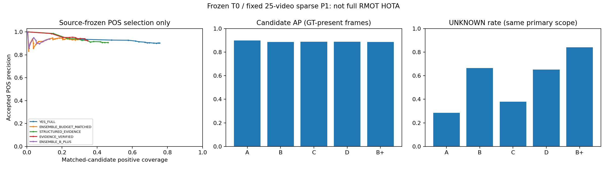

# P1：V2→Refer-Dance 冻结视觉语义教师可靠性与公平性报告

## 结论与边界

科学验收：`SIMPLE_TEACHER_ONLY_NO_EVIDENCE_CONTRIBUTION`。Gate A至少一组通过：**True**；
Evidence进入P2的Gate：**False**。本轮学生更新为0；完成P1后停止，未启动蒸馏长训。
工程完成不等于科研成功，不能用更高置信度、loss下降或少量接受样本代替语义证据。
T0整句教师在本固定候选的条件语义指标上有真实正向证据，但分属性/证据验证没有通过独立贡献验收。
这不等于证明所有证据机制无效：B/B-plus接受数量不足时，同覆盖检验记为证据不足，而非显著劣于。
同数量D与C的精度差为0；对A/SoftMatch同数量对照也未显示增益，且D覆盖明显下降。

这是已多次诊断的官方25Val开发性稀疏实验，不是新盲测，不是完整视频RMOT HOTA。
T0为`Qwen/Qwen3-VL-2B-Instruct`，HF revision`89644892e4d85e24eaac8bacfd4f463576704203`。
权重文件SHA256`7de1838c87a5349b016c26a1c3f7d2bc400a3d485f95ef39a7059ffd734977a0`。
BF16、无量化、冻结、无adapter；YesTrack官方KITTI-V2 LoRA未能正常公开下载/本机核验，用户明确允许缺失，不以V1/Dance/其它项目自训adapter替代。

## 覆盖和官方计分协议

完整probe覆盖25视频、425video-expression、5个预定锚点/视频，共2125个frame-query、
每方法8381个固定候选—查询配对；独立完整smoke每方法1649对。
抽样完全由GT-free MOT/原句/封存源分数确定；固定manifest SHA为
`a75c2da4453cc279c7560f831a53bb09fcb9f17d71ffbaf5db4885fe0eadee2c`。
官方GT按mark非0、class=1、帧偏移0、IoU≥0.5计分，40 Query-Present与
385 Query-Empty。固定锚点有193个GT-present frame-query，
1102条GT观测、485次候选正匹配机会，
正候选分布于25视频。
官方未匹配/空查询不等于画面已被逐人逐属性穷尽核验。主语义Gate在预注册GT-present frame-query上计算；全部425官方计分另列，绝不删除。
同一人多个MOT框可重复形成candidate TP，故GT覆盖使用一对一匹配，不能把候选TP当成不同人。

## 主语义质量（GT-present固定frame-query）

| 方法 | AP | AUROC | R@1 | POS(真/总) | POS精度 | GT覆盖 | UNKNOWN |
|---|---:|---:|---:|---:|---:|---:|---:|
| Frozen FlexHook | 72.929% | 58.339% | 17.618% | 40/46 | 86.957% | 3.630% | 0.000% |
| A / YesTrack整句 | 89.771% | 86.228% | 27.872% | 366/405 | 90.370% | 33.122% | 28.384% |
| B / 等预算整句 | 88.576% | 84.615% | 26.910% | 141/151 | 93.377% | 12.704% | 66.360% |
| C / 分属性 | 88.725% | 83.735% | 27.838% | 224/247 | 90.688% | 20.327% | 37.976% |
| D / 证据验证 | 88.725% | 83.735% | 27.838% | 168/182 | 92.308% | 15.245% | 65.177% |
| B-plus / 同视图同验证器 | 88.536% | 84.637% | 25.735% | 62/66 | 93.939% | 5.626% | 83.968% |
| 原TCP/TRP / 13帧重置 | 84.393% | 82.221% | 25.075% | 404/475 | 85.053% | 36.570% | 20.368% |
| SoftMatch-inspired权重 | 89.771% | 86.228% | 27.872% | 366/405 | 90.370% | 33.122% | 28.384% |

AP/AUROC是candidate级；R@k为每个GT-present frame-query一对一恢复GT比例的宏平均；
GT覆盖是所有锚点官方有效GT中接受POS的一对一匹配比例。最多4个采样候选，R@5不会超出采样库。
AP比较均对同样8381采样库做相同筛选，不混用历史全量Frozen 0.650204 AUROC或HOTA 8.2180。
主口径实际含761对，其中485为官方正候选，类别先验与全425辅助口径不同；不能把主口径90.37%精度宣传为全425精度。
例如A全425候选POS精度为57.911%，一对一精度为57.753%。

## 全425官方辅助口径（不能解释为穷尽语义真值）

| 方法 | 全425 AP | POS(真/总) | NEG误杀(真/总) | UNKNOWN |
|---|---:|---:|---:|---:|
| Frozen FlexHook | 10.056% | 40/452 | 445/7929 | 0.000% |
| A / YesTrack整句 | 60.415% | 366/632 | 22/6636 | 13.280% |
| B / 等预算整句 | 58.686% | 141/204 | 18/5847 | 27.801% |
| C / 分属性 | 61.835% | 224/322 | 57/7279 | 9.307% |
| D / 证据验证 | 61.835% | 168/223 | 3/3786 | 52.166% |
| B-plus / 同视图同验证器 | 59.425% | 62/80 | 4/3177 | 61.138% |
| 原TCP/TRP / 13帧重置 | 47.552% | 404/831 | 15/6623 | 11.061% |
| SoftMatch-inspired权重 | 60.415% | 366/632 | 22/6636 | 13.280% |

逐episode、逐视频、表达子组、presence及query-swap见同名CSV；不存在独立属性GT，所有17表达均含动作与服饰，
APPEARANCE/ACTION子组重叠，SPATIAL样本为0，不能声称完成空间关系或逐属性准确率验证。
解析器仅C/D使用预登记的dacning→dancing别名，整句保留原文；另列含/不含别名子组，不能把可能的文字规范化收益全算成结构化贡献。
Query-swap只用同一实际候选跨真实表达的采样交集，不补造缺失分数，不把其它可真表达一律当负例。

## 归因、覆盖与不确定性

- A相对匹配Frozen AP：+16.841个百分点，25视频配对95%区间[+2.461, +31.137]个百分点。
- B−A AP：-0.011948，R@1：-0.009623。
- B−A配对AP：-1.195个百分点，25视频配对95%区间[-2.949, +0.647]个百分点。
- B同时获取匹配C动作判断的四观测，故B−A不是只改变提示词次数的纯因果效应；B/C与D/B-plus才是视图匹配比较。
- C−B AP：0.001491，R@1：0.009283。
- C−B配对AP：+0.149个百分点，25视频配对95%区间[-2.639, +2.741]个百分点。
- D−C AP：0.000000；D和C同原始分属性分数，验证器只改变三值接受状态，不凭筛选增加原始排序信息。
- D对B-plus同视觉、同调用槽、同验证器比较：`{"status": "INSUFFICIENT_MATCHED_POS_COVERAGE", "left_count": 182, "right_available": 66}`。
- D−B-plus配对原始AP：+0.189个百分点，25视频配对95%区间[-2.612, +3.168]个百分点；不能代替同接受覆盖的验证器检验。
- D对C同接受数量次要归因：`{"status": "POST_HOC_COUNT_MATCHED_DIAGNOSTIC_NOT_DEPLOYABLE", "left_count": 182, "right_available": 247, "left_precision": 0.9230769230769231, "matched_right_precision": 0.9230769230769231, "precision_gain": 0.0, "CI95": [-0.023151340996168574, 0.02838652460964358], "valid_resamples": 2000, "GT_coverage_retained_vs_full_right": 0.75, "left_distinct_GT_observations": 168, "right_full_distinct_GT_observations": 224, "matched_control_distinct_GT_observations": 168, "comparison_uses_same_candidates": true, "threshold_feedback_to_teacher": false}`；不改原Gates。
- D的UNKNOWN原因：`{"LOW_RELIABILITY": 2966, "CONTRADICTORY_VISUAL_EVIDENCE": 2060, "TEACHER_DISAGREEMENT": 621, "TEMPORAL_EVIDENCE_MISSING": 11}`。
- 完整表达官方匹配候选中的分数瓶颈：`{"candidate_pairs": 485, "min_score_kind_ACTION": 214, "below_source_POS_gate_ACTION_AND_APPEARANCE": 39, "C_state_UNKNOWN": 204, "nonbinary_original_answer_pairs": 0, "below_source_POS_gate_NONE": 224, "C_state_SUPPORT_POS": 224, "below_source_POS_gate_ACTION": 64, "min_score_kind_APPEARANCE": 249, "min_score_kind_ACTION_AND_APPEARANCE": 22, "C_state_SUPPORT_NEG": 57, "below_source_POS_gate_APPEARANCE": 158}`。
  这只说明哪种问题的分数限制了完整表达，不是用完整表达标签伪造逐属性准确率。
- 完整25视频配对bootstrap，2000次、seed0，相关帧/表达不作为独立样本；有效重采样数和CI保留在bootstrap.json。
- 全425 D恢复/丢失及FP：`{"recovered_GT": 159, "lost_GT": 31, "new_prediction_rows": 214, "removed_prediction_rows": 443, "new_FP_prediction_rows": 55, "removed_FP_prediction_rows": 412, "existing_rows_became_FP_due_to_rematching": 0, "existing_rows_ceased_FP_due_to_rematching": 0, "new_rows_without_any_GT_IoU_match": 55, "removed_rows_without_any_GT_IoU_match": 412, "assignment_FP_change": -357, "interpretation": "new/removed FP rows use their respective one-to-one IoU05 assignment; existing-row rematching is separate; any-IoU semantic unmatched rows also reported; NOT full TrackEval"}`。
- 新增/删除FP预测行依据各自一对一IoU匹配；原有预测行因重分配变FP/不再FP单列，四项精确还原净FP变化。
  另报新行是否完全没有任何GT IoU匹配，区分语义候选标签与重复框造成的跟踪FP；这些是稀疏IoU诊断，不是完整TrackEval。
- SoftMatch-inspired仅用源冻结置信度半高斯权重，无额外硬门限；若接受POS权重均1则与A接受集合相同，不能宣称独立监督信号。
- D接受POS中的非Yes/No控制输出统计：`{"candidate_pairs": 223, "pairs_with_nonbinary_original": 0, "pairs_with_nonbinary_control": 0}`。
  无图/遮挡的条件Yes-No比值可能未校准，绝不将控制非回答解释成No；详细特征分组按完整表达IoU匹配分，不冒充逐属性真值。

## 计算与输入公平性

| 方法 | 累计worker秒 | 实际方法wall秒 | 分配GPU小时 | 新前向 | 所需独立raw调用 | 逻辑调用槽 | 逻辑视觉/语言token | 前向峰值GiB |
|---|---:|---:|---:|---:|---:|---:|---:|---:|
| A / YesTrack整句 | 486.27 | 183.93 | 0.1351 | 6732 | 8381 | 8381 | 838100/485112 | 4.358 |
| B / 等预算整句 | 2185.36 | 865.36 | 0.6070 | 18216 | 22678 | 22678 | 4782100/1150169 | 5.059 |
| C / 分属性 | 979.34 | 775.01 | 0.2720 | 9027 | 11282 | 22678 | 4782100/1105306 | 5.053 |
| D / 证据验证 | 13012.92 | 3902.43 | 3.6147 | 36070 | 56372 | 113359 | 19122000/5429380 | 5.044 |
| B-plus / 同视图同验证器 | 17455.76 | 5944.57 | 4.8488 | 72801 | 113327 | 113359 | 19122000/5653629 | 5.055 |
| 原TCP/TRP / 13帧重置 | 6116.90 | 4665.09 | 1.6991 | 21129 | 34628 | 34628 | 3970100/2040139 | 4.120 |
| SoftMatch-inspired权重 | 486.27 | 183.93 | 0.1351 | 6732 | 8381 | 8381 | 838100/485112 | 4.358 |

A只做原整句当前ROI，成本低；B与C逐候选对应相同视图/调用槽；B-plus逐一匹配D的5类干预视图、调用槽，并使用同验证器。
语言token受问法影响，实际报告，不宣称完全相同token。D/B-plus公平性以逐输入图像SHA和视图类型核验，而非只比参数量。
缓存可以共享，但表中所需raw调用和逻辑槽不抹去缓存前置成本；SoftMatch继承A全部MLLM成本。
SoftMatch行是A的依赖成本，不能再加一次得到总GPU小时。逐worker吞吐见budget_by_worker.csv，不是完整视频FPS。
分配GPU小时是共享GPU worker存活时间，不是独占利用率或能耗；等价raw秒是原批次均摊观察值，不能冒充另跑的独立实测时长。
方法wall为其最早worker启动至最晚退出的跨度，包含异步流水线滞后；没有独占四卡/单卡重测，不声称实测单卡加速倍数。
完整实验中发现V1反复解码/均值/哈希的CPU开销；V2只读LRU缓存经40项真实RGB/元数据一致性检查后用于后续worker。
旧健康进程未因代码更新而自动重启，逐worker缓存版本单列；因此实际wall不是统一缓存/硬件条件下的纯算法速度比较。
失败/恢复尝试的累计worker秒和GPU小时全部计入，成功恢复worker的总样本数不除以其仅剩余工作耗时来虚增FPS。
全部pipeline阶段含失败/恢复的GPU分配时间12.6485小时；
另有首个2对功能检查16.70秒。各阶段wall time、吞吐、峰值、原始请求/图像/token和所有失败记录另列。
TCP/TRP按用户授权固定13个因果活动帧原策略重置，保留6帧TCP、stride4、原TRP，不是从视频开头累积状态，更不是完整视频HOTA。

## 源规则、泄露隔离与风险

固定源4视频64窗口、203对，源POS/NEG门限0.95/0.05，
仅源开发选择。源验证器接受5个POS、精度1.0，但覆盖仅5/82，样本小且是源整句校准，不能证明Dance服饰教师可靠。
分属性min是预登记逻辑评分，不是经独立校准的联合概率；跨问题形式共用源门限存在校准迁移风险，不能据此推论所有教师/门限普遍无效。
所有六组完整预测、prompt/config/raw缓存索引先SHA封存，独立进程随后才读取目标GT。
所有教师receipt记录0目标GT打开尝试、0参数更新，原始模型完整参数SHA前后相同；Linux Landlock内核限制只读输入。
官方教师MLLM大规模预训练语料无法逐条核验，Refer-Dance潜在重叠**未知**；本轮未加载Dance LoRA或用Dance GT调prompt/阈值。
遮挡可能OOD、临近历史重叠强相关，视觉依赖与身份一致性不是语义真值；不把任何单项证据称为独立oracle。

## 用户16项问题逐项回答

1. 实际Qwen3-VL-2B-Instruct T0；**没有**加载KITTI-V2 LoRA，T1缺失已授权。
2. 教师目标标签输入0；目标GT仅封存后独立评测。
3. 全25个Dance Val视频、425表达均覆盖。
4. A/B/C/D/B-plus/TCP各8381对；完整smoke各1649对，非上限8500/1700虚报。
5. 相同候选/分辨率/预设历史，B=C同视图调用槽、B-plus=D同干预调用槽；A较便宜，语言token实测不同，不能称全组预算完全相等。
6. A主语义AP 89.771%，AUROC 86.228%，POS精度 90.370%，GT覆盖 33.122%。
7. B−A AP -0.011948，R@1 -0.009623，不把多提示词收益归因于分属性。
8. C−B AP 0.001491，R@1 0.009283，Gate B为False。
9. D Gate B为False；必须超过强B-plus，不能用双loss或更多调用宣称贡献。
10. POS P–C完整曲线见precision_coverage.csv，部署门限与离线扫分数诊断分列，不回写目标阈值。
11. D候选正机会正确监督168/485；一对一GT监督168/1102，
    其中采样候选可恢复GT为482，可恢复但未被POS监督为314；
    根本不在抽样候选可恢复范围的GT为620，不能全归咎于教师；NEG误杀候选3，不重复计算同一人。
12. D主口径UNKNOWN 65.177%，全425为52.166%；必须同时看GT覆盖，不能靠拒绝大多数样本报成功。
13. 没有已加载的目标适配权重；通用预训练潜在Refer-Dance重叠无法排除，状态UNKNOWN。
14. 40Train图像/表达已有，匹配官方DETR+NeuralSORT预测MOT仍缺失，不用GT补齐。
15. Evidence P2 Gate为False，formal_P2_executable=False；停止P1，不自动蒸馏。若只有简单教师通过，可仅作为以后需授权的基线设计。
16. 分支research/v2dance-evidence-teacher-p1-20261026；预测封存源提交a16646762163e28a2b4c53612af16d295e23bb52，离线报告源提交dde72c99d0d56b77c45c93203c72d5055c67a801。
    评测/报告脚本SHA另存evaluation_summary.json与report_generation.json，最终公开树映射见publication.json，完整复现命令见下一节。

## 复现与恢复

```bash
cd /data2/user/FlexHook-TTA
# 默认仅打印计划；--execute才执行，已有sealed方法自动保留。
bash scripts/run_teacher_probe_4gpu.sh --phase calibrate --execute
/data2/user/TTA-RMOT-assets/teacher-p1/env/bin/python scripts/calibrate_teacher_reliability.py --predictions results/runs/teacher_probe_p1_20261026_v1/calibrate/T0/SOURCE_RELIABILITY/teacher_outputs.jsonl --output results/teacher_probe/source_calibration_rules_T0.json
bash scripts/run_teacher_probe_4gpu.sh --phase smoke --rules results/teacher_probe/source_calibration_rules_T0.json --execute
bash scripts/run_teacher_probe_4gpu.sh --phase full --rules results/teacher_probe/source_calibration_rules_T0.json --execute
/home/szgx/anaconda3/envs/dfot/bin/python scripts/merge_teacher_probe_shards.py
/home/szgx/anaconda3/envs/dfot/bin/python scripts/audit_teacher_leakage.py
/home/szgx/anaconda3/envs/dfot/bin/python scripts/evaluate_teacher_probe.py
/home/szgx/anaconda3/envs/dfot/bin/python scripts/report_teacher_probe.py
```

恢复根目录`/data2/user/FlexHook-TTA/results/runs/teacher_probe_p1_20261026_v1`；原始输出/receipt、共享SQLite cache及teacher_cache_index指定的完整raw索引保留服务器。
首个source暂存缺帧失败已修复，38张合法源图补齐，源样本/真值hash不变；失败日志未隐藏。
完整probe中GPU7的D正常完成后，下一方法在模型加载前因显存入场余量不足被拦截；仅恢复失败单元，未用改batch/分辨率绕过。
依据实测约5.15GiB峰值，恢复worker采用8GiB分配上限加4GiB物理空闲余量，仍保留相同dtype/batch/像素/模型；所有入场与失败记录保留。
完整文本日志归档102成员，SHA`ef950ba32162c597a5a603f687a3e579b0c7b51a764dd20a0200ac59357abdb9`；不含图像、权重或GT。
历史六TTA/UDA结果未覆盖；本轮不产生新的完整RMOT HOTA，不把开发诊断当独立确认。


