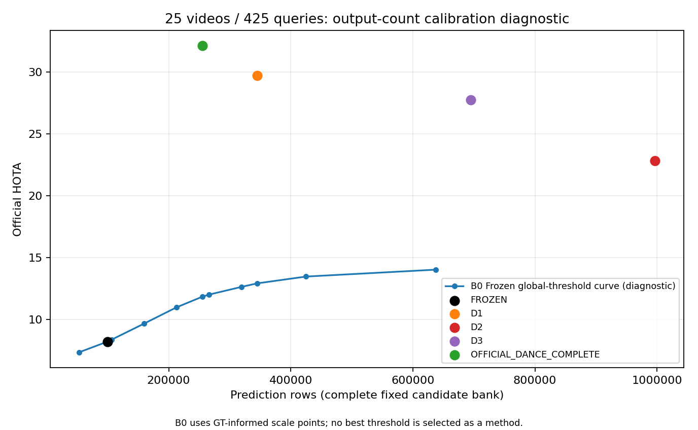

# D-FIT事后归因 v2：完整候选参照、数量校准与排序分离

状态：COMPLETE；完成后停止。v1停止记录与全部历史结果/vendor不改。

## 1. 结论摘要（Q1–Q4）

- Q1/判定C：相对完整同域官方254,910行，FROZEN=0.3911倍；D0_NAIVE=0.0828倍；D1=1.3546倍；D2=3.9086倍；D3=2.7270倍；D1与官方同量级，D2/D3过量、Frozen/D0不足（仅描述，不等于方法优劣）。
- Q2：D1−Frozen@D1数量=+0.3025 HOTA（CI[-0.438566309146064, 1.163106285890135]），D3−Frozen@D3数量=+0.6644；数量/存在性效应与帧内排序不能混为一谈。
- Q3/判定A：学生提供了超出简单校准的存在性信息；事后最好固定GT-free基线为B1_SRC_RATE_GLOBAL，HOTA=13.8480，D1差值区间=[9.949078899512797, 22.881122298707897]（只报告、不改定义）。
- Q4/判定B：排序信号只在 oracle 数量下可见；D3排序−Frozen在K=完整官方/D1下分别+0.0257/+0.6313，区间[-0.11603601573095021, 0.1679924233810208] / [-0.2294051426811933, 1.7479052701859568]。
- 主参照完整HOTA32.139，历史覆盖重新评测32.134；全部25视频425表达，开发Val事后诊断、不是盲测/Train→Val，不训练新模型。

## 2. 表C：完整覆盖对齐

GT统计：212,541检测、252个GT IDs；40 Query-Present/385 Query-Empty；完整视频时间轴433636个query-frame，其中GT有目标42782帧、空390854帧。GT不作为一个可部署模型，其HOTA/IDF1无意义，记N/A。

| 指标 | GT统计 | OFFICIAL_DANCE_COMPLETE | FROZEN | D0_NAIVE | D1 | D2 | D3 |
|---|---|---|---|---|---|---|---|
| 预测/GT行数 | 212,541 | 254,910 | 99,704 | 21,100 | 345,302 | 996,330 | 695,148 |
| /GT检测 | 1.0000 | 1.1993 | 0.4691 | 0.0993 | 1.6246 | 4.6877 | 3.2707 |
| /完整官方行数 | 0.8338 | 1.0000 | 0.3911 | 0.0828 | 1.3546 | 3.9086 | 2.7270 |
| 选中率 | N/A | 0.0710 | 0.0278 | 0.0059 | 0.0962 | 0.2776 | 0.1937 |
| 有输出query-frames | 42,782 | 41,979 | 36,452 | 12,191 | 81,061 | 188,897 | 113,802 |
| 有输出帧比例 | 0.0987 | 0.0968 | 0.0841 | 0.0281 | 0.1869 | 0.4356 | 0.2624 |
| 非空帧平均k | 4.9680 | 6.0723 | 2.7352 | 1.7308 | 4.2598 | 5.2745 | 6.1084 |
| 非空帧p50 k | 4.0000 | 6.0000 | 2.0000 | 1.0000 | 4.0000 | 4.0000 | 5.0000 |
| 非空帧p90 k | 11.0000 | 12.0000 | 5.0000 | 3.0000 | 8.0000 | 11.0000 | 14.0000 |
| GT有目标帧平均k | 4.9680 | 3.3472 | 0.2865 | 0.2397 | 4.3178 | 7.0402 | 5.6927 |
| GT空帧平均k | 0 | 0.2858 | 0.2237 | 0.0278 | 0.4108 | 1.7785 | 1.1554 |
| HOTA | N/A | 32.1390 | 8.2180 | 7.4499 | 29.7020 | 22.8440 | 27.7680 |
| DetA | N/A | 28.3540 | 3.1937 | 3.7469 | 28.9830 | 15.1550 | 21.3550 |
| AssA | N/A | 36.4860 | 21.1470 | 14.8340 | 30.5150 | 34.4760 | 36.1570 |
| DetRe | N/A | 48.3090 | 4.5441 | 3.9671 | 58.5850 | 74.5990 | 74.7930 |
| DetPr | N/A | 40.2790 | 9.6868 | 39.9600 | 36.0610 | 15.9140 | 22.8680 |
| AssRe | N/A | 42.1740 | 24.5840 | 15.7920 | 35.0490 | 39.8540 | 41.8210 |
| AssPr | N/A | 65.5390 | 72.2030 | 71.3460 | 63.7500 | 63.0840 | 64.4790 |
| IDF1 | N/A | 27.8160 | 4.4414 | 4.6833 | 27.6210 | 16.1940 | 22.1090 |
| IDSW | N/A | 1287.0000 | 269.0000 | 283.0000 | 2119.0000 | 2160.0000 | 2101.0000 |
| CLR_FP | N/A | 142730.0000 | 89376.0000 | 12026.0000 | 209159.0000 | 822787.0000 | 521200.0000 |
| CLR_FN | N/A | 100361.0000 | 202213.0000 | 203467.0000 | 76398.0000 | 38998.0000 | 38593.0000 |
| Dets | 212,541 | 254910.0000 | 99704.0000 | 21100.0000 | 345302.0000 | 996330.0000 | 695148.0000 |
| IDs | 252 | 1431.0000 | 1769.0000 | 814.0000 | 3322.0000 | 6935.0000 | 4280.0000 |
| Query-Empty全部预测行 | N/A | 108,123 | 87,371 | 10,783 | 156,758 | 686,166 | 446,071 |

GT列IDs指GT_IDs，其余模型IDs为预测IDs；FP/FN是官方CLEAR，不混用旧IoU离线行匹配。k统计包含零候选帧，p50/p90仅在有输出帧上，分位为numpy默认线性插值。每视频HOTA/行数/同视频官方倍数见per_video_all.csv。

## 3. 排序×数量矩阵（30格）

K=ORACLE_GT【ORACLE，使用GT，仅诊断】不属于方法；非oracle所有K都是对应模型实际margin>0的逐帧数量。下表HOTA采用官方summary，差值采用未舍入官方TP加权值；最后位的差异不是更换指标。

### HOTA矩阵

| 排序R / 数量K | FROZEN | D1 | D2 | D3 | OFFICIAL_DANCE_COMPLETE | ORACLE_GT【GT】 |
|---|---|---|---|---|---|---|
| FROZEN | 8.2180 | 29.4000 | 22.8540 | 27.1030 | 31.7710 | 45.7940 |
| D1 | 7.8978 | 29.7020 | 22.8910 | 27.3960 | 31.7080 | 46.4350 |
| D2 | 7.8380 | 29.7120 | 22.8440 | 27.2710 | 31.7650 | 46.4370 |
| D3 | 8.1589 | 30.0310 | 23.1370 | 27.7680 | 31.7970 | 47.4980 |
| OFFICIAL_DANCE_COMPLETE | 8.1361 | 30.1120 | 22.7730 | 27.0980 | 32.1390 | 46.7570 |

### 预测行数矩阵

| 排序R / 数量K | FROZEN | D1 | D2 | D3 | OFFICIAL_DANCE_COMPLETE | ORACLE_GT【GT】 |
|---|---|---|---|---|---|---|
| FROZEN | 99704.0000 | 345302.0000 | 996330.0000 | 695148.0000 | 254910.0000 | 201009.0000 |
| D1 | 99704.0000 | 345302.0000 | 996330.0000 | 695148.0000 | 254910.0000 | 201009.0000 |
| D2 | 99704.0000 | 345302.0000 | 996330.0000 | 695148.0000 | 254910.0000 | 201009.0000 |
| D3 | 99704.0000 | 345302.0000 | 996330.0000 | 695148.0000 | 254910.0000 | 201009.0000 |
| OFFICIAL_DANCE_COMPLETE | 99704.0000 | 345302.0000 | 996330.0000 | 695148.0000 | 254910.0000 | 201009.0000 |

### 同列减Frozen排序的HOTA差值

| 排序R / 数量K | FROZEN | D1 | D2 | D3 | OFFICIAL_DANCE_COMPLETE | ORACLE_GT【GT】 |
|---|---|---|---|---|---|---|
| FROZEN | 0.0000 | 0.0000 | 0.0000 | 0.0000 | 0.0000 | 0.0000 |
| D1 | -0.3202 | 0.3025 | 0.0371 | 0.2929 | -0.0627 | 0.6407 |
| D2 | -0.3801 | 0.3119 | -0.0105 | 0.1681 | -0.0060 | 0.6434 |
| D3 | -0.0591 | 0.6313 | 0.2826 | 0.6644 | 0.0257 | 1.7041 |
| OFFICIAL_DANCE_COMPLETE | -0.0820 | 0.7118 | -0.0815 | -0.0054 | 0.3677 | 0.9628 |

混合格继承排序模型和数量模型的已付训练/推理成本，是后验诊断，不是免费Frozen系统、独立新算法或GT-free oracle。固定列严格保持同样输出行数，变化只能来自选择哪些同帧候选及其关联效果。

### 贡献解释：逐帧/逐表达k并非一个全局数量

D1、Frozen@D1逐帧k、B0 Frozen全局top345,302，三者总输出同为345,302行，但HOTA分别29.702、29.400、12.930；关键不是单纯把阈值降低到相同总数，而是把数量分配到哪些表达和时刻。Frozen@D1继承了训练后D1提供的查询条件数量信息，不能把它描述成无需学习的Frozen校准。

D1相对Frozen的整体改善约21.484点，而固定D1数量后排序差只有约0.3025且区间跨0；HOTA非线性、数量与排序有交互，不能据此计算一个因果贡献百分比。表C也显示D1非空帧81,061多于官方41,979，虽然非空帧平均k反而更低（4.26 vs6.07），剩余差距仍包含存在性误发射，不只是每帧目标过多。

D3在两列实际可用数量下区间均跨0，仅GT数量列为正；这支持受理想数量条件约束的内部排序信号，不支持宣称已转化为可部署HOTA收益。D1点值仍低于同域参考32.139；D1−官方区间包含0不等于证明追平或等效。此诊断定位输出机制，不单独证明教师监督是唯一训练因果因素，也不是盲测泛化。

## 4. 固定校准基线（B1–B4）

| 版本 | HOTA | DetA | AssA | IDF1 | 行数 | /GT | /完整官方 | GT空帧平均k | Query-Empty预测行 |
|---|---|---|---|---|---|---|---|---|---|
| B1_SRC_RATE_GLOBAL | 13.8480 | 7.3144 | 26.2290 | 7.8057 | 1,143,831 | 5.3817 | 4.4872 | 2.4694 | 957,992 |
| B1_SRC_RATE_QUERY | 8.7547 | 4.7169 | 16.2880 | 5.7528 | 1,143,845 | 5.3818 | 4.4873 | 2.6373 | 1,027,799 |
| B2_Z_OFFLINE | 4.4367 | 3.1095 | 6.3608 | 4.2503 | 276,972 | 1.3031 | 1.0865 | 0.6381 | 248,713 |
| B2_Z_CAUSAL | 3.0672 | 2.3022 | 4.1170 | 3.1036 | 163,413 | 0.7689 | 0.6411 | 0.3781 | 147,304 |
| B3_MEAN_GLOBAL | 12.3490 | 6.8036 | 22.4210 | 7.9984 | 291,507 | 1.3715 | 1.1436 | 0.6286 | 244,983 |
| B3_MEAN_QUERY | 1.4402 | 0.7292 | 2.8591 | 1.1197 | 23,054 | 0.1085 | 0.0904 | 0.0490 | 19,067 |
| B4_TEACHER_RATE | 0.3952 | 0.1448 | 1.0802 | 0.2908 | 656 | 0.0031 | 0.0026 | 0.0006 | 239 |
| B4b_TEACHER_GATE | 9.4371 | 4.0601 | 21.9370 | 5.6765 | 18,235 | 0.0858 | 0.0715 | 0.0203 | 7,861 |

- B1_SRC_RATE_GLOBAL：源官方选中率+目标全局无标签分位；离线未来帧；生成进程目标GT打开0。
- B1_SRC_RATE_QUERY：源官方选中率+目标逐表达无标签分位；离线未来帧；生成进程目标GT打开0。
- B2_Z_OFFLINE：源z0+目标逐表达均值/总体方差；离线未来帧；生成进程目标GT打开0。
- B2_Z_CAUSAL：源因果z0+目标仅过去100数值帧；不含当前/未来；生成进程目标GT打开0。
- B3_MEAN_GLOBAL：源全局均值+目标全局均值；离线未来帧；生成进程目标GT打开0。
- B3_MEAN_QUERY：源全局均值+目标逐表达均值；离线未来帧；生成进程目标GT打开0。
- B4_TEACHER_RATE：Naive8500教师已判断样本+Frozen全视频；离线未来信息；生成进程目标GT打开0。
- B4b_TEACHER_GATE：Naive8500教师表达门控+Frozen；离线未来信息；生成进程目标GT打开0。

完整表C同字段（包括DetRe/DetPr/AssRe/AssPr/FP/FN/IDs、帧数量统计）见baselines.csv/alignment.json。源r_src=0.3187540118393838、源均值−8.394860413379645，z0_offline=1.4466019189252521、z0_causal=1.8597054552922299；均在源官方4视频862表达计算，不能称17源Train统计。

B4_RATE按预注册P_q/N_q最终只输出656行，而非将稀疏教师正率外推到全视频；这是固定基线的定义，不据GT事后改公式。回退明细和边界tie见GT_free_predictions.json，未采样/无效候选不补硬负例。

## 5. 25视频聚类bootstrap与判定

固定2000次/seed0，未舍入官方HOTA精确合并，95%配对percentile区间；leave-one-video-out删除整段视频及全部表达，不能把帧当独立样本。

| 比较 | ΔHOTA | 95% CI | LOO范围 | 负/正/平视频 | 行数差 |
|---|---|---|---|---|---|
| D1_minus_FROZEN_at_own_K | 0.3025 | [-0.4386, +1.1631] | [-0.0526, +0.4399] | 12/13/0 | 0 |
| D2_minus_FROZEN_at_own_K | -0.0105 | [-0.2149, +0.1669] | [-0.0573, +0.0339] | 16/7/2 | 0 |
| D3_minus_FROZEN_at_own_K | 0.6644 | [-0.0004, +1.5934] | [+0.3594, +0.8048] | 9/11/5 | 0 |
| D1_minus_B1_SRC_RATE_GLOBAL | 15.8544 | [+9.9491, +22.8811] | [+14.5156, +18.4182] | 2/23/0 | -798,529 |
| D1_minus_B1_SRC_RATE_QUERY | 20.9477 | [+15.4783, +27.6694] | [+19.7483, +23.2794] | 1/24/0 | -798,543 |
| D1_minus_B2_Z_OFFLINE | 25.2657 | [+19.5173, +32.3129] | [+24.0416, +27.7055] | 0/25/0 | 68,330 |
| D1_minus_B2_Z_CAUSAL | 26.6352 | [+21.0098, +33.6009] | [+25.4179, +29.0069] | 0/25/0 | 181,889 |
| D1_minus_B3_MEAN_GLOBAL | 17.3537 | [+11.2399, +24.6673] | [+15.9355, +19.4737] | 2/23/0 | 53,795 |
| D1_minus_B3_MEAN_QUERY | 28.2622 | [+22.5075, +35.4612] | [+26.9537, +30.6911] | 0/25/0 | 322,248 |
| D1_minus_B4_TEACHER_RATE | 29.3072 | [+23.7264, +36.1969] | [+28.0337, +31.6348] | 0/25/0 | 344,646 |
| D1_minus_B4b_TEACHER_GATE | 20.2652 | [+11.8967, +29.9684] | [+18.7520, +24.7618] | 1/24/0 | 327,067 |
| D1_minus_best_GT_free_baseline | 15.8544 | [+9.9491, +22.8811] | [+14.5156, +18.4182] | 2/23/0 | -798,529 |
| D1_sort_minus_FROZEN_K_OFFICIAL_DANCE_COMPLETE | -0.0627 | [-0.1946, +0.0587] | [-0.0914, -0.0184] | 14/8/3 | 0 |
| D3_sort_minus_FROZEN_K_OFFICIAL_DANCE_COMPLETE | 0.0257 | [-0.1160, +0.1680] | [-0.0003, +0.0728] | 11/9/5 | 0 |
| D1_sort_minus_FROZEN_K_D1 | 0.3025 | [-0.4386, +1.1631] | [-0.0526, +0.4399] | 12/13/0 | 0 |
| D3_sort_minus_FROZEN_K_D1 | 0.6313 | [-0.2294, +1.7479] | [+0.1232, +0.8408] | 10/15/0 | 0 |
| D1_sort_minus_FROZEN_K_ORACLE_GT | 0.6407 | [-0.0014, +1.6338] | [+0.2604, +0.7496] | 10/13/2 | 0 |
| D3_sort_minus_FROZEN_K_ORACLE_GT | 1.7041 | [+0.3447, +3.3957] | [+1.2357, +1.8559] | 10/14/1 | 0 |
| D1_minus_OFFICIAL_DANCE_COMPLETE | -2.4365 | [-7.4624, +2.5120] | [-3.4964, -1.0091] | 14/11/0 | 90,392 |
| HIST_D1_minus_OFFICIAL | -2.4370 | [-7.4641, +2.5040] | [-3.4975, -1.0078] | 14/11/0 | 90,058 |

判定A：学生提供了超出简单校准的存在性信息；触发基线：无。
判定B：排序信号只在 oracle 数量下可见。
判定C：{"OFFICIAL_DANCE_COMPLETE": {"ratio": 1.0, "label": "与同域官方同量级"}, "FROZEN": {"ratio": 0.39113412576987955, "label": "过量或不足"}, "D0_NAIVE": {"ratio": 0.08277431250245185, "label": "过量或不足"}, "D1": {"ratio": 1.354603585579224, "label": "与同域官方同量级"}, "D2": {"ratio": 3.9085559609273863, "label": "过量或不足"}, "D3": {"ratio": 2.727033070495469, "label": "过量或不足"}}。

判定逐字依预注册，但“区间包含0”不是等效检验，更不是完整因果证明；只针对这八个固定基线，事后选最好基线的区间未校正选择，不能夸大成所有校准都足够/所有存在性都已解决。敏感性和B0不参与A/B/C。

## 6. B0全局阈值曲线（不是方法）

| 曲线点 | 行数 | HOTA | margin边界 | 边界tie数 |
|---|---|---|---|---|
| B0_SCALE_0p25 | 53,135 | 7.3527 | 1.4332 | 1 |
| B0_SCALE_0p5 | 106,271 | 8.3712 | -0.1720 | 1 |
| B0_SCALE_0p75 | 159,406 | 9.6673 | -1.4264 | 1 |
| B0_SCALE_1p0 | 212,541 | 10.9820 | -2.5097 | 1 |
| B0_SCALE_1p25 | 265,676 | 12.0120 | -3.4556 | 1 |
| B0_SCALE_1p5 | 318,812 | 12.6370 | -4.2981 | 1 |
| B0_SCALE_2p0 | 425,082 | 13.4760 | -5.7434 | 1 |
| B0_SCALE_3p0 | 637,623 | 14.0340 | -7.9558 | 1 |
| B0_NATIVE_FROZEN_COUNT | 99,704 | 8.2180 | 0.0000 | 1 |
| B0_NATIVE_OFFICIAL_COMPLETE_COUNT | 254,910 | 11.8450 | -3.2708 | 1 |
| B0_NATIVE_D1_COUNT | 345,302 | 12.9300 | -4.6870 | 1 |

预算含用户指定GT检测规模，仅作阈值/数量可恢复性曲线；没有挑最优阈值部署，没有用目标GT优化B1–B4。原始模型散点不是曲线上相同行数预测的等价物。

## 7. 自检与两种覆盖范围

完整参照254,910行HOTA32.139，历史参照254,118行HOTA32.134；原覆盖425表达逐行复现，新792行均来自692末观测。其余四主对角和六旧count_controls逐行等价通过，原HOTA8.218/29.702/22.844/27.768与29.400/22.854/27.103及7.8978/7.8380/8.1589不变，详见matrix_self_checks.json。

FlexHook data/mydataloader.py:354/359的排他range漏每轨迹末观测；完整211,085 vs历史210,393，差692 MOT/11,764候选–表达。vendor不改，历史预测不覆写。敏感性只是预测候选统一减末观测，GT、425表达、时间轴及官方过滤均保持原样。

| 历史覆盖排序R | 历史覆盖K | HOTA | 行数 | 完整原生HOTA | 完整原生行数 |
|---|---|---|---|---|---|
| FROZEN | FROZEN | 8.2072 | 99320.0000 | 8.2180 | 99704.0000 |
| D1 | D1 | 29.6970 | 344176.0000 | 29.7020 | 345302.0000 |
| D2 | D2 | 22.8530 | 993229.0000 | 22.8440 | 996330.0000 |
| D3 | D3 | 27.7760 | 692777.0000 | 27.7680 | 695148.0000 |
| OFFICIAL_DANCE_COMPLETE | OFFICIAL_DANCE_COMPLETE | 32.1340 | 254118.0000 | 32.1390 | 254910.0000 |
| D1 | OFFICIAL_DANCE_COMPLETE | 31.7040 | 254118.0000 | N/A | N/A |
| D3 | OFFICIAL_DANCE_COMPLETE | 31.7950 | 254118.0000 | N/A | N/A |

历史覆盖D1−OFFICIAL的CI单列在bootstrap最后一行，不参与主判定；七套敏感性预测均本轮重新官方评价，不拿旧结果冒充重评。完整/历史HOTA可对照，但不根据哪个较好挑选覆盖。

这里历史覆盖Frozen是**当前已封存ZERO_UPDATE margin的同一历史候选子集**，因此为8.2072/99,320，而非替换为早期批量推理的8.2060/99,316；两份文件均未改。全3,576,681重叠分数审计查到6个接近零的符号差（5新增、1删除，净+4），所有边界margin绝对值不超过0.000128；全局最大margin差0.00118494，符合不同既有数值路径的小差异。具体逐候选分数在frozen_historical_overlap.json；不声称当前子集逐行复现早期batch文件，不按GT挑选或替换这些margin。官方Dance历史对角仍按硬门槛严格复现254,118/32.134。

## 8. GT隔离审计

参考构建与全部40套GT-free预测生成独立进程目标GT打开尝试均0；只用剥离标签runtime文本、固定MOT、封存margin、源分数、Naive8500。最终封存后独立ORACLE进程读425 GT文件，仅生成明确ORACLE/B0；报告进程读425 GT做帧分组。没有GT进入源统计、分位阈值、学生、checkpoint选择或因果窗口。

所有58预测集各425表达，24,650个预测文件均封存并在官方评测后复核SHA；逐文件清单all_prediction_files.csv.gz，服务器完整文件路径与seal见prediction_manifest.json。旧D-FIT/v1权重、margin、预测不动。

## 9. 成本与可恢复路径

本轮新GPU调用0、训练/优化0、新教师0；CPU准备wall合计292.025s、进程CPU 291.787s；有效新官方jobs=46，保留无效B0尝试=4，新评价实际总次数=50，逐行等价复用=12，官方worker-wall累计1637.598s（含无效尝试、并行求和，不是调度墙钟或CPU-core小时）。报告/打包耗时另见completion。

先前官方补分数0.051710 GPU-process小时及D-FIT训练/推理成本仍存在，见costs.json继承路径SHA；不能将本轮低CPU成本说成免费独立RMOT。每job日志/完成收据与完整官方summary+detailed在official_metrics_and_logs.tar.gz。
服务器恢复根：`/data2/user/FlexHook-TTA/results/runs/diag_attrib_20261031_v2`；仅恢复缺失/失败单元，已通过单元不重跑。所有计算完成后停止，不启动新训练。

## 10. 失败与修复记录

v1明确停止记录保留：完整官方与旧254,118条件不相容；用户批准并先推送v2后才改用完整参照，不称为科研收益。v2初始8项针对性CPU测试通过；补充判定和B0绝对预算回归后共12项通过（不累加重叠运行次数）。

汇总发现真实B0实现错误：round_budget(scale,GT_count)误把1.25/1.5/2/3倍GT预算均截为212,541；撤销未推送的初版完整报告，保留全部四套错误预测、官方CSV/日志与初版报告。最小修复改为绝对round-half-up(scale×212,541)，只按实际3,588,445候选上限截断；正确预算265,676/318,812/425,082/637,623，仅重评这四点。其余健康评测不重跑，预注册定义、seed、权重、阈值算法均不改；A/B/C不依赖B0且未因修复改变。详情见EXECUTION_NOTES.md、B0_recovery.json及归档retained_invalid_B0。

## 建议（只建议，不执行）

当前证据支持保留D1作为学到逐表达/逐帧数量分配的基线，而不是把它的收益归为一个全局阈值；不把D3的Oracle排序收益包装成实际方法成功。若后续获授权，优先研究无GT的查询存在性/时间分配与空目标误发射控制，保留简单源统计校准作强制对照，不继续通过更大pos_weight扩大输出。两模型拼接后验格子不是可部署新算法；本轮不开始新训练。
