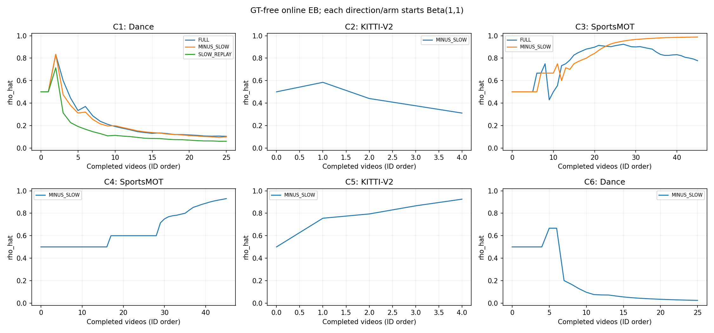
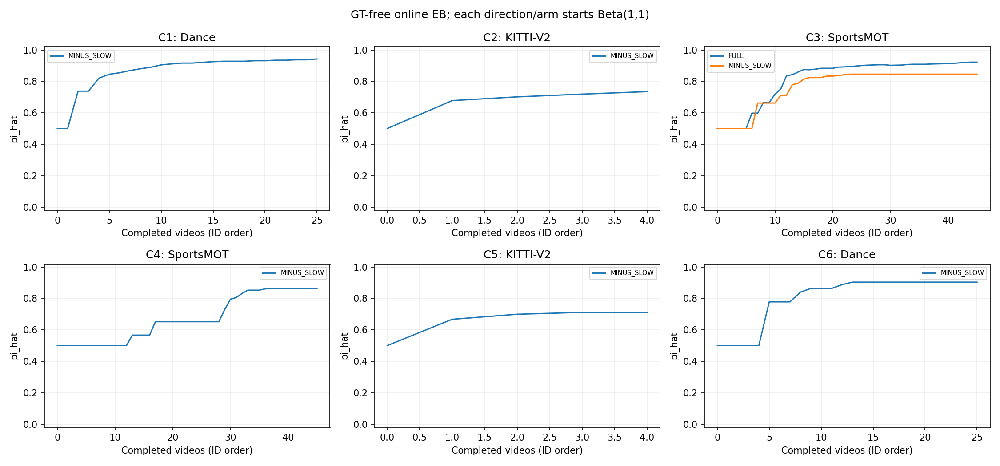

# v7：在线EB存在性与慢速分支公平检验

当前已封存并完成官方评测 11/12 个主项；只对实际完成集合统计，不能把阶段结果当最终验收。

| method | six_directions_complete | directions_above_both_controls | Dance_both_within_two_of_v5 | result |
| --- | --- | --- | --- | --- |
| FULL_v7 | False | 3 | False | NOT_EVALUATED |
| MINUS_SLOW_v7 | True | 5 | False | FAIL |

## 1. 六方向主表（未运行格为NA，不是0）

| pair | source | target | NATIVE | PRES_TOPK | FULL_v5 | FULL_v6 | FULL_v7 | MINUS_SLOW_v7 | SLOW_REPLAY_v7 | YT_PRIOR | UNIFORM_K | YT_PRIOR_rematch_pending |
| --- | --- | --- | --- | --- | --- | --- | --- | --- | --- | --- | --- | --- |
| C1 | V2-best | Dance | 8.218023 | 10.320883 | 37.723955 | 26.367793 | 35.166028 | 38.849551 | 37.649438 | 22.710562 | 24.107948 | False |
| C2 | Dance-best | KITTI-V2 | 13.501503 | 13.781387 | 16.099630 | 26.818212 | NA | 25.313445 | NA | 24.285695 | 24.413313 | False |
| C3 | V2-best | SportsMOT | 50.970478 | 52.927461 | 43.914165 | 59.341507 | 65.133068 | 65.345262 | 62.102780 | 58.600791 | 40.804245 | False |
| C4 | Dance-best | SportsMOT | 20.559603 | 21.010887 | 32.191307 | NA | 61.378753 | 45.656912 | NA | 46.098939 | 40.804245 | False |
| C5 | LaMOT-best | KITTI-V2 | 22.398306 | 23.875533 | 18.315360 | NA | NA | 30.331540 | NA | 27.588195 | 25.674444 | False |
| C6 | LaMOT-best | Dance | 15.475743 | 15.151263 | 36.468777 | NA | NA | 30.204325 | NA | 20.821630 | 24.107948 | False |

## 2. 完整官方指标

| pair | method | HOTA_unrounded | DetA | AssA | IDF1 | IDSW | prediction_rows | query_empty_prediction_rows | Present_HOTA | teacher_calls | GT_open_attempts |
| --- | --- | --- | --- | --- | --- | --- | --- | --- | --- | --- | --- |
| C1 | MINUS_SLOW_v7 | 38.849551 | 44.840000 | 33.728000 | 37.332000 | 1386.000000 | 183380 | 18477 | 40.248855 | 3264 | 0 |
| C1 | FULL_v7 | 35.166028 | 37.435000 | 33.111000 | 32.586000 | 1327.000000 | 189470 | 35767 | 37.559187 | 3195 | 0 |
| C1 | SLOW_REPLAY_v7 | 37.649438 | 43.592000 | 32.597000 | 35.317000 | 1372.000000 | 177705 | 24573 | 39.495566 | 3264 | 0 |
| C2 | MINUS_SLOW_v7 | 25.313445 | 11.013000 | 58.264000 | 19.629000 | 701.000000 | 155932 | 0 | 25.313445 | 20955 | 0 |
| C3 | MINUS_SLOW_v7 | 65.345262 | 60.290000 | 70.837000 | 65.297000 | 2848.000000 | 1517412 | 0 | 65.345262 | 3508 | 0 |
| C3 | FULL_v7 | 65.133068 | 59.881000 | 70.858000 | 64.876000 | 3195.000000 | 1635162 | 0 | 65.133068 | 3508 | 0 |
| C3 | SLOW_REPLAY_v7 | 62.102780 | 54.194000 | 71.175000 | 60.913000 | 4114.000000 | 2299972 | 0 | 62.102780 | 3508 | 0 |
| C4 | MINUS_SLOW_v7 | 45.656912 | 30.011000 | 69.461000 | 40.131000 | 1480.000000 | 815058 | 0 | 45.656912 | 3508 | 0 |
| C4 | FULL_v7 | 61.378753 | 53.603000 | 70.290000 | 60.107000 | 2777.000000 | 1328506 | 0 | 61.378753 | 3508 | 0 |
| C5 | MINUS_SLOW_v7 | 30.331540 | 16.362000 | 56.330000 | 27.606000 | 2746.000000 | 1125042 | 0 | 30.331540 | 20955 | 0 |
| C6 | MINUS_SLOW_v7 | 30.204325 | 27.982000 | 32.653000 | 26.355000 | 840.000000 | 111717 | 13144 | 31.024575 | 2233 | 0 |

## 3. 存在性与在线比例

| pair | method | query_present_episodes | query_empty_episodes | correctly_inferred_empty | present_incorrectly_inferred_empty | empty_rejected_without_presence_answers | present_rejected_without_presence_answers | query_empty_prediction_rows |
| --- | --- | --- | --- | --- | --- | --- | --- | --- |
| C1 | FULL_v7 | 40 | 385 | 302 | 9 | 95 | 1 | 35767 |
| C1 | MINUS_SLOW_v7 | 40 | 385 | 293 | 6 | 96 | 1 | 18477 |
| C1 | SLOW_REPLAY_v7 | 40 | 385 | 302 | 11 | 93 | 0 | 24573 |
| C2 | MINUS_SLOW_v7 | 862 | 0 | 0 | 296 | 0 | 0 | 0 |
| C3 | FULL_v7 | 466 | 0 | 0 | 52 | 0 | 0 | 0 |
| C3 | MINUS_SLOW_v7 | 466 | 0 | 0 | 2 | 0 | 0 | 0 |
| C3 | SLOW_REPLAY_v7 | 466 | 0 | 0 | 0 | 0 | 0 | 0 |
| C4 | FULL_v7 | 466 | 0 | 0 | 67 | 0 | 0 | 0 |
| C4 | MINUS_SLOW_v7 | 466 | 0 | 0 | 4 | 0 | 0 | 0 |
| C5 | MINUS_SLOW_v7 | 862 | 0 | 0 | 12 | 0 | 0 | 0 |
| C6 | MINUS_SLOW_v7 | 40 | 385 | 274 | 13 | 218 | 12 | 13144 |

逐视频先验与软计数见eb_stream.csv/原presence.json；逐句未截断/截断LL和触发次数见presence_likelihood.csv。停止概率与按最后DS重算概率分别记录，不冒充同一个时点。
presence_decisions.csv中的teacher_absent/teacher_confirmed_present是继承的字段名，v7实际表示EB的终止判空/判存在，不是教师直接审阅完整视频的标注；无分层回答而仅由先验触发的拒绝另行列出。

## 4. 高置信错负与真实恢复

| pair | method | matched_candidate_positive_tracks_majority | confident_negative_GT_FN | confident_negative_GT_FN_unqueried | GTpositive_high_negative_rate |
| --- | --- | --- | --- | --- | --- |
| C1 | FULL_v7 | 567 | 135 | 121 | 0.238095 |
| C1 | MINUS_SLOW_v7 | 567 | 86 | 76 | 0.151675 |
| C1 | SLOW_REPLAY_v7 | 567 | 129 | 49 | 0.227513 |
| C2 | MINUS_SLOW_v7 | 8441 | 2508 | 2122 | 0.297121 |
| C3 | FULL_v7 | 5528 | 291 | 221 | 0.052641 |
| C3 | MINUS_SLOW_v7 | 5528 | 27 | 1 | 0.004884 |
| C3 | SLOW_REPLAY_v7 | 5528 | 25 | 0 | 0.004522 |
| C4 | FULL_v7 | 5528 | 331 | 243 | 0.059877 |
| C4 | MINUS_SLOW_v7 | 5528 | 47 | 18 | 0.008502 |
| C5 | MINUS_SLOW_v7 | 8441 | 145 | 50 | 0.017178 |
| C6 | MINUS_SLOW_v7 | 567 | 271 | 271 | 0.477954 |

此表高置信错负仍用v6的p<.05以可比；实际伪监督阈值为.15/.85，且未问始终UNKNOWN。最终posterior不是实际优化输入。

v7组合prior截断到[-2,2]且未问对evidence=0，因此未判空句子的未问对posterior至少为sigmoid(-2)≈.1192；本表未问p<.05来自整句判空置零，不是未问对被赋了训练负标签。

| pair | method | GT_observations | matched_GT | GT_recall | output_rows | recovered_GT | lost_GT | net_GT_vs_Native | new_FP_rows | removed_FP_rows | unchanged_rows_new_FP | unchanged_rows_removed_FP | net_FP_vs_Native | definition |
| --- | --- | --- | --- | --- | --- | --- | --- | --- | --- | --- | --- | --- | --- | --- |
| C1 | MINUS_SLOW | 212541 | 133456 | 0.627907 | 183380 | 124690 | 1571 | 123119 | 46430 | 85885 | 12 | 0 | -39443 | offline max-cardinality framewise IoU>=0.5 assignment, not official HOTA matching |
| C1 | FULL | 212541 | 119390 | 0.561727 | 189470 | 115259 | 6206 | 109053 | 69648 | 88945 | 10 | 0 | -19287 | offline max-cardinality framewise IoU>=0.5 assignment, not official HOTA matching |
| C1 | SLOW_REPLAY | 212541 | 128714 | 0.605596 | 177705 | 123491 | 5114 | 118377 | 48838 | 89225 | 11 | 0 | -40376 | offline max-cardinality framewise IoU>=0.5 assignment, not official HOTA matching |
| C2 | MINUS_SLOW | 491286 | 70575 | 0.143654 | 155932 | 53656 | 8922 | 44734 | 63808 | 52499 | 6 | 6 | 11309 | offline max-cardinality framewise IoU>=0.5 assignment, not official HOTA matching |
| C3 | MINUS_SLOW | 1533675 | 1197247 | 0.780639 | 1517412 | 348657 | 50850 | 297807 | 170541 | 165288 | 221 | 293 | 5181 | offline max-cardinality framewise IoU>=0.5 assignment, not official HOTA matching |
| C3 | FULL | 1533675 | 1239667 | 0.808298 | 1635162 | 438007 | 97780 | 340227 | 303144 | 222971 | 504 | 166 | 80511 | offline max-cardinality framewise IoU>=0.5 assignment, not official HOTA matching |
| C3 | SLOW_REPLAY | 1533675 | 1408416 | 0.918328 | 2299972 | 549072 | 40096 | 508976 | 738717 | 162874 | 802 | 73 | 576572 | offline max-cardinality framewise IoU>=0.5 assignment, not official HOTA matching |
| C4 | MINUS_SLOW | 1533675 | 567570 | 0.370072 | 815058 | 458089 | 37612 | 420477 | 230396 | 48344 | 78 | 124 | 182006 | offline max-cardinality framewise IoU>=0.5 assignment, not official HOTA matching |
| C4 | FULL | 1533675 | 1044451 | 0.681012 | 1328506 | 925113 | 27755 | 897358 | 266873 | 48378 | 97 | 19 | 218573 | offline max-cardinality framewise IoU>=0.5 assignment, not official HOTA matching |
| C5 | MINUS_SLOW | 491286 | 247921 | 0.504637 | 1125042 | 165312 | 9922 | 155390 | 721812 | 85035 | 95 | 42 | 636830 | offline max-cardinality framewise IoU>=0.5 assignment, not official HOTA matching |
| C6 | MINUS_SLOW | 212541 | 76869 | 0.361667 | 111717 | 38637 | 29062 | 9575 | 21341 | 429175 | 78 | 28 | -407784 | offline max-cardinality framewise IoU>=0.5 assignment, not official HOTA matching |

GT召回是独立IoU≥.5最大基数匹配，不替代官方TrackEval；新增/删除预测行的FP与不变行匹配重分配分列。

## 5. 慢速更新、成本与成对差值

| pair | method | rho | logical_questions | new_teacher_calls | cache_hits | replayed_answers | teacher_forward_GPU_hours | teacher_equivalent_GPU_hours | replay_teacher_cost_in_MINUS_dependency | LoRA_GPU_hours | rescore_GPU_hours | assigned_worker_wall_hours | failed_worker_attempts | worker_wall_includes_estimated_attempts | incomplete_failed_rescore_GPU_phases | peak_parent_allocated_bytes | peak_teacher_allocated_bytes | trainable_parameters_observed_in_updates | optimizer_updates | videos_with_LoRA_updates | wall_is_not_GPU_utilization_integral |
| --- | --- | --- | --- | --- | --- | --- | --- | --- | --- | --- | --- | --- | --- | --- | --- | --- | --- | --- | --- | --- | --- |
| C1 | MINUS_SLOW | 0.300000 | 3264 | 595 | 2669 | 0 | 0.012809 | 0.042194 | False | 0.000000 | 0.000000 | 0.040861 | 0 | False | 0 | None | 4472145920 | [] | 0 | 0 | True |
| C1 | FULL | 0.300000 | 3195 | 572 | 2623 | 0 | 0.034324 | 0.064342 | False | 2.415356 | 2.544065 | 5.037107 | 0 | False | 0 | 4578221056 | 4522808832 | [24576] | 3900 | 23 | True |
| C1 | SLOW_REPLAY | 0.300000 | 3264 | 0 | 0 | 3264 | 0.000000 | 0.042194 | True | 1.659143 | 2.147413 | 3.830350 | 0 | False | 0 | 4575358464 | None | [24576] | 3050 | 18 | True |
| C2 | MINUS_SLOW | 0.300000 | 20955 | 9477 | 11478 | 0 | 0.318490 | 0.646320 | False | 0.000000 | 0.000000 | 0.428484 | 0 | False | 0 | None | 5469817344 | [] | 0 | 0 | True |
| C3 | MINUS_SLOW | 0.300000 | 3508 | 1720 | 1788 | 0 | 0.039901 | 0.090459 | False | 0.000000 | 0.000000 | 0.075097 | 0 | False | 0 | None | 5899776000 | [] | 0 | 0 | True |
| C3 | FULL | 0.300000 | 3508 | 1761 | 1747 | 0 | 0.043687 | 0.089526 | False | 3.070007 | 1.315566 | 4.477327 | 0 | False | 0 | 4582467584 | 5904013312 | [24576] | 7000 | 40 | True |
| C3 | SLOW_REPLAY | 0.300000 | 3508 | 0 | 0 | 3508 | 0.000000 | 0.090459 | True | 2.191930 | 1.776948 | 3.988956 | 0 | False | 0 | 4582467584 | None | [24576] | 4550 | 26 | True |
| C4 | MINUS_SLOW | 0.300000 | 3508 | 1234 | 2274 | 0 | 0.027750 | 0.081677 | False | 0.000000 | 0.000000 | 0.061267 | 0 | False | 0 | None | 5896557568 | [] | 0 | 0 | True |
| C4 | FULL | 0.300000 | 3508 | 1258 | 2250 | 0 | 0.027714 | 0.072779 | False | 3.510564 | 1.604821 | 5.185544 | 0 | False | 0 | 4583483392 | 5255084032 | [24576] | 8400 | 44 | True |
| C5 | MINUS_SLOW | 0.300000 | 20955 | 13042 | 7913 | 0 | 0.247136 | 0.465638 | False | 0.000000 | 0.000000 | 0.355100 | 0 | False | 0 | None | 5474210304 | [] | 0 | 0 | True |
| C6 | MINUS_SLOW | 0.300000 | 2233 | 594 | 1639 | 0 | 0.025479 | 0.046053 | False | 0.000000 | 0.000000 | 0.050530 | 0 | False | 0 | None | 4676065280 | [] | 0 | 0 | True |

| pair | method | loss_type | sample_count_unit | videos_with_updates | optimizer_updates | actual_target_or_positive_samples | actual_NONE_or_negative_samples | NONE_reweighted_samples |
| --- | --- | --- | --- | --- | --- | --- | --- | --- |
| C1 | FULL | EXCLUSIVE_LIST_CE | sampled track-frame target/none | 23 | 3900 | 124800 | 0 | 0 |
| C1 | SLOW_REPLAY | EXCLUSIVE_LIST_CE | sampled track-frame target/none | 18 | 3050 | 97600 | 0 | 0 |
| C3 | FULL | BINARY_BCE | sampled query-track-frame | 40 | 7000 | 115407 | 108593 | 0 |
| C3 | SLOW_REPLAY | BINARY_BCE | sampled query-track-frame | 26 | 4550 | 115562 | 30038 | 0 |
| C4 | FULL | BINARY_BCE | sampled query-track-frame | 44 | 8400 | 122509 | 146291 | 0 |

| comparison | delta_HOTA | CI95 | clusters |
| --- | --- | --- | --- |
| C1__FULL_v7_minus_MINUS_SLOW_v7 | -3.683522 | [-9.777914, 1.400499] | 25 |
| C1__SLOW_REPLAY_v7_minus_MINUS_SLOW_v7 | -1.200113 | [-7.271403, 5.171619] | 25 |
| C3__FULL_v7_minus_MINUS_SLOW_v7 | -0.212194 | [-1.672129, 1.316876] | 45 |
| C3__SLOW_REPLAY_v7_minus_MINUS_SLOW_v7 | -3.242482 | [-4.950690, -1.412725] | 45 |
| C4__FULL_v7_minus_MINUS_SLOW_v7 | 15.721841 | [11.158589, 20.752579] | 45 |

逐轮真实优化输入正负暴露、训练池计数、两种权重、更新步数见slow_rounds.csv与原逐步records；不由轮末标签倒推。SLOW_REPLAY复用MINUS实际问题/帧/看法/原始回答，新增教师调用为0；独立部署总成本仍包含MINUS教师依赖，不能说完全不用教师。
互斥CE的负样本计数指NONE类训练样本，不是所有负类梯度；正例列表中已知负类仍可受CE约束。BCE的负样本则是负(query,track,frame)实例，两个单位不混加。没有NONE样本时，NONE频率降权未实际触发，不能宣称该机制已获实验验证。

FULL−MINUS包括选题反馈；REPLAY−MINUS固定教师内容但包含LoRA及模型引起的f/快校准/EB下游效应，并非将派生状态也固定。零adapter输入已用相同冻结bank锚定，后续FP32打分路径及32帧近似的限制仍需披露。

## 6. 不确定性与边界

完整视频bootstrap2000次seed0见bootstrap.json；KITTI四视频仅点估计，条件于当前固定流，未覆盖重新适应后的顺序/seed不确定性。

视频转导式/冻结教师辅助，Val历史开发复用，非严格帧因果或盲测。所有GT仅封存后独立CPU读取。DS事后值仅实际提问集合，不代表全候选教师准确率。worker/phase elapsed非GPU利用率积分；历史候选、冻结推理、源头成本不是零。

成本关卡见budget_preflight.json；本批结束后停止，不自动开预算曲线/消融、未选v7 FULL、v6扩展或旧80项。

## 磁盘满恢复（最后一项尚未正式封存）

C4回放在完成36视频、保存7200步后因/data1可用空间0中断；第37视频的部分打分保留，实际子进程退出码未能持久化，不猜测。原件保留，逐文件SHA核验后的工作副本与日志接到data2；见storage_recovery.json和storage_copy_manifest.json。恢复只补剩9视频，11份原官评按seal校验后复用，不重跑。修复公开74ae8eb7后，恢复队列已实际启动（observer39453），C4在GPU0/PID3832396接续第37视频；完整收据见recovery_started.json。

45项相关检查通过。真实只读报告预检未调用旧摘要/归因计算函数，原11项main.csv逐字不变；新诊断写公共报告缓存，不向满盘旧目录写回。现表成本仍只含已封存11项；C4失败壁钟估算和未测完的打分GPU相位将在最终报告明确列出，不记成0。

固定证据慢速效应目前：C1−MINUS为−1.200113，CI跨0；C3为−3.242482，CI[−4.950690,−1.412725]，召回虽升但FP净增571391。C4 FULL相对MINUS+15.721841的真实收益不改写六方向验收，最终仍等待C4固定回放。

## SportsMOT 418条敏感性（v4内容不变，仅限制序列ID）

| pair | method | full466_HOTA | HOTA_unrounded | DetA | AssA | IDF1 | IDSW | episodes | prediction_rows |
| --- | --- | --- | --- | --- | --- | --- | --- | --- | --- |
| C3 | MINUS_SLOW_v7 | 65.345262 | 66.270536 | 62.067000 | 70.773000 | 66.436000 | 2834.000000 | 418 | 1457601 |
| C3 | FULL_v7 | 65.133068 | 66.164138 | 61.837000 | 70.807000 | 66.142000 | 3175.000000 | 418 | 1567967 |
| C3 | SLOW_REPLAY_v7 | 62.102780 | 63.387637 | 56.518000 | 71.103000 | 62.532000 | 4086.000000 | 418 | 2187514 |
| C4 | MINUS_SLOW_v7 | 45.656912 | 45.919286 | 30.352000 | 69.472000 | 40.478000 | 1480.000000 | 418 | 809852 |
| C4 | FULL_v7 | 61.378753 | 61.840624 | 54.414000 | 70.289000 | 60.690000 | 2772.000000 | 418 | 1313103 |
