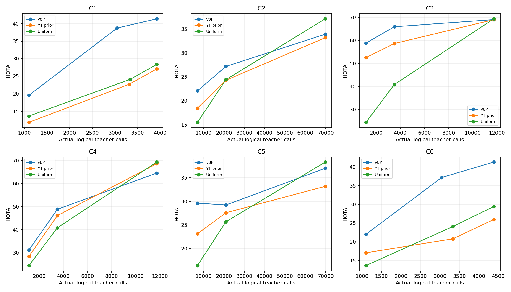

### B2适用边界（事后描述，不新增验收或方法选择）

| rho | pointwise_wins | directions |
| --- | --- | --- |
| 0.1 | 6 | 6 |
| 0.3 | 6 | 6 |
| 1.0 | 2 | 6 |

胜出指主方法HOTA严格高于两项对照中较好者；不是六个独立数据集的统计显著性。主预算仍是事前固定的ρ=.3，不从本曲线重新选预算。

高预算C3：主方法69.00265131164979，UNIFORM为69.34468334097244，主方法减UNIFORM的95%区间为[-1.5019438897990631, 0.8041410640502751]，跨0。

高预算C4：主方法64.58142280713945，YT为68.6462614956987、UNIFORM为69.34468334097244；主方法减YT区间[-5.308732737885622, -2.7240420309250357]，减UNIFORM区间[-5.7785246196545055, -3.785297297579069]，两者均不跨0。不能宣称全预算支配性。

高预算C2/C5也低于UNIFORM，但KITTI只有4视频，仅报告点值，不造置信区间。Dance两个方向在三档预算点值均胜出；完整18格对比见budget_comparisons.csv。

| pair | method | logical_calls | unique_asked_pairs | repeated_pair_calls | repeat_pair_fraction |
| --- | --- | --- | --- | --- | --- |
| C3 | MINUS_SLOW | 11738 | 8006 | 3732 | 0.3179417277219288 |
| C3 | UNIFORM_K | 11738 | 11738 | 0 | 0.0 |
| C4 | MINUS_SLOW | 11738 | 7973 | 3765 | 0.32075310955869824 |
| C4 | UNIFORM_K | 11738 | 11738 | 0 | 0.0 |

覆盖统计只读封存问题与MOT元数据，GT打开0、模型/教师调用0。复问是同一物理对换帧/看法，不是缓存键重复；这是复核与覆盖的观察差异，不能单独证明掉分原因。不新增因果实验，不据此改获取规则。

ρ=.1/1.0逐视频调用匹配；.3按明确指令保留历史对照，Dance调用数并非完全相等，实际横轴如图。不同视图及不同系统的前置计算不同，不能由同调用数或缓存后的新增GPU耗时宣称端到端算力相等/更低。历史准备见inherited_costs.json，不将复用记成零，也不把废弃研究全部算成最小部署必需。
