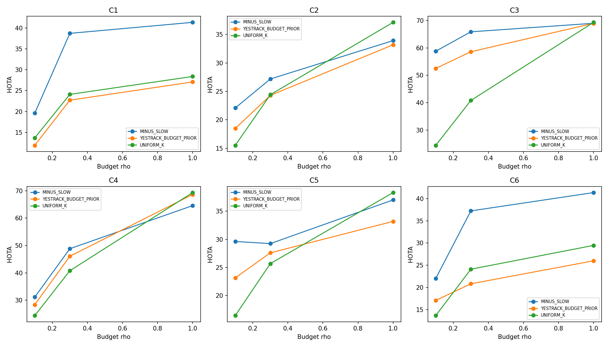

## B2

| pair | method | rho | HOTA | DetA | AssA | IDF1 | delta_vs_MINUS | CI95_vs_MINUS | logical_calls | new_calls | cache_hits | reused |
| --- | --- | --- | --- | --- | --- | --- | --- | --- | --- | --- | --- | --- |
| C1 | MINUS_SLOW | 0.1 | 19.601600379491472 | 13.652 | 28.31 | 14.872 | 0.0 | [0.0, 0.0] | 1103 | 3 | 1100 | False |
| C2 | MINUS_SLOW | 0.1 | 22.083864765882215 | 8.3849 | 58.215 | 15.428 | 0.0 | None | 6984 | 2011 | 4973 | False |
| C3 | MINUS_SLOW | 0.1 | 58.797047995287365 | 48.369 | 71.478 | 57.656 | 0.0 | [0.0, 0.0] | 1160 | 86 | 1074 | False |
| C4 | MINUS_SLOW | 0.1 | 31.16275308373445 | 13.974 | 69.495 | 21.474 | 0.0 | [0.0, 0.0] | 1160 | 89 | 1071 | False |
| C5 | MINUS_SLOW | 0.1 | 29.61784145990643 | 14.753 | 59.548 | 25.811 | 0.0 | None | 6984 | 310 | 6674 | False |
| C6 | MINUS_SLOW | 0.1 | 22.02549646601532 | 18.726 | 25.98 | 17.52 | 0.0 | [0.0, 0.0] | 1103 | 16 | 1087 | False |
| C1 | MINUS_SLOW | 1.0 | 41.38010434736191 | 46.678 | 36.73 | 39.348 | 0.0 | [0.0, 0.0] | 3924 | 380 | 3544 | False |
| C2 | MINUS_SLOW | 1.0 | 33.91847197991578 | 20.453 | 56.348 | 33.651 | 0.0 | None | 69854 | 21138 | 48716 | False |
| C3 | MINUS_SLOW | 1.0 | 69.00265131164979 | 66.887 | 71.204 | 69.654 | 0.0 | [0.0, 0.0] | 11738 | 3447 | 8291 | False |
| C4 | MINUS_SLOW | 1.0 | 64.58142280713945 | 58.981 | 70.728 | 64.431 | 0.0 | [0.0, 0.0] | 11738 | 2448 | 9290 | False |
| C5 | MINUS_SLOW | 1.0 | 37.012748529334935 | 23.551 | 58.267 | 37.67 | 0.0 | None | 69854 | 21348 | 48506 | False |
| C6 | MINUS_SLOW | 1.0 | 41.34480415068018 | 49.866 | 34.364 | 40.028 | 0.0 | [0.0, 0.0] | 4384 | 164 | 4220 | False |
| C1 | YESTRACK_BUDGET_PRIOR | 0.1 | 11.887785529426429 | 5.281 | 26.778 | 7.9709 | -7.713814850065043 | [-14.318242633778125, -1.0961357019319953] | 1103 | 0 | 1103 | False |
| C2 | YESTRACK_BUDGET_PRIOR | 0.1 | 18.478726689479593 | 6.7473 | 50.788 | 12.728 | -3.6051380764026213 | None | 6984 | 0 | 6984 | False |
| C3 | YESTRACK_BUDGET_PRIOR | 0.1 | 52.51092015451327 | 47.203 | 58.427 | 55.643 | -6.286127840774093 | [-9.616362176165204, -1.9909282671821267] | 1160 | 0 | 1160 | False |
| C4 | YESTRACK_BUDGET_PRIOR | 0.1 | 28.409874036640666 | 14.001 | 57.652 | 22.498 | -2.752879047093785 | [-6.041496092723581, 0.45230167106790603] | 1160 | 0 | 1160 | False |
| C5 | YESTRACK_BUDGET_PRIOR | 0.1 | 23.138212871368687 | 11.671 | 45.995 | 20.579 | -6.479628588537743 | None | 6984 | 0 | 6984 | False |
| C6 | YESTRACK_BUDGET_PRIOR | 0.1 | 17.084765806137405 | 10.598 | 27.591 | 12.081 | -4.940730659877914 | [-10.781816744771621, 1.5778436210176028] | 1103 | 0 | 1103 | False |
| C1 | YESTRACK_BUDGET_PRIOR | 1.0 | 27.08773370991011 | 17.504 | 41.946 | 22.633 | -14.292370637451796 | [-19.190178601261977, -9.312710613500201] | 3924 | 395 | 3529 | False |
| C2 | YESTRACK_BUDGET_PRIOR | 1.0 | 33.18914165316332 | 18.922 | 58.322 | 31.375 | -0.7293303267524607 | None | 69854 | 15883 | 53971 | False |
| C3 | YESTRACK_BUDGET_PRIOR | 1.0 | 68.97374133248228 | 66.729 | 71.31 | 70.241 | -0.02890997916750848 | [-1.0528789962802498, 0.9913436749186159] | 11738 | 3533 | 8205 | False |
| C4 | YESTRACK_BUDGET_PRIOR | 1.0 | 68.6462614956987 | 65.927 | 71.493 | 69.942 | 4.064838688559249 | [2.7240420309250357, 5.308732737885622] | 11738 | 100 | 11638 | False |
| C5 | YESTRACK_BUDGET_PRIOR | 1.0 | 33.18914165316332 | 18.922 | 58.322 | 31.375 | -3.823606876171617 | None | 69854 | 0 | 69854 | False |
| C6 | YESTRACK_BUDGET_PRIOR | 1.0 | 25.9969793844731 | 17.867 | 37.88 | 20.499 | -15.347824766207083 | [-20.82139970059194, -9.502909282953386] | 4384 | 370 | 4014 | False |
| C1 | UNIFORM_K | 0.1 | 13.675802135131299 | 5.5818 | 33.519 | 8.7779 | -5.925798244360173 | [-11.696572148491255, -0.16275296103933148] | 1103 | 0 | 1103 | False |
| C2 | UNIFORM_K | 0.1 | 15.516389480432707 | 4.2019 | 57.382 | 8.4503 | -6.5674752854495075 | None | 6984 | 0 | 6984 | False |
| C3 | UNIFORM_K | 0.1 | 24.41929456751229 | 8.6438 | 69.031 | 15.885 | -34.377753427775076 | [-38.409067041669175, -29.472946853369027] | 1160 | 0 | 1160 | False |
| C4 | UNIFORM_K | 0.1 | 24.41929456751229 | 8.6438 | 69.031 | 15.885 | -6.743458516222162 | [-11.97201000847023, -1.1981555402380375] | 1160 | 0 | 1160 | False |
| C5 | UNIFORM_K | 0.1 | 16.416887824605762 | 4.6503 | 58.041 | 9.2875 | -13.200953635300667 | None | 6984 | 0 | 6984 | False |
| C6 | UNIFORM_K | 0.1 | 13.675802135131299 | 5.5818 | 33.519 | 8.7779 | -8.34969433088402 | [-15.546719257654988, -0.45265494167453935] | 1103 | 0 | 1103 | False |
| C1 | UNIFORM_K | 1.0 | 28.396654583924118 | 19.646 | 41.084 | 24.824 | -12.98344976343779 | [-17.941771148668174, -7.924827427015235] | 3924 | 923 | 3001 | False |
| C2 | UNIFORM_K | 1.0 | 37.12843327953046 | 23.25 | 59.39 | 37.713 | 3.209961299614683 | None | 69854 | 42672 | 27182 | False |
| C3 | UNIFORM_K | 1.0 | 69.34468334097244 | 67.57 | 71.183 | 69.938 | 0.3420320293226524 | [-0.8041410640502751, 1.5019438897990631] | 11738 | 8082 | 3656 | False |
| C4 | UNIFORM_K | 1.0 | 69.34468334097244 | 67.57 | 71.183 | 69.938 | 4.763260533832991 | [3.785297297579069, 5.7785246196545055] | 11738 | 0 | 11738 | False |
| C5 | UNIFORM_K | 1.0 | 38.31738468091339 | 24.694 | 59.553 | 39.494 | 1.3046361515784568 | None | 69854 | 2212 | 67642 | False |
| C6 | UNIFORM_K | 1.0 | 29.463444323336276 | 21.662 | 40.119 | 26.356 | -11.881359827343907 | [-17.056068084736026, -6.3767272914086615] | 4384 | 283 | 4101 | False |
| C1 | MINUS_SLOW | 0.3 | 38.738938585641804 | 44.929 | 33.478 | 37.131 | NA | NA | 3047 | 0 | 0 | True |
| C1 | YESTRACK_BUDGET_PRIOR | 0.3 | 22.710562286007747 | 13.338 | 38.724 | 18.453 | NA | NA | 3311 | 0 | 0 | True |
| C1 | UNIFORM_K | 0.3 | 24.10794837948786 | 14.856 | 39.204 | 20.122 | NA | NA | 3334 | 0 | 0 | True |
| C2 | MINUS_SLOW | 0.3 | 27.176405389761815 | 13.503 | 54.771 | 23.524 | NA | NA | 20955 | 0 | 0 | True |
| C2 | YESTRACK_BUDGET_PRIOR | 0.3 | 24.2856949360245 | 10.383 | 56.973 | 18.903 | NA | NA | 20955 | 0 | 0 | True |
| C2 | UNIFORM_K | 0.3 | 24.413312965419834 | 10.359 | 57.635 | 19.26 | NA | NA | 20955 | 0 | 0 | True |
| C3 | MINUS_SLOW | 0.3 | 65.88252919362655 | 61.126 | 71.023 | 66.002 | NA | NA | 3508 | 0 | 0 | True |
| C3 | YESTRACK_BUDGET_PRIOR | 0.3 | 58.60079081166481 | 53.68 | 63.988 | 61.4 | NA | NA | 3508 | 0 | 0 | True |
| C3 | UNIFORM_K | 0.3 | 40.80424475482688 | 23.9 | 69.7 | 37.305 | NA | NA | 3508 | 0 | 0 | True |
| C4 | MINUS_SLOW | 0.3 | 48.847077403355854 | 33.387 | 71.468 | 44.581 | NA | NA | 3508 | 0 | 0 | True |
| C4 | YESTRACK_BUDGET_PRIOR | 0.3 | 46.09893939637592 | 31.057 | 68.435 | 43.712 | NA | NA | 3508 | 0 | 0 | True |
| C4 | UNIFORM_K | 0.3 | 40.80424475482688 | 23.9 | 69.7 | 37.305 | NA | NA | 3508 | 0 | 0 | True |
| C5 | MINUS_SLOW | 0.3 | 29.23131541800287 | 15.242 | 56.16 | 25.862 | NA | NA | 20955 | 0 | 0 | True |
| C5 | YESTRACK_BUDGET_PRIOR | 0.3 | 27.588195011841616 | 14.436 | 52.84 | 24.998 | NA | NA | 20955 | 0 | 0 | True |
| C5 | UNIFORM_K | 0.3 | 25.674444073607777 | 11.368 | 58.082 | 20.946 | NA | NA | 20955 | 0 | 0 | True |
| C6 | MINUS_SLOW | 0.3 | 37.225905280090466 | 42.272 | 32.855 | 35.972 | NA | NA | 3046 | 0 | 0 | True |
| C6 | YESTRACK_BUDGET_PRIOR | 0.3 | 20.821630175303536 | 14.259 | 30.45 | 16.013 | NA | NA | 3334 | 0 | 0 | True |
| C6 | UNIFORM_K | 0.3 | 24.10794837948786 | 14.856 | 39.204 | 20.122 | NA | NA | 3334 | 0 | 0 | True |

### 成本

| pair | method | rho | teacher_GPU_hours | original_reused_method_teacher_GPU_hours | teacher_equivalent_GPU_hours | LoRA_GPU_hours | rescore_GPU_hours | wall_seconds | GT_open_attempts |
| --- | --- | --- | --- | --- | --- | --- | --- | --- | --- |
| C1 | MINUS_SLOW | 0.1 | 0.00020260010031051935 | NA | 0.017236556886674234 | 0.0 | 0.0 | 77.25986531889066 | 0 |
| C2 | MINUS_SLOW | 0.1 | 0.0331232525035739 | NA | 0.180497849958812 | 0.0 | 0.0 | 387.87339428579435 | 0 |
| C3 | MINUS_SLOW | 0.1 | 0.002300647304703792 | NA | 0.02747356476413027 | 0.0 | 0.0 | 87.64410958299413 | 0 |
| C4 | MINUS_SLOW | 0.1 | 0.0010737067040625132 | NA | 0.02252325725156443 | 0.0 | 0.0 | 80.60466180788353 | 0 |
| C5 | MINUS_SLOW | 0.1 | 0.005386990293756955 | NA | 0.1990569541384112 | 0.0 | 0.0 | 236.8794089248404 | 0 |
| C6 | MINUS_SLOW | 0.1 | 0.0004157768949193673 | NA | 0.018566248238878362 | 0.0 | 0.0 | 82.65166941611096 | 0 |
| C1 | MINUS_SLOW | 1.0 | 0.02758841469198362 | NA | 0.08215428658025421 | 0.0 | 0.0 | 232.71262908680364 | 0 |
| C2 | MINUS_SLOW | 1.0 | 1.2411994608309276 | NA | 2.575825542462894 | 0.0 | 0.0 | 6446.936479132157 | 0 |
| C3 | MINUS_SLOW | 1.0 | 0.11408111363054356 | NA | 0.32813715939648636 | 0.0 | 0.0 | 682.0444406028837 | 0 |
| C4 | MINUS_SLOW | 1.0 | 0.05861577457269757 | NA | 0.2996881964320763 | 0.0 | 0.0 | 473.4505962738767 | 0 |
| C5 | MINUS_SLOW | 1.0 | 0.4157915669909885 | NA | 1.7683105490109285 | 0.0 | 0.0 | 3565.8123527667485 | 0 |
| C6 | MINUS_SLOW | 1.0 | 0.004007854361294044 | NA | 0.09245324021613018 | 0.0 | 0.0 | 158.30302946269512 | 0 |
| C1 | YESTRACK_BUDGET_PRIOR | 0.1 | 0.0 | NA | 0.004780428424970879 | 0.0 | 0.0 | 35.65680778073147 | 0 |
| C2 | YESTRACK_BUDGET_PRIOR | 0.1 | 0.0 | NA | 0.11638106701792172 | 0.0 | 0.0 | 31.812265157699585 | 0 |
| C3 | YESTRACK_BUDGET_PRIOR | 0.1 | 0.0 | NA | 0.01458718119308877 | 0.0 | 0.0 | 36.47275531897321 | 0 |
| C4 | YESTRACK_BUDGET_PRIOR | 0.1 | 0.0 | NA | 0.018204552765425118 | 0.0 | 0.0 | 39.68665408529341 | 0 |
| C5 | YESTRACK_BUDGET_PRIOR | 0.1 | 0.0 | NA | 0.12250648621768237 | 0.0 | 0.0 | 36.85866430820897 | 0 |
| C6 | YESTRACK_BUDGET_PRIOR | 0.1 | 0.0 | NA | 0.01022218567363363 | 0.0 | 0.0 | 34.98655726155266 | 0 |
| C1 | YESTRACK_BUDGET_PRIOR | 1.0 | 0.003933611998153437 | NA | 0.02418788090386171 | 0.0 | 0.0 | 52.99343977123499 | 0 |
| C2 | YESTRACK_BUDGET_PRIOR | 1.0 | 0.5863133661767157 | NA | 1.5355149254029692 | 0.0 | 0.0 | 2253.4769593989477 | 0 |
| C3 | YESTRACK_BUDGET_PRIOR | 1.0 | 0.1470252769947466 | NA | 0.27974625178019924 | 0.0 | 0.0 | 584.138803283684 | 0 |
| C4 | YESTRACK_BUDGET_PRIOR | 1.0 | 0.005899812770334797 | NA | 0.28088819171178947 | 0.0 | 0.0 | 77.42526477295905 | 0 |
| C5 | YESTRACK_BUDGET_PRIOR | 1.0 | 0.0 | NA | 1.53551492540297 | 0.0 | 0.0 | 132.37592704687268 | 0 |
| C6 | YESTRACK_BUDGET_PRIOR | 1.0 | 0.002752143524509544 | NA | 0.03915488418143122 | 0.0 | 0.0 | 47.59215896204114 | 0 |
| C1 | UNIFORM_K | 0.1 | 0.0 | NA | 0.00511154898367143 | 0.0 | 0.0 | 44.91241377219558 | 0 |
| C2 | UNIFORM_K | 0.1 | 0.0 | NA | 0.17239427206808225 | 0.0 | 0.0 | 84.78734612092376 | 0 |
| C3 | UNIFORM_K | 0.1 | 0.0 | NA | 0.00991137470018455 | 0.0 | 0.0 | 53.57922916300595 | 0 |
| C4 | UNIFORM_K | 0.1 | 0.0 | NA | 0.00991137470018455 | 0.0 | 0.0 | 55.6422397880815 | 0 |
| C5 | UNIFORM_K | 0.1 | 0.0 | NA | 0.17239427206808225 | 0.0 | 0.0 | 87.98004273278639 | 0 |
| C6 | UNIFORM_K | 0.1 | 0.0 | NA | 0.00511154898367143 | 0.0 | 0.0 | 46.40104815317318 | 0 |
| C1 | UNIFORM_K | 1.0 | 0.009217276078027983 | NA | 0.023042157161602815 | 0.0 | 0.0 | 80.39345198497176 | 0 |
| C2 | UNIFORM_K | 1.0 | 1.6841453935058477 | NA | 2.342118389916 | 0.0 | 0.0 | 6621.239169277716 | 0 |
| C3 | UNIFORM_K | 1.0 | 0.4530819455845954 | NA | 0.486369997914716 | 0.0 | 0.0 | 1748.83875548793 | 0 |
| C4 | UNIFORM_K | 1.0 | 0.0 | NA | 0.486369997914716 | 0.0 | 0.0 | 110.48045437596738 | 0 |
| C5 | UNIFORM_K | 1.0 | 0.02940800884259968 | NA | 2.342118389916 | 0.0 | 0.0 | 1429.4508144920692 | 0 |
| C6 | UNIFORM_K | 1.0 | 0.002001945467976232 | NA | 0.025948190347270812 | 0.0 | 0.0 | 57.27603679895401 | 0 |
| C1 | MINUS_SLOW | 0.3 | 0 | 0.008412589948469152 | 0.041203664328604526 | NA | NA | NA | NA |
| C1 | YESTRACK_BUDGET_PRIOR | 0.3 | 0 | 0.00901168654317088 | 0.014094984572533149 | NA | NA | NA | NA |
| C1 | UNIFORM_K | 0.3 | 0 | 0.015020918686059304 | 0.01517933538519535 | NA | NA | NA | NA |
| C2 | MINUS_SLOW | 0.3 | 0 | 0.05448593842654696 | 0.5048934282658086 | NA | NA | NA | NA |
| C2 | YESTRACK_BUDGET_PRIOR | 0.3 | 0 | 0.1715148479971362 | 0.3199431909271247 | NA | NA | NA | NA |
| C2 | UNIFORM_K | 0.3 | 0 | 0.494888556482943 | 0.5113373947359107 | NA | NA | NA | NA |
| C3 | MINUS_SLOW | 0.3 | 0 | 0.02528437180638624 | 0.10734614810273982 | NA | NA | NA | NA |
| C3 | YESTRACK_BUDGET_PRIOR | 0.3 | 0 | 0.04073775380746358 | 0.04653544925099074 | NA | NA | NA | NA |
| C3 | UNIFORM_K | 0.3 | 0 | 0.030315608973485522 | 0.030369480243550885 | NA | NA | NA | NA |
| C4 | MINUS_SLOW | 0.3 | 0 | 0.01880893132558817 | 0.09629169495102868 | NA | NA | NA | NA |
| C4 | YESTRACK_BUDGET_PRIOR | 0.3 | 0 | 0.020196886002474154 | 0.054274110454748496 | NA | NA | NA | NA |
| C4 | UNIFORM_K | 0.3 | 0 | 0.0 | 0.030369480243550885 | NA | NA | NA | NA |
| C5 | MINUS_SLOW | 0.3 | 0 | 0.22113135993273722 | 0.5680610310078873 | NA | NA | NA | NA |
| C5 | YESTRACK_BUDGET_PRIOR | 0.3 | 0 | 0.16413569093578392 | 0.3572007641932323 | NA | NA | NA | NA |
| C5 | UNIFORM_K | 0.3 | 0 | 0.0 | 0.5113373947359107 | NA | NA | NA | NA |
| C6 | MINUS_SLOW | 0.3 | 0 | 0.006899680897541758 | 0.04711344464741142 | NA | NA | NA | NA |
| C6 | YESTRACK_BUDGET_PRIOR | 0.3 | 0 | 0.02082678336947639 | 0.02960372117037266 | NA | NA | NA | NA |
| C6 | UNIFORM_K | 0.3 | 0 | 0.0 | 0.01517933538519535 | NA | NA | NA | NA |

复用行的teacher_GPU_hours=0只指本阶段没有新增forward，不是该系统无需GPU；原方法实际成本在original_reused_method_teacher_GPU_hours，缓存等价forward成本另列。

预算 .1/1.0 每视频实际调用精确匹配；.3 按预注册直接复用历史对照。

