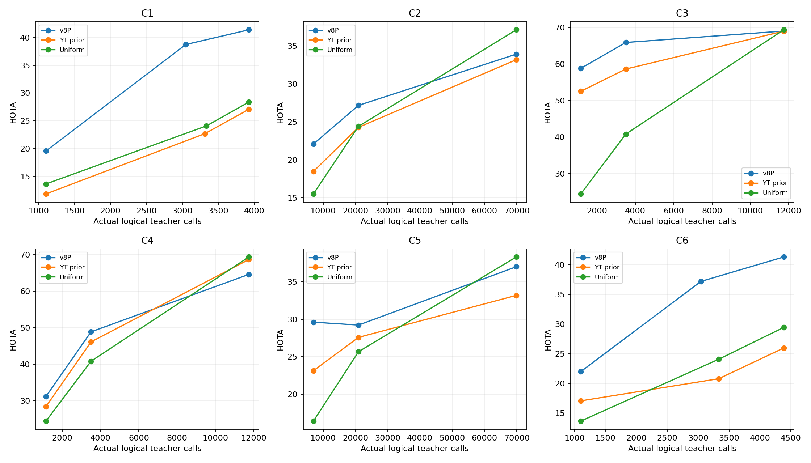
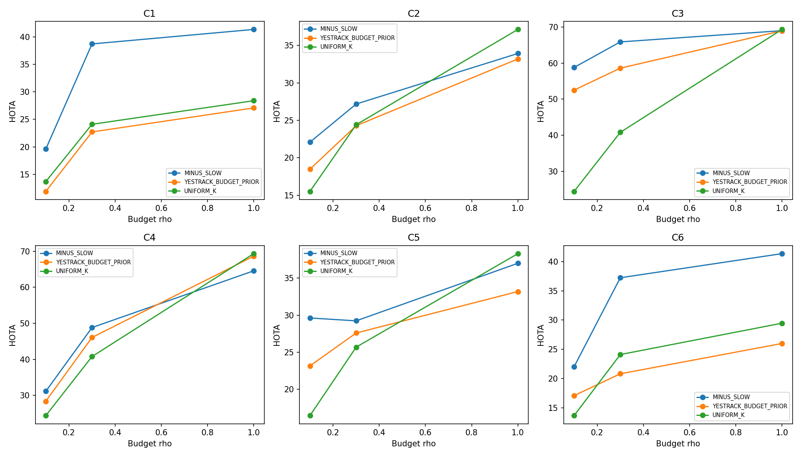
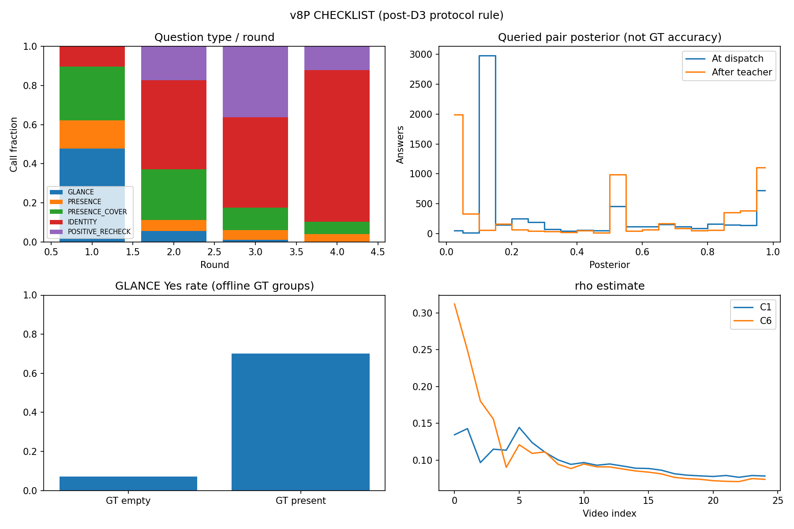
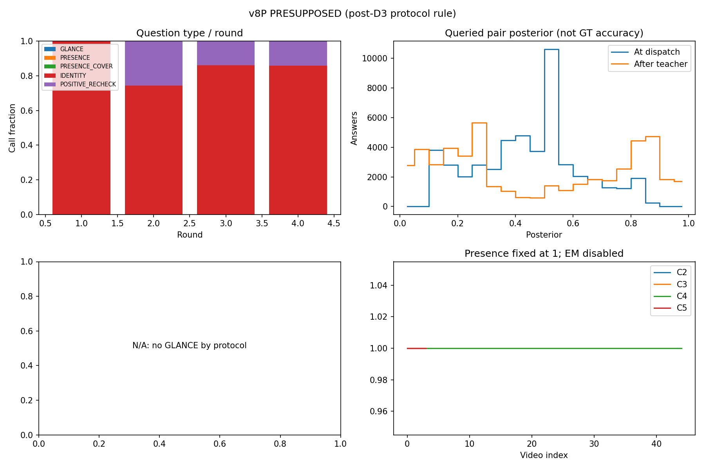

# v8P：查询协议条件存在性推断

阶段 A：**PASS**。超过两项对照：6/6；逐项门槛见 stage_A_gate.json。

<!-- ORDERED_V8P_REPORT -->

主预算ρ=.3通过原门槛；ρ=.1也为6/6点值胜出，但ρ=1.0仅Dance两方向胜出。C4高预算落后两对照的区间均不跨0，消融也有反例，不能宣称全预算/全模块成功。

主表全部使用MINUS（神经主干/PCD冻结），但v8快速CPU校准w、a_q、T、β仍只在有教师证据的对上拟合；不是ZERO_UPDATE。教师固定为Qwen3-VL-2B，候选/原始分数不变。CHECKLIST走原v8，PRESUPPOSED假定整视频句子存在，禁用存在性提问/EM；不是假定每一帧都有目标。

方向：C1=V2→Dance，C2=Dance→KITTI-V2，C3=V2→SportsMOT，C4=Dance→SportsMOT，C5=LaMOT→KITTI-V2，C6=LaMOT→Dance。

每格均完整覆盖对应目标：Dance为25视频/425表达，KITTI-V2为4视频/862表达，SportsMOT为45视频/466表达（v4 GT）。

符号：ρ为教师查询预算比例；ρ̂为存在性估计比例，二者不是同一个量。

## 1. 主表与预注册判定

| pair | protocol | NATIVE | PRES_TOPK | YT_PRIOR | UNIFORM_K | v7 | v8 | v8P | DetA | AssA | IDF1 | delta_v8P_v8 |
| --- | --- | --- | --- | --- | --- | --- | --- | --- | --- | --- | --- | --- |
| C1 | CHECKLIST | 8.218023278370481 | 10.320883397533184 | 22.710562286007747 | 24.10794837948786 | 38.84955091620297 | 38.738938585641804 | 38.738938585641804 | 44.929 | 33.478 | 37.131 | 0.0 |
| C2 | PRESUPPOSED | 13.501502990288703 | 13.781386736365283 | 24.2856949360245 | 24.413312965419834 | 25.313445217438108 | 24.0898042336293 | 27.176405389761815 | 13.503 | 54.771 | 23.524 | 3.086601156132513 |
| C3 | PRESUPPOSED | 50.97047846720586 | 52.927461466047234 | 58.60079081166481 | 40.80424475482688 | 65.34526162194236 | 61.47714552132973 | 65.88252919362655 | 61.126 | 71.023 | 66.002 | 4.405383672296821 |
| C4 | PRESUPPOSED | 20.559603304869942 | 21.010887407715792 | 46.09893939637592 | 40.80424475482688 | 45.65691239177472 | 48.149705641172716 | 48.847077403355854 | 33.387 | 71.468 | 44.581 | 0.6973717621831383 |
| C5 | PRESUPPOSED | 22.39830567256699 | 23.87553292700683 | 27.588195011841616 | 25.674444073607777 | 30.331539988799776 | 27.95353889860121 | 29.23131541800287 | 15.242 | 56.16 | 25.862 | 1.2777765194016588 |
| C6 | CHECKLIST | 15.475742574192424 | 15.15126321329042 | 20.821630175303536 | 24.10794837948786 | 30.204325261900642 | 37.225905280090466 | 37.225905280090466 | 42.272 | 32.855 | 35.972 | 0.0 |

### 成对视频聚类不确定性

上表v7/v8/v8P均指各版MINUS_SLOW主方法，不逐格挑选FULL或REPLAY的较好结果；C1/C6按指令直接引用原v8。

| comparison | delta_HOTA | CI95 | clusters |
| --- | --- | --- | --- |
| C1__v8P_minus_v7 | -0.11061233056116748 | [-2.7791137723576465, 2.2133423184254104] | 25 |
| C1__v8P_minus_v8 | 0.0 | [0.0, 0.0] | 25 |
| C2__v8P_minus_v7 | 1.8629601723237066 | None | 4 |
| C2__v8P_minus_v8 | 3.086601156132513 | None | 4 |
| C3__v8P_minus_v7 | 0.5372675716841968 | [-0.1698995922753907, 1.2797667154213952] | 45 |
| C3__v8P_minus_v8 | 4.405383672296821 | [2.362101408766496, 6.719193199489854] | 45 |
| C4__v8P_minus_v7 | 3.1901650115811364 | [-0.8610312250933407, 7.091182103331881] | 45 |
| C4__v8P_minus_v8 | 0.6973717621831383 | [-5.0063359944082535, 6.653169744047835] | 45 |
| C5__v8P_minus_v7 | -1.1002245707969074 | None | 4 |
| C5__v8P_minus_v8 | 1.2777765194016588 | None | 4 |
| C6__v8P_minus_v7 | 7.021580018189823 | [-1.5476125067394546, 16.459452124139037] | 25 |
| C6__v8P_minus_v8 | 0.0 | [0.0, 0.0] | 25 |

KITTI只有4个视频，CI=None表示按预注册只报告点估计，不表示差值为零。

## 2. 存在性

| pair | protocol | false_absent | correct_empty | present_queries_zero_prediction_rows | empty_queries_zero_prediction_rows | present_episodes | empty_episodes | query_empty_prediction_rows |
| --- | --- | --- | --- | --- | --- | --- | --- | --- |
| C1 | CHECKLIST | 11 | 347 | 15 | 380 | 40 | 385 | 12276 |
| C2 | PRESUPPOSED | 0 | 0 | 428 | 0 | 862 | 0 | 0 |
| C3 | PRESUPPOSED | 0 | 0 | 77 | 0 | 466 | 0 | 0 |
| C4 | PRESUPPOSED | 0 | 0 | 122 | 0 | 466 | 0 | 0 |
| C5 | PRESUPPOSED | 0 | 0 | 150 | 0 | 862 | 0 | 0 |
| C6 | CHECKLIST | 11 | 330 | 13 | 376 | 40 | 385 | 17329 |

PRESUPPOSED 的判空为 0 是协议的设计结果，不是学习出了完美存在性。C1/C6 用原 v8 seal SHA 直接引用，新增调用为 0。

false_absent/correct_empty 沿用 EVIDENCE+PRIOR_BUDGET_EXHAUSTED 的拒绝原因口径；zero_prediction_rows 另计最终零行输出，包含未拒绝整句但轨迹后验没有选中任何目标的情形。二者不能混用。

## 3. 消融、预算曲线与适用边界

### B1 归因解读（不改变主配方）

- 随机获取在5/6方向的点值低于主方法，但C5反而高3.4559；有视频聚类区间的方向中，C3的随机获取差值区间不跨0，C1/C4/C6均跨0。不能把点值五胜写成所有域的稳定主动获取收益。
- 去DS在5/6方向点值下降；C4下降11.7765，区间[−16.7351, −6.6562]。C5去DS却提高4.5701（只有4视频，只报点估计），说明当前DS并非普适地优于固定可靠性。
- 去路由在Sports的C3/C4分别下降8.1813/9.5841，区间均不跨0；Dance两方向不变，KITTI两个方向去路由点值更高。不能宣称同一路由在所有域都有贡献。
- 去GLANCE在C1/C6均有更高点值（+1.9177/+3.0676），但两个95%区间都包含0。GLANCE的必要性未得到支持；本轮不会据此删模块、改参数或另选主方法。
- Checklist上的去EB、去PRES均降低两个Dance方向的点值；C1的相应区间不跨0，C6区间较宽且跨0。Presupposed上的−PRESUPPOSITION直接引用旧v8，而非新增训练。
- 固定ρ不保证所有消融的实际调用相同：例如C1去DS为2580次，主方法3047次。模块会改变停止与后续选题；表中保留实际调用、缓存与GPU相位成本，不能把所有端到端差值解释成纯可靠性估计的单因素收益。C2–C5的三个新消融实际调用均等于相应主方法。

B1完整报告原样保留全部反例；B2继续使用已登记的主配方，不从消融中逐方向挑最好结果。

### B1

关键反例、实际调用差异与归因边界见 [B1_FINDINGS.md](B1_FINDINGS.md)；主方法不据消融结果改动。

| pair | method | rho | HOTA | DetA | AssA | IDF1 | delta_vs_MINUS | CI95_vs_MINUS | logical_calls | new_calls | cache_hits | reused |
| --- | --- | --- | --- | --- | --- | --- | --- | --- | --- | --- | --- | --- |
| C1 | RANDOM_ACQ | 0.3 | 38.26787520110981 | 43.522 | 33.73 | 36.581 | -0.4710633845319947 | [-1.5517961681409953, 0.41585788674803886] | 3008 | 60 | 2948 | False |
| C2 | RANDOM_ACQ | 0.3 | 24.809579575215203 | 10.952 | 56.279 | 19.813 | -2.366825814546612 | None | 20955 | 11078 | 9877 | False |
| C3 | RANDOM_ACQ | 0.3 | 64.22402578049103 | 58.08 | 71.031 | 64.125 | -1.65850341313552 | [-2.713694895163426, -0.5830253792115044] | 3508 | 1242 | 2266 | False |
| C4 | RANDOM_ACQ | 0.3 | 47.204699238326064 | 31.391 | 70.986 | 42.444 | -1.6423781650297897 | [-7.685482518408627, 4.422443380689327] | 3508 | 1143 | 2365 | False |
| C5 | RANDOM_ACQ | 0.3 | 32.6872636741882 | 18.447 | 58.048 | 30.761 | 3.4559482561853336 | None | 20955 | 9437 | 11518 | False |
| C6 | RANDOM_ACQ | 0.3 | 37.19870192130362 | 42.871 | 32.345 | 35.66 | -0.027203358786842102 | [-0.7531003076284379, 0.6912787894627997] | 3048 | 64 | 2984 | False |
| C1 | MINUS_DS | 0.3 | 35.045259273414096 | 36.226 | 33.939 | 31.291 | -3.693679312227708 | [-7.9468927342862195, -0.6619122972977631] | 2580 | 42 | 2538 | False |
| C2 | MINUS_DS | 0.3 | 24.477479851025944 | 10.668 | 56.23 | 19.28 | -2.698925538735871 | None | 20955 | 2553 | 18402 | False |
| C3 | MINUS_DS | 0.3 | 65.134844575173 | 59.72 | 71.053 | 65.391 | -0.7476846184535475 | [-1.7890079617503143, 0.416373721920996] | 3508 | 567 | 2941 | False |
| C4 | MINUS_DS | 0.3 | 37.07055640402284 | 19.573 | 70.213 | 30.849 | -11.776520999333016 | [-16.73510879576293, -6.656173184902182] | 3508 | 219 | 3289 | False |
| C5 | MINUS_DS | 0.3 | 33.801372818674196 | 19.558 | 58.529 | 32.333 | 4.5700574006713275 | None | 20955 | 2030 | 18925 | False |
| C6 | MINUS_DS | 0.3 | 33.11872436822118 | 35.957 | 30.57 | 29.963 | -4.1071809118692855 | [-11.457765330102308, 2.182053105117466] | 2859 | 26 | 2833 | False |
| C1 | MINUS_ROUTE | 0.3 | 38.738938585641804 | 44.929 | 33.478 | 37.131 | 0.0 | [0.0, 0.0] | 3047 | 0 | 3047 | False |
| C2 | MINUS_ROUTE | 0.3 | 27.570592432342217 | 14.008 | 54.339 | 24.352 | 0.39418704258040194 | None | 20955 | 4253 | 16702 | False |
| C3 | MINUS_ROUTE | 0.3 | 57.70121644236157 | 45.531 | 73.127 | 57.033 | -8.181312751264983 | [-12.919172334995796, -4.057026508274226] | 3508 | 400 | 3108 | False |
| C4 | MINUS_ROUTE | 0.3 | 39.2630001553725 | 21.136 | 72.939 | 32.94 | -9.584077247983352 | [-14.02996170436457, -4.830308797702235] | 3508 | 156 | 3352 | False |
| C5 | MINUS_ROUTE | 0.3 | 30.548132784576538 | 16.54 | 56.525 | 27.912 | 1.3168173665736695 | None | 20955 | 3703 | 17252 | False |
| C6 | MINUS_ROUTE | 0.3 | 37.225905280090466 | 42.272 | 32.855 | 35.972 | 0.0 | [0.0, 0.0] | 3046 | 0 | 3046 | False |
| C1 | MINUS_GLANCE | 0.3 | 40.656663654769595 | 46.796 | 35.403 | 39.668 | 1.9177250691277905 | [-0.20540976486509377, 5.190920267032604] | 3036 | 21 | 3015 | False |
| C6 | MINUS_GLANCE | 0.3 | 40.293466291985766 | 46.26 | 35.187 | 39.363 | 3.0675610118953003 | [-0.0579647898107623, 7.5139980622852605] | 3073 | 53 | 3020 | False |
| C1 | MINUS_EB | 0.3 | 33.470806296796894 | 34.946 | 32.121 | 30.427 | -5.26813228884491 | [-10.572184377174235, -0.5883922789087351] | 3205 | 41 | 3164 | False |
| C6 | MINUS_EB | 0.3 | 35.55852024514737 | 37.753 | 33.576 | 33.138 | -1.667385034943095 | [-8.26672388223027, 4.578220228987407] | 3233 | 166 | 3067 | False |
| C1 | MINUS_PRES | 0.3 | 35.92574841903291 | 39.406 | 32.825 | 33.942 | -2.813190166608898 | [-5.395406593721157, -0.7347161028198306] | 3334 | 70 | 3264 | False |
| C6 | MINUS_PRES | 0.3 | 27.33102450539868 | 19.17 | 39.02 | 23.798 | -9.894880774691785 | [-19.809088967127625, 0.25510386287978987] | 3334 | 420 | 2914 | False |
| C2 | MINUS_PRESUPPOSITION | 0.3 | 24.0898042336293 | 10.036 | 57.868 | 18.054 | -3.086601156132513 | None | 20628 | 0 | 0 | True |
| C3 | MINUS_PRESUPPOSITION | 0.3 | 61.47714552132973 | 52.8 | 71.587 | 61.259 | -4.405383672296821 | [-6.719193199489855, -2.362101408766497] | 3508 | 0 | 0 | True |
| C4 | MINUS_PRESUPPOSITION | 0.3 | 48.149705641172716 | 32.815 | 70.651 | 43.62 | -0.6973717621831383 | [-6.653169744047846, 5.006335994408252] | 3508 | 0 | 0 | True |
| C5 | MINUS_PRESUPPOSITION | 0.3 | 27.95353889860121 | 13.566 | 57.674 | 23.587 | -1.2777765194016588 | None | 20955 | 0 | 0 | True |

### B2适用边界（事后描述，不新增验收或方法选择）

| rho | pointwise_wins | directions |
| --- | --- | --- |
| 0.1 | 6 | 6 |
| 0.3 | 6 | 6 |
| 1.0 | 2 | 6 |

胜出指主方法HOTA严格高于两项对照中较好者；不是六个独立数据集的统计显著性。主预算仍是事前固定的ρ=.3，不从本曲线重新选预算。

高预算C3：主方法69.00265131164979，UNIFORM为69.34468334097244，主方法减UNIFORM的95%区间为[-1.5019438897990631, 0.8041410640502751]，跨0。

高预算C4：主方法64.58142280713945，YT为68.6462614956987、UNIFORM为69.34468334097244；主方法减YT区间[-5.308732737885622, -2.7240420309250357]，减UNIFORM区间[-5.7785246196545055, -3.785297297579069]，两者均不跨0。不能宣称全预算支配性。

高预算C2/C5也低于UNIFORM，但KITTI只有4视频，仅报告点值，不造置信区间。Dance两个方向在三档预算点值均胜出；完整18格对比见budget_comparisons.csv。

| pair | method | logical_calls | unique_asked_pairs | repeated_pair_calls | repeat_pair_fraction |
| --- | --- | --- | --- | --- | --- |
| C3 | MINUS_SLOW | 11738 | 8006 | 3732 | 0.3179417277219288 |
| C3 | UNIFORM_K | 11738 | 11738 | 0 | 0.0 |
| C4 | MINUS_SLOW | 11738 | 7973 | 3765 | 0.32075310955869824 |
| C4 | UNIFORM_K | 11738 | 11738 | 0 | 0.0 |

覆盖统计只读封存问题与MOT元数据，GT打开0、模型/教师调用0。复问是同一物理对换帧/看法，不是缓存键重复；这是复核与覆盖的观察差异，不能单独证明掉分原因。不新增因果实验，不据此改获取规则。

ρ=.1/1.0逐视频调用匹配；.3按明确指令保留历史对照，Dance调用数并非完全相等，实际横轴如图。不同视图及不同系统的前置计算不同，不能由同调用数或缓存后的新增GPU耗时宣称端到端算力相等/更低。历史准备见inherited_costs.json，不将复用记成零，也不把废弃研究全部算成最小部署必需。

### B2

| pair | method | rho | HOTA | DetA | AssA | IDF1 | delta_vs_MINUS | CI95_vs_MINUS | logical_calls | new_calls | cache_hits | reused |
| --- | --- | --- | --- | --- | --- | --- | --- | --- | --- | --- | --- | --- |
| C1 | MINUS_SLOW | 0.1 | 19.601600379491472 | 13.652 | 28.31 | 14.872 | 0.0 | [0.0, 0.0] | 1103 | 3 | 1100 | False |
| C2 | MINUS_SLOW | 0.1 | 22.083864765882215 | 8.3849 | 58.215 | 15.428 | 0.0 | None | 6984 | 2011 | 4973 | False |
| C3 | MINUS_SLOW | 0.1 | 58.797047995287365 | 48.369 | 71.478 | 57.656 | 0.0 | [0.0, 0.0] | 1160 | 86 | 1074 | False |
| C4 | MINUS_SLOW | 0.1 | 31.16275308373445 | 13.974 | 69.495 | 21.474 | 0.0 | [0.0, 0.0] | 1160 | 89 | 1071 | False |
| C5 | MINUS_SLOW | 0.1 | 29.61784145990643 | 14.753 | 59.548 | 25.811 | 0.0 | None | 6984 | 310 | 6674 | False |
| C6 | MINUS_SLOW | 0.1 | 22.02549646601532 | 18.726 | 25.98 | 17.52 | 0.0 | [0.0, 0.0] | 1103 | 16 | 1087 | False |
| C1 | MINUS_SLOW | 1.0 | 41.38010434736191 | 46.678 | 36.73 | 39.348 | 0.0 | [0.0, 0.0] | 3924 | 380 | 3544 | False |
| C2 | MINUS_SLOW | 1.0 | 33.91847197991578 | 20.453 | 56.348 | 33.651 | 0.0 | None | 69854 | 21138 | 48716 | False |
| C3 | MINUS_SLOW | 1.0 | 69.00265131164979 | 66.887 | 71.204 | 69.654 | 0.0 | [0.0, 0.0] | 11738 | 3447 | 8291 | False |
| C4 | MINUS_SLOW | 1.0 | 64.58142280713945 | 58.981 | 70.728 | 64.431 | 0.0 | [0.0, 0.0] | 11738 | 2448 | 9290 | False |
| C5 | MINUS_SLOW | 1.0 | 37.012748529334935 | 23.551 | 58.267 | 37.67 | 0.0 | None | 69854 | 21348 | 48506 | False |
| C6 | MINUS_SLOW | 1.0 | 41.34480415068018 | 49.866 | 34.364 | 40.028 | 0.0 | [0.0, 0.0] | 4384 | 164 | 4220 | False |
| C1 | YESTRACK_BUDGET_PRIOR | 0.1 | 11.887785529426429 | 5.281 | 26.778 | 7.9709 | -7.713814850065043 | [-14.318242633778125, -1.0961357019319953] | 1103 | 0 | 1103 | False |
| C2 | YESTRACK_BUDGET_PRIOR | 0.1 | 18.478726689479593 | 6.7473 | 50.788 | 12.728 | -3.6051380764026213 | None | 6984 | 0 | 6984 | False |
| C3 | YESTRACK_BUDGET_PRIOR | 0.1 | 52.51092015451327 | 47.203 | 58.427 | 55.643 | -6.286127840774093 | [-9.616362176165204, -1.9909282671821267] | 1160 | 0 | 1160 | False |
| C4 | YESTRACK_BUDGET_PRIOR | 0.1 | 28.409874036640666 | 14.001 | 57.652 | 22.498 | -2.752879047093785 | [-6.041496092723581, 0.45230167106790603] | 1160 | 0 | 1160 | False |
| C5 | YESTRACK_BUDGET_PRIOR | 0.1 | 23.138212871368687 | 11.671 | 45.995 | 20.579 | -6.479628588537743 | None | 6984 | 0 | 6984 | False |
| C6 | YESTRACK_BUDGET_PRIOR | 0.1 | 17.084765806137405 | 10.598 | 27.591 | 12.081 | -4.940730659877914 | [-10.781816744771621, 1.5778436210176028] | 1103 | 0 | 1103 | False |
| C1 | YESTRACK_BUDGET_PRIOR | 1.0 | 27.08773370991011 | 17.504 | 41.946 | 22.633 | -14.292370637451796 | [-19.190178601261977, -9.312710613500201] | 3924 | 395 | 3529 | False |
| C2 | YESTRACK_BUDGET_PRIOR | 1.0 | 33.18914165316332 | 18.922 | 58.322 | 31.375 | -0.7293303267524607 | None | 69854 | 15883 | 53971 | False |
| C3 | YESTRACK_BUDGET_PRIOR | 1.0 | 68.97374133248228 | 66.729 | 71.31 | 70.241 | -0.02890997916750848 | [-1.0528789962802498, 0.9913436749186159] | 11738 | 3533 | 8205 | False |
| C4 | YESTRACK_BUDGET_PRIOR | 1.0 | 68.6462614956987 | 65.927 | 71.493 | 69.942 | 4.064838688559249 | [2.7240420309250357, 5.308732737885622] | 11738 | 100 | 11638 | False |
| C5 | YESTRACK_BUDGET_PRIOR | 1.0 | 33.18914165316332 | 18.922 | 58.322 | 31.375 | -3.823606876171617 | None | 69854 | 0 | 69854 | False |
| C6 | YESTRACK_BUDGET_PRIOR | 1.0 | 25.9969793844731 | 17.867 | 37.88 | 20.499 | -15.347824766207083 | [-20.82139970059194, -9.502909282953386] | 4384 | 370 | 4014 | False |
| C1 | UNIFORM_K | 0.1 | 13.675802135131299 | 5.5818 | 33.519 | 8.7779 | -5.925798244360173 | [-11.696572148491255, -0.16275296103933148] | 1103 | 0 | 1103 | False |
| C2 | UNIFORM_K | 0.1 | 15.516389480432707 | 4.2019 | 57.382 | 8.4503 | -6.5674752854495075 | None | 6984 | 0 | 6984 | False |
| C3 | UNIFORM_K | 0.1 | 24.41929456751229 | 8.6438 | 69.031 | 15.885 | -34.377753427775076 | [-38.409067041669175, -29.472946853369027] | 1160 | 0 | 1160 | False |
| C4 | UNIFORM_K | 0.1 | 24.41929456751229 | 8.6438 | 69.031 | 15.885 | -6.743458516222162 | [-11.97201000847023, -1.1981555402380375] | 1160 | 0 | 1160 | False |
| C5 | UNIFORM_K | 0.1 | 16.416887824605762 | 4.6503 | 58.041 | 9.2875 | -13.200953635300667 | None | 6984 | 0 | 6984 | False |
| C6 | UNIFORM_K | 0.1 | 13.675802135131299 | 5.5818 | 33.519 | 8.7779 | -8.34969433088402 | [-15.546719257654988, -0.45265494167453935] | 1103 | 0 | 1103 | False |
| C1 | UNIFORM_K | 1.0 | 28.396654583924118 | 19.646 | 41.084 | 24.824 | -12.98344976343779 | [-17.941771148668174, -7.924827427015235] | 3924 | 923 | 3001 | False |
| C2 | UNIFORM_K | 1.0 | 37.12843327953046 | 23.25 | 59.39 | 37.713 | 3.209961299614683 | None | 69854 | 42672 | 27182 | False |
| C3 | UNIFORM_K | 1.0 | 69.34468334097244 | 67.57 | 71.183 | 69.938 | 0.3420320293226524 | [-0.8041410640502751, 1.5019438897990631] | 11738 | 8082 | 3656 | False |
| C4 | UNIFORM_K | 1.0 | 69.34468334097244 | 67.57 | 71.183 | 69.938 | 4.763260533832991 | [3.785297297579069, 5.7785246196545055] | 11738 | 0 | 11738 | False |
| C5 | UNIFORM_K | 1.0 | 38.31738468091339 | 24.694 | 59.553 | 39.494 | 1.3046361515784568 | None | 69854 | 2212 | 67642 | False |
| C6 | UNIFORM_K | 1.0 | 29.463444323336276 | 21.662 | 40.119 | 26.356 | -11.881359827343907 | [-17.056068084736026, -6.3767272914086615] | 4384 | 283 | 4101 | False |
| C1 | MINUS_SLOW | 0.3 | 38.738938585641804 | 44.929 | 33.478 | 37.131 | NA | NA | 3047 | 0 | 0 | True |
| C1 | YESTRACK_BUDGET_PRIOR | 0.3 | 22.710562286007747 | 13.338 | 38.724 | 18.453 | NA | NA | 3311 | 0 | 0 | True |
| C1 | UNIFORM_K | 0.3 | 24.10794837948786 | 14.856 | 39.204 | 20.122 | NA | NA | 3334 | 0 | 0 | True |
| C2 | MINUS_SLOW | 0.3 | 27.176405389761815 | 13.503 | 54.771 | 23.524 | NA | NA | 20955 | 0 | 0 | True |
| C2 | YESTRACK_BUDGET_PRIOR | 0.3 | 24.2856949360245 | 10.383 | 56.973 | 18.903 | NA | NA | 20955 | 0 | 0 | True |
| C2 | UNIFORM_K | 0.3 | 24.413312965419834 | 10.359 | 57.635 | 19.26 | NA | NA | 20955 | 0 | 0 | True |
| C3 | MINUS_SLOW | 0.3 | 65.88252919362655 | 61.126 | 71.023 | 66.002 | NA | NA | 3508 | 0 | 0 | True |
| C3 | YESTRACK_BUDGET_PRIOR | 0.3 | 58.60079081166481 | 53.68 | 63.988 | 61.4 | NA | NA | 3508 | 0 | 0 | True |
| C3 | UNIFORM_K | 0.3 | 40.80424475482688 | 23.9 | 69.7 | 37.305 | NA | NA | 3508 | 0 | 0 | True |
| C4 | MINUS_SLOW | 0.3 | 48.847077403355854 | 33.387 | 71.468 | 44.581 | NA | NA | 3508 | 0 | 0 | True |
| C4 | YESTRACK_BUDGET_PRIOR | 0.3 | 46.09893939637592 | 31.057 | 68.435 | 43.712 | NA | NA | 3508 | 0 | 0 | True |
| C4 | UNIFORM_K | 0.3 | 40.80424475482688 | 23.9 | 69.7 | 37.305 | NA | NA | 3508 | 0 | 0 | True |
| C5 | MINUS_SLOW | 0.3 | 29.23131541800287 | 15.242 | 56.16 | 25.862 | NA | NA | 20955 | 0 | 0 | True |
| C5 | YESTRACK_BUDGET_PRIOR | 0.3 | 27.588195011841616 | 14.436 | 52.84 | 24.998 | NA | NA | 20955 | 0 | 0 | True |
| C5 | UNIFORM_K | 0.3 | 25.674444073607777 | 11.368 | 58.082 | 20.946 | NA | NA | 20955 | 0 | 0 | True |
| C6 | MINUS_SLOW | 0.3 | 37.225905280090466 | 42.272 | 32.855 | 35.972 | NA | NA | 3046 | 0 | 0 | True |
| C6 | YESTRACK_BUDGET_PRIOR | 0.3 | 20.821630175303536 | 14.259 | 30.45 | 16.013 | NA | NA | 3334 | 0 | 0 | True |
| C6 | UNIFORM_K | 0.3 | 24.10794837948786 | 14.856 | 39.204 | 20.122 | NA | NA | 3334 | 0 | 0 | True |

### B3

| pair | method | rho | HOTA | DetA | AssA | IDF1 | delta_vs_MINUS | CI95_vs_MINUS | logical_calls | new_calls | cache_hits | reused |
| --- | --- | --- | --- | --- | --- | --- | --- | --- | --- | --- | --- | --- |
| C4 | FULL | 0.3 | 60.03685316632962 | 51.539 | 69.946 | 58.8 | 11.189775762973767 | [7.666913529862094, 15.131208188416359] | 3508 | 391 | 3117 | False |
| C4 | SLOW_REPLAY | 0.3 | 52.14626459554812 | 39.702 | 68.501 | 48.374 | 3.2991871921922638 | [0.3185326036661069, 6.660413690461902] | 3508 | 0 | 0 | False |

#### B3实际更新与归因范围

| method | videos | videos_with_LoRA_updates | optimizer_updates | optimized_positive_samples | optimized_negative_samples | logical_calls |
| --- | --- | --- | --- | --- | --- | --- |
| FULL | 45 | 21 | 2650 | 42400 | 42400 | 3508 |
| SLOW_REPLAY | 45 | 11 | 1150 | 18400 | 18400 | 3508 |

相对MINUS：FULL ΔDetA=+18.152、ΔAssA=-1.522、ΔIDF1=+14.219；SLOW_REPLAY ΔDetA=+6.315、ΔAssA=-2.967、ΔIDF1=+3.793。

两项HOTA改善都伴随AssA下降，不能说身份关联也全面改善；本轮没有新增等数量排序诊断，不能据此证明语义排序恢复。

两臂门槛通过的视频数和实际优化步数不同，FULL与REPLAY不是等步数训练对照；这些差异原样列出，不通过补步或修改门槛抹平。

FULL会随LoRA改变后续选题，不能将FULL−MINUS全部解释为固定教师证据下的效应。SLOW_REPLAY固定MINUS的问题、教师回答、DS与存在性快照，单独报告其差值和区间；未过更新门槛的视频不计为实际训练。正负样本数是累计训练抽取次数（可重复），不是不同轨迹数、额外教师标签或独立样本量。逐项成本与计数见slow_actual_updates.csv，冻结回放审计见validation_V8P_B3.json。两项只覆盖预注册C4，不外推为六方向慢分支均有效，也不替换六方向的冻结主表。

归因边界：这是原v6配方既有行为，不是本轮改动。MINUS在全轨迹观测上计算f；慢分支更新后，FrameCacheV6.refresh_sampled会用固定32帧中出现轨迹的子集比例覆盖f，并继续快校准。因此REPLAY−MINUS识别的是固定证据下启用整个慢分支的净变化（含权重更新、既定32帧近似重算和其后快校准），不是纯权重替换的单因素分解。本轮没有新增“零权重更新但执行同样32帧f替换”的控制，不能把净增益全部分配给权重学习本身。零更新时的数值锚定不消除开始更新之后的这项限制；不据此改变原验收或启动额外实验。代码位置见flex_uda/active/v6_frames.py的decode/refresh_sampled与flex_uda/active/v7_frozen.py的refresh。

## 4. 行为分析

完整错拒、高置信错负、教师支持覆盖在 presence_decisions.csv、final_confidence.csv；DS 与 GT 事后特异度在 reliability_vs_GT.csv，分别保留锚点与轨迹多数标签。

PRESUPPOSED 中未问对的 evidence=0，组合先验截断[-2,2]且不判整句空，因此未问对 posterior≥sigmoid(-2)≈.119；其 p<.05 高置信错负为0是构造保证，不是学会了语义或恢复了所有GT的证据。普通漏检、已问错误负例和新增误检仍需看下表。

| pair | GT_recall | v8_GT_recall | output_rows | v8_output_rows | recovered_GT | lost_GT | new_FP_rows | removed_FP_rows |
| --- | --- | --- | --- | --- | --- | --- | --- | --- |
| C1 | 0.611180901567227 | 0.611180901567227 | 170340 | 170340 | 124312 | 4748 | 40268 | 89208 |
| C2 | 0.21812956200665193 | 0.12978794429314086 | 328731 | 143584 | 85364 | 4041 | 184697 | 37182 |
| C3 | 0.7730268798800267 | 0.6204482696790389 | 1463185 | 1103776 | 334495 | 48363 | 128575 | 165935 |
| C4 | 0.4075198461212447 | 0.4001440983259165 | 850445 | 840764 | 506437 | 28527 | 212100 | 52052 |
| C5 | 0.5358121338690701 | 0.1829891346384794 | 1334241 | 192158 | 178532 | 7826 | 899869 | 69237 |
| C6 | 0.5815066269566813 | 0.5815066269566813 | 165227 | 165227 | 76853 | 20553 | 28352 | 429511 |

GT 恢复采用离线 IoU≥.5 最大基数匹配，不冒充官方 HOTA；新增行 FP 与不变行匹配重分配分开记录。

该节recovered_GT、lost_GT、new_FP_rows、removed_FP_rows均相对于同方向的NATIVE预测，不是v8→v8P的变化；与v8的召回和输出行数在独立列中并列。新增行误检与不变预测行的匹配重分配仍按离线记录分开。

## 5. 成本

| pair | reused_v8 | logical_calls | new_calls_this_round | cache_hits_this_round | new_teacher_GPU_hours_this_round | teacher_GPU_hours | teacher_equivalent_GPU_hours | wall_seconds | GT_open_attempts |
| --- | --- | --- | --- | --- | --- | --- | --- | --- | --- |
| C1 | True | 3047 | 0 | 0 | 0 | 0.008412589948469152 | 0.041203664328604526 | 141.77783266827464 | 0 |
| C2 | False | 20955 | 4055 | 16900 | 0.05448593842654696 | 0.05448593842654696 | 0.5048934282658086 | 756.5447309869342 | 0 |
| C3 | False | 3508 | 375 | 3133 | 0.02528437180638624 | 0.02528437180638624 | 0.10734614810273982 | 217.31642399774864 | 0 |
| C4 | False | 3508 | 325 | 3183 | 0.01880893132558817 | 0.01880893132558817 | 0.09629169495102868 | 186.66691682767123 | 0 |
| C5 | False | 20955 | 6126 | 14829 | 0.22113135993273722 | 0.22113135993273722 | 0.5680610310078873 | 1348.7203895361163 | 0 |
| C6 | True | 3046 | 0 | 0 | 0 | 0.006899680897541758 | 0.04711344464741142 | 144.6164501789026 | 0 |

teacher_GPU_hours 是该方法原有的新调用相位时长，new_teacher_GPU_hours_this_round 单列本轮新增；引用 C1/C6 不等于原方法无成本。equivalent 时长包含缓存条目的原始 forward 成本，不等于本轮实际 GPU 耗时。所有相位时长均非独占利用率积分。

| pair | control | MINUS_v8P_calls | historical_control_calls | relative_difference |
| --- | --- | --- | --- | --- |
| C1 | YESTRACK_BUDGET_PRIOR | 3047 | 3311 | -0.07973421926910298 |
| C1 | UNIFORM_K | 3047 | 3334 | -0.08608278344331134 |
| C2 | YESTRACK_BUDGET_PRIOR | 20955 | 20955 | 0.0 |
| C2 | UNIFORM_K | 20955 | 20955 | 0.0 |
| C3 | YESTRACK_BUDGET_PRIOR | 3508 | 3508 | 0.0 |
| C3 | UNIFORM_K | 3508 | 3508 | 0.0 |
| C4 | YESTRACK_BUDGET_PRIOR | 3508 | 3508 | 0.0 |
| C4 | UNIFORM_K | 3508 | 3508 | 0.0 |
| C5 | YESTRACK_BUDGET_PRIOR | 20955 | 20955 | 0.0 |
| C5 | UNIFORM_K | 20955 | 20955 | 0.0 |
| C6 | YESTRACK_BUDGET_PRIOR | 3046 | 3334 | -0.08638272345530894 |
| C6 | UNIFORM_K | 3046 | 3334 | -0.08638272345530894 |

ρ=.3按本轮明确指令保留历史对照，不因名义预算相同就声称实际调用严格相等；B2的.1/1.0逐视频匹配。

bootstrap.json：Dance/SportsMOT 按视频聚类，2000 次、seed 0；KITTI 只有 4 视频，仅点估计。生成 GT 打开尝试全部为 0，逐预测 SHA 在 prediction_paths.json；先封存后独立 GT 评测。MINUS 不挂 LoRA、无学生参数更新。原 v8 阶段 3 未中断，旧 80 项未启动。

### B1成本

| pair | method | rho | teacher_GPU_hours | original_reused_method_teacher_GPU_hours | teacher_equivalent_GPU_hours | LoRA_GPU_hours | rescore_GPU_hours | wall_seconds | GT_open_attempts |
| --- | --- | --- | --- | --- | --- | --- | --- | --- | --- |
| C1 | RANDOM_ACQ | 0.3 | 0.0011873084725812077 | NA | 0.04340538644014109 | 0.0 | 0.0 | 119.83254130696878 | 0 |
| C2 | RANDOM_ACQ | 0.3 | 0.22431182391812196 | NA | 0.4942365630636167 | 0.0 | 0.0 | 1399.8939648298547 | 0 |
| C3 | RANDOM_ACQ | 0.3 | 0.023419103390640683 | NA | 0.07506481155360982 | 0.0 | 0.0 | 194.96564462175593 | 0 |
| C4 | RANDOM_ACQ | 0.3 | 0.03540753671226816 | NA | 0.09403736918910452 | 0.0 | 0.0 | 250.80982497194782 | 0 |
| C5 | RANDOM_ACQ | 0.3 | 0.19939389460267395 | NA | 0.5092559091383606 | 0.0 | 0.0 | 1321.1909768702462 | 0 |
| C6 | RANDOM_ACQ | 0.3 | 0.001156542294839811 | NA | 0.04805585817193253 | 0.0 | 0.0 | 119.97612400818616 | 0 |
| C1 | MINUS_DS | 0.3 | 0.0032978843183567126 | NA | 0.03794414916336799 | 0.0 | 0.0 | 120.86106402007863 | 0 |
| C2 | MINUS_DS | 0.3 | 0.12187086351435734 | NA | 0.5791793605613811 | 0.0 | 0.0 | 1007.5180081822909 | 0 |
| C3 | MINUS_DS | 0.3 | 0.006733293483007906 | NA | 0.07109876634502368 | 0.0 | 0.0 | 121.16372268740088 | 0 |
| C4 | MINUS_DS | 0.3 | 0.005181074198852811 | NA | 0.06971069805525304 | 0.0 | 0.0 | 117.00441808998585 | 0 |
| C5 | MINUS_DS | 0.3 | 0.1032542452451566 | NA | 0.5987544886737063 | 0.0 | 0.0 | 926.0384257840924 | 0 |
| C6 | MINUS_DS | 0.3 | 0.0006030013925758087 | NA | 0.04572344452388173 | 0.0 | 0.0 | 120.14076207205653 | 0 |
| C1 | MINUS_ROUTE | 0.3 | 0.0 | NA | 0.04120366432860454 | 0.0 | 0.0 | 116.29837888618931 | 0 |
| C2 | MINUS_ROUTE | 0.3 | 0.19155405812482867 | NA | 0.5772916954353553 | 0.0 | 0.0 | 1187.5576821896248 | 0 |
| C3 | MINUS_ROUTE | 0.3 | 0.005317913099166213 | NA | 0.060750388524841444 | 0.0 | 0.0 | 111.06530110817403 | 0 |
| C4 | MINUS_ROUTE | 0.3 | 0.009485484487118407 | NA | 0.0720630769246243 | 0.0 | 0.0 | 129.53392741503194 | 0 |
| C5 | MINUS_ROUTE | 0.3 | 0.16918334648142466 | NA | 0.587486271583551 | 0.0 | 0.0 | 1103.7599412119016 | 0 |
| C6 | MINUS_ROUTE | 0.3 | 0.0 | NA | 0.04711344464741142 | 0.0 | 0.0 | 117.05947766406462 | 0 |
| C1 | MINUS_GLANCE | 0.3 | 0.001775193428232645 | NA | 0.04135120487019611 | 0.0 | 0.0 | 124.30395463714376 | 0 |
| C6 | MINUS_GLANCE | 0.3 | 0.0010657545489569506 | NA | 0.046787642974387915 | 0.0 | 0.0 | 124.38274673558772 | 0 |
| C1 | MINUS_EB | 0.3 | 0.0008681899764471584 | NA | 0.037941149195188886 | 0.0 | 0.0 | 111.51726139290258 | 0 |
| C6 | MINUS_EB | 0.3 | 0.002444820499771999 | NA | 0.04859181844493844 | 0.0 | 0.0 | 111.53315308084711 | 0 |
| C1 | MINUS_PRES | 0.3 | 0.003911061187843895 | NA | 0.047174742034075255 | 0.0 | 0.0 | 105.82283174199983 | 0 |
| C6 | MINUS_PRES | 0.3 | 0.004952103927757384 | NA | 0.056157199905283194 | 0.0 | 0.0 | 105.4121041377075 | 0 |
| C2 | MINUS_PRESUPPOSITION | 0.3 | 0 | 0.18910447447198547 | 0.558176149230843 | NA | NA | NA | 0 |
| C3 | MINUS_PRESUPPOSITION | 0.3 | 0 | 0.029707682240987198 | 0.09898208429451183 | NA | NA | NA | 0 |
| C4 | MINUS_PRESUPPOSITION | 0.3 | 0 | 0.023659691668322515 | 0.08957699273881417 | NA | NA | NA | 0 |
| C5 | MINUS_PRESUPPOSITION | 0.3 | 0 | 0.09626169836420255 | 0.47442380663434613 | NA | NA | NA | 0 |

复用行的teacher_GPU_hours=0只指本阶段没有新增forward，不是该系统无需GPU；原方法实际成本在original_reused_method_teacher_GPU_hours，缓存等价forward成本另列。

### B2成本

| pair | method | rho | teacher_GPU_hours | original_reused_method_teacher_GPU_hours | teacher_equivalent_GPU_hours | LoRA_GPU_hours | rescore_GPU_hours | wall_seconds | GT_open_attempts |
| --- | --- | --- | --- | --- | --- | --- | --- | --- | --- |
| C1 | MINUS_SLOW | 0.1 | 0.00020260010031051935 | NA | 0.017236556886674234 | 0.0 | 0.0 | 77.25986531889066 | 0 |
| C2 | MINUS_SLOW | 0.1 | 0.0331232525035739 | NA | 0.180497849958812 | 0.0 | 0.0 | 387.87339428579435 | 0 |
| C3 | MINUS_SLOW | 0.1 | 0.002300647304703792 | NA | 0.02747356476413027 | 0.0 | 0.0 | 87.64410958299413 | 0 |
| C4 | MINUS_SLOW | 0.1 | 0.0010737067040625132 | NA | 0.02252325725156443 | 0.0 | 0.0 | 80.60466180788353 | 0 |
| C5 | MINUS_SLOW | 0.1 | 0.005386990293756955 | NA | 0.1990569541384112 | 0.0 | 0.0 | 236.8794089248404 | 0 |
| C6 | MINUS_SLOW | 0.1 | 0.0004157768949193673 | NA | 0.018566248238878362 | 0.0 | 0.0 | 82.65166941611096 | 0 |
| C1 | MINUS_SLOW | 1.0 | 0.02758841469198362 | NA | 0.08215428658025421 | 0.0 | 0.0 | 232.71262908680364 | 0 |
| C2 | MINUS_SLOW | 1.0 | 1.2411994608309276 | NA | 2.575825542462894 | 0.0 | 0.0 | 6446.936479132157 | 0 |
| C3 | MINUS_SLOW | 1.0 | 0.11408111363054356 | NA | 0.32813715939648636 | 0.0 | 0.0 | 682.0444406028837 | 0 |
| C4 | MINUS_SLOW | 1.0 | 0.05861577457269757 | NA | 0.2996881964320763 | 0.0 | 0.0 | 473.4505962738767 | 0 |
| C5 | MINUS_SLOW | 1.0 | 0.4157915669909885 | NA | 1.7683105490109285 | 0.0 | 0.0 | 3565.8123527667485 | 0 |
| C6 | MINUS_SLOW | 1.0 | 0.004007854361294044 | NA | 0.09245324021613018 | 0.0 | 0.0 | 158.30302946269512 | 0 |
| C1 | YESTRACK_BUDGET_PRIOR | 0.1 | 0.0 | NA | 0.004780428424970879 | 0.0 | 0.0 | 35.65680778073147 | 0 |
| C2 | YESTRACK_BUDGET_PRIOR | 0.1 | 0.0 | NA | 0.11638106701792172 | 0.0 | 0.0 | 31.812265157699585 | 0 |
| C3 | YESTRACK_BUDGET_PRIOR | 0.1 | 0.0 | NA | 0.01458718119308877 | 0.0 | 0.0 | 36.47275531897321 | 0 |
| C4 | YESTRACK_BUDGET_PRIOR | 0.1 | 0.0 | NA | 0.018204552765425118 | 0.0 | 0.0 | 39.68665408529341 | 0 |
| C5 | YESTRACK_BUDGET_PRIOR | 0.1 | 0.0 | NA | 0.12250648621768237 | 0.0 | 0.0 | 36.85866430820897 | 0 |
| C6 | YESTRACK_BUDGET_PRIOR | 0.1 | 0.0 | NA | 0.01022218567363363 | 0.0 | 0.0 | 34.98655726155266 | 0 |
| C1 | YESTRACK_BUDGET_PRIOR | 1.0 | 0.003933611998153437 | NA | 0.02418788090386171 | 0.0 | 0.0 | 52.99343977123499 | 0 |
| C2 | YESTRACK_BUDGET_PRIOR | 1.0 | 0.5863133661767157 | NA | 1.5355149254029692 | 0.0 | 0.0 | 2253.4769593989477 | 0 |
| C3 | YESTRACK_BUDGET_PRIOR | 1.0 | 0.1470252769947466 | NA | 0.27974625178019924 | 0.0 | 0.0 | 584.138803283684 | 0 |
| C4 | YESTRACK_BUDGET_PRIOR | 1.0 | 0.005899812770334797 | NA | 0.28088819171178947 | 0.0 | 0.0 | 77.42526477295905 | 0 |
| C5 | YESTRACK_BUDGET_PRIOR | 1.0 | 0.0 | NA | 1.53551492540297 | 0.0 | 0.0 | 132.37592704687268 | 0 |
| C6 | YESTRACK_BUDGET_PRIOR | 1.0 | 0.002752143524509544 | NA | 0.03915488418143122 | 0.0 | 0.0 | 47.59215896204114 | 0 |
| C1 | UNIFORM_K | 0.1 | 0.0 | NA | 0.00511154898367143 | 0.0 | 0.0 | 44.91241377219558 | 0 |
| C2 | UNIFORM_K | 0.1 | 0.0 | NA | 0.17239427206808225 | 0.0 | 0.0 | 84.78734612092376 | 0 |
| C3 | UNIFORM_K | 0.1 | 0.0 | NA | 0.00991137470018455 | 0.0 | 0.0 | 53.57922916300595 | 0 |
| C4 | UNIFORM_K | 0.1 | 0.0 | NA | 0.00991137470018455 | 0.0 | 0.0 | 55.6422397880815 | 0 |
| C5 | UNIFORM_K | 0.1 | 0.0 | NA | 0.17239427206808225 | 0.0 | 0.0 | 87.98004273278639 | 0 |
| C6 | UNIFORM_K | 0.1 | 0.0 | NA | 0.00511154898367143 | 0.0 | 0.0 | 46.40104815317318 | 0 |
| C1 | UNIFORM_K | 1.0 | 0.009217276078027983 | NA | 0.023042157161602815 | 0.0 | 0.0 | 80.39345198497176 | 0 |
| C2 | UNIFORM_K | 1.0 | 1.6841453935058477 | NA | 2.342118389916 | 0.0 | 0.0 | 6621.239169277716 | 0 |
| C3 | UNIFORM_K | 1.0 | 0.4530819455845954 | NA | 0.486369997914716 | 0.0 | 0.0 | 1748.83875548793 | 0 |
| C4 | UNIFORM_K | 1.0 | 0.0 | NA | 0.486369997914716 | 0.0 | 0.0 | 110.48045437596738 | 0 |
| C5 | UNIFORM_K | 1.0 | 0.02940800884259968 | NA | 2.342118389916 | 0.0 | 0.0 | 1429.4508144920692 | 0 |
| C6 | UNIFORM_K | 1.0 | 0.002001945467976232 | NA | 0.025948190347270812 | 0.0 | 0.0 | 57.27603679895401 | 0 |
| C1 | MINUS_SLOW | 0.3 | 0 | 0.008412589948469152 | 0.041203664328604526 | NA | NA | NA | NA |
| C1 | YESTRACK_BUDGET_PRIOR | 0.3 | 0 | 0.00901168654317088 | 0.014094984572533149 | NA | NA | NA | NA |
| C1 | UNIFORM_K | 0.3 | 0 | 0.015020918686059304 | 0.01517933538519535 | NA | NA | NA | NA |
| C2 | MINUS_SLOW | 0.3 | 0 | 0.05448593842654696 | 0.5048934282658086 | NA | NA | NA | NA |
| C2 | YESTRACK_BUDGET_PRIOR | 0.3 | 0 | 0.1715148479971362 | 0.3199431909271247 | NA | NA | NA | NA |
| C2 | UNIFORM_K | 0.3 | 0 | 0.494888556482943 | 0.5113373947359107 | NA | NA | NA | NA |
| C3 | MINUS_SLOW | 0.3 | 0 | 0.02528437180638624 | 0.10734614810273982 | NA | NA | NA | NA |
| C3 | YESTRACK_BUDGET_PRIOR | 0.3 | 0 | 0.04073775380746358 | 0.04653544925099074 | NA | NA | NA | NA |
| C3 | UNIFORM_K | 0.3 | 0 | 0.030315608973485522 | 0.030369480243550885 | NA | NA | NA | NA |
| C4 | MINUS_SLOW | 0.3 | 0 | 0.01880893132558817 | 0.09629169495102868 | NA | NA | NA | NA |
| C4 | YESTRACK_BUDGET_PRIOR | 0.3 | 0 | 0.020196886002474154 | 0.054274110454748496 | NA | NA | NA | NA |
| C4 | UNIFORM_K | 0.3 | 0 | 0.0 | 0.030369480243550885 | NA | NA | NA | NA |
| C5 | MINUS_SLOW | 0.3 | 0 | 0.22113135993273722 | 0.5680610310078873 | NA | NA | NA | NA |
| C5 | YESTRACK_BUDGET_PRIOR | 0.3 | 0 | 0.16413569093578392 | 0.3572007641932323 | NA | NA | NA | NA |
| C5 | UNIFORM_K | 0.3 | 0 | 0.0 | 0.5113373947359107 | NA | NA | NA | NA |
| C6 | MINUS_SLOW | 0.3 | 0 | 0.006899680897541758 | 0.04711344464741142 | NA | NA | NA | NA |
| C6 | YESTRACK_BUDGET_PRIOR | 0.3 | 0 | 0.02082678336947639 | 0.02960372117037266 | NA | NA | NA | NA |
| C6 | UNIFORM_K | 0.3 | 0 | 0.0 | 0.01517933538519535 | NA | NA | NA | NA |

复用行的teacher_GPU_hours=0只指本阶段没有新增forward，不是该系统无需GPU；原方法实际成本在original_reused_method_teacher_GPU_hours，缓存等价forward成本另列。

### B3成本

| pair | method | rho | teacher_GPU_hours | original_reused_method_teacher_GPU_hours | teacher_equivalent_GPU_hours | LoRA_GPU_hours | rescore_GPU_hours | wall_seconds | GT_open_attempts |
| --- | --- | --- | --- | --- | --- | --- | --- | --- | --- |
| C4 | FULL | 0.3 | 0.006626883870145927 | NA | 0.08306926543012974 | 1.4311938471586392 | 0.8967535315759273 | 8550.20572760189 | 0 |
| C4 | SLOW_REPLAY | 0.3 | 0.0 | NA | 0.09629169495102868 | 0.5217034156937411 | 0.8377168126950144 | 4957.01973392209 | 0 |

复用行的teacher_GPU_hours=0只指本阶段没有新增forward，不是该系统无需GPU；原方法实际成本在original_reused_method_teacher_GPU_hours，缓存等价forward成本另列。

### 本轮新增实验总账（不重复计入历史引用）

| logical_calls | new_calls | cache_hits | replayed_answers | teacher_GPU_hours | LoRA_GPU_hours | rescore_GPU_hours | scheduler_wall_hours |
| --- | --- | --- | --- | --- | --- | --- | --- |
| 809481 | 174909 | 631064 | 3508 | 6.270277922489655 | 1.9528972628523804 | 1.7344703442709417 | 10.979899542819444 |

调度墙钟包含等待GPU与CPU官评；相位时长不是GPU利用率积分或独占预留时间。缓存命中仍消耗逻辑查询预算，回放不新增教师调用；引用的C1/C6和历史对照的原系统成本已另列，不在本轮新增总账里重加。

历史源/目标准备与原完整margin推理账见inherited_costs.json。二者为历史过程时长，不是同硬件冷启动基准，不重复相加为最小部署成本；部分旧成本未精确计时，不记为0。UNIFORM不直接使用身份排序，只有MOTION项可使用原存在性门控，因此不能把所有前置计算一律称为共同必需成本。同调用不等于同视图成本/同GPU算力；本轮新调用、缓存、回放、缓存等价相位时长、实际worker墙钟分别报告。

## 6. 限制

C1 协议规则明确在看到 D3 后制定，在这三个数据集上等价于按数据集设定存在性先验，不是普遍可识别性定理。KITTI 仅四视频；这些官方 val 已用于开发，不宣称盲测。所有方向与失败均上报。

阶段A的正向证据有边界：C3相对v8的95%区间为[2.3621,6.7192]；C4的区间跨0；KITTI不做置信区间。C5相对v7仍低1.1002 HOTA，不能说每个方向都优于此前全部版本。

消除整句拒绝不等于恢复存在性：C2仍有428/862个有GT的句子最终零行输出，C3/C4/C5分别为77/122/150。C5召回从.1830升至.5358，但输出从192158增到1334241行，相对Native新增899869个错误行；其高置信正轨迹的GT精度仅.3384（C2为.3338）。因此当前通过的是预注册主门槛，不能把所有增益写成语义匹配或DS可靠性已解决；B1完整反例已列入第3节。

协议规则读取全部目标查询元数据一次；整视频分数/轨迹聚合及部分教师看法使用未来帧，属于视频级转导，不是严格逐帧因果部署。六个方向只来自三个目标集合，不能当作六个独立数据集；协议假定尚未在其它查询协议上盲测。外部冻结教师提供额外知识，不等价于无教师的源模型自身恢复。B1的GLANCE必要性及C5的DS/获取收益未获一致支持；高预算四方向落后，正式ρ=.3门槛通过不表示所有模块、所有预算均成立。覆盖统计为事后描述，不进入阈值、验收或主方法选择。

bootstrap区间仅描述已固定预测的视频聚类变动，不校正多轮Val开发或事后协议设计的选择偏差，也不替代新盲测。连续适应状态会跨视频传递；本次重采样不重排视频、不重跑适应，因此不代表重新运行整个在线流程的全部不确定性。

## 7. 关闭、审计与恢复

状态：REGISTERED_V8P_COMPLETE；新增官评项66，累计方法—表达评测条数37692。生成进程目标GT打开尝试均0；独立官评与事后诊断按协议使用GT。24项定向CPU测试通过；两个未改的长合成测试本轮未重复，历史收据保留，不能算作新增通过。覆盖诊断54格GT0、教师/模型调用0。

全部日志和冻结BF16教师原始输出见logs.json、archive_validation.json；预测/数组路径与SHA见prediction_paths.json、B1/B2/B3_prediction_paths.json（存在者）、numerical_artifact_paths.json。大模型/大数组不入git。原v8阶段3独立继续/关闭，未停止其进程、未启动旧阶段4/80项，也未启动新方法。终端observer复接只影响只读传输，不是GPU任务失败或重跑。

冻结分支的优化/回放检查明确标记NOT_EVALUATED_NO_UPDATES/NO_REPLAY，不作为真实LoRA验证。
本轮B3的2项真实优化/固定回放审计为PASS，实际优化次数3800；完整收据见validation_V8P_B3.json，额外PRESUPPOSED实测核验及样本数见slow_updates_inputs.json和slow_actual_updates.csv。

报告后处理曾误用旧版main.csv文件名，已修正为v8P的direction_summary.csv；随后90份真实B3收据回归和完整报告编排均通过，没有重跑预测或官评。详细失败/修复及保留判断见research_log.md。

### 原v8关闭审计失败的隔离记录

原v8的11项GPU任务和官评已结束，但其supervisor退出码1不改、全局审计未改判通过。26处冲突均为冻结回放的反事实分层检查；350份六存在性数组、问题/回答/DS与源MINUS一致，真实源判空的覆盖有效。原未改校验器仅在独立目录复查9项非回放方法通过，不能冒充11项全局验收。当前v8P引用的C1/C6 MINUS处于这个严格通过子集；本轮B3为不推断存在性的PRESUPPOSED。

全部旧预测、原关闭traceback和冻结教师原始记录隔离保存于[source_v8_retained/REPORT.md](source_v8_retained/REPORT.md)；具体26处见original_v8_audit_diagnostic.json。原v8代码、验证文件和失败收据均未修改，不开启旧阶段4，也不在本轮擅自修订旧验收口径。归档字节验证状态：ARCHIVE_AND_ORIGINAL_TEACHER_RECORDS_VERIFIED，这不是全局实验PASS。
