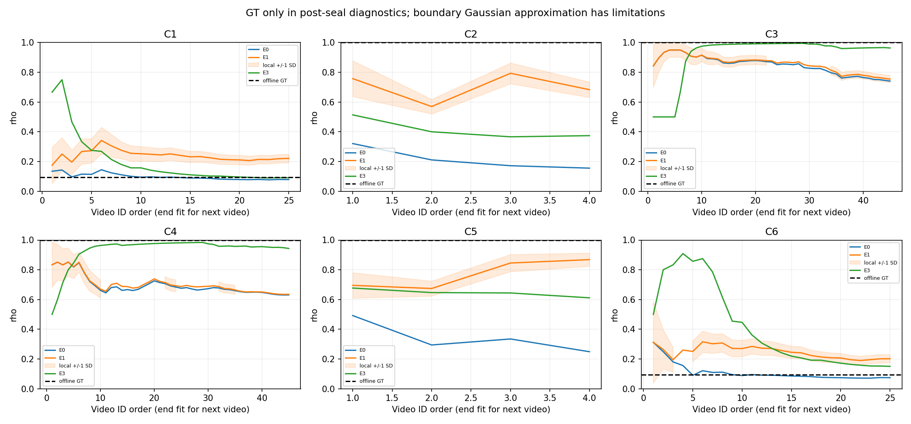

# v9存在性离线验证

选择：未选择；状态：STOP_NO_ESTIMATOR_PASSED。E2=NOT_APPLICABLE。

E1未通过时不以E0/E3替代为新方法；E2因SportsMOT文本复用不分离而不可用。不调整阈值或为单一数据集开先验例外。

失败门槛：C1：正确标空下限未通过；C2：rho误差未通过；C3：错拒上限、rho误差未通过；C4：错拒上限、rho误差未通过；C6：正确标空下限未通过。

本轮门槛使用官方val/test GT，是在val上进行开发，不是盲测。所有估计/生成进程CPU-only、GT打开0；GT只由估计封存后的独立诊断进程读取。原v8阶段3队列继续，阶段4暂停。

## 1. 固定门槛与全部结果

| estimator | pair | output_false_absent | output_correct_empty | rho_hat | rho_GT | rho_error | false_absent_gate | correct_empty_gate | rho_gate | ALL_GATES_PASS |
| --- | --- | --- | --- | --- | --- | --- | --- | --- | --- | --- |
| E0 | C1 | 11 | 347 | 0.07858059365200874 | 0.09411764705882353 | 0.015537053406814785 | True | True | True | True |
| E0 | C2 | 647 | 0 | 0.15536997225250299 | 1.0 | 0.844630027747497 | False | True | False | False |
| E0 | C3 | 81 | 0 | 0.7411308267433294 | 1.0 | 0.2588691732566706 | False | True | False | False |
| E0 | C4 | 112 | 0 | 0.6308896900786074 | 1.0 | 0.3691103099213926 | False | True | False | False |
| E0 | C5 | 540 | 0 | 0.24889869817554114 | 1.0 | 0.7511013018244589 | False | True | False | False |
| E0 | C6 | 11 | 330 | 0.07407433162328235 | 0.09411764705882353 | 0.02004331543554118 | True | True | True | True |
| E1 | C1 | 1 | 187 | 0.22071961535699666 | 0.09411764705882353 | 0.12660196829817313 | True | False | True | False |
| E1 | C2 | 52 | 0 | 0.683265946715945 | 1.0 | 0.316734053284055 | True | True | False | False |
| E1 | C3 | 73 | 0 | 0.7543340675655187 | 1.0 | 0.24566593243448132 | False | True | False | False |
| E1 | C4 | 107 | 0 | 0.6348778789656584 | 1.0 | 0.3651221210343416 | False | True | False | False |
| E1 | C5 | 33 | 0 | 0.8683202510828576 | 1.0 | 0.1316797489171424 | True | True | True | True |
| E1 | C6 | 3 | 175 | 0.2014157870165383 | 0.09411764705882353 | 0.10729813995771478 | True | False | True | False |
| E3 | C1 | 7 | 318 | 0.09090909090909091 | 0.09411764705882353 | 0.0032085561497326165 | True | True | True | True |
| E3 | C2 | 225 | 0 | 0.3739612188365651 | 1.0 | 0.6260387811634349 | False | True | False | False |
| E3 | C3 | 10 | 0 | 0.9636963696369637 | 1.0 | 0.0363036303630363 | True | True | True | True |
| E3 | C4 | 16 | 0 | 0.9435215946843853 | 1.0 | 0.056478405315614655 | True | True | True | True |
| E3 | C5 | 138 | 0 | 0.6114285714285714 | 1.0 | 0.38857142857142857 | True | True | False | False |
| E3 | C6 | 2 | 254 | 0.15057915057915058 | 0.09411764705882353 | 0.056461503520327055 | True | False | True | False |

B2两类门槛都用最终输出拒绝（EVIDENCE+PRIOR_BUDGET_EXHAUSTED）；视频末按新估计器重新决定预算耗尽拒绝集合。数值门槛、选择优先级不变。

## 2. 估计器终值、Laplace与截断诊断

| estimator | pair | pi_or_mu | marginal_pi | GT_pi_strata | tau | rho_laplace_std | uncapped_output_disagreements | uncapped_evidence_disagreements |
| --- | --- | --- | --- | --- | --- | --- | --- | --- |
| E0 | C1 | [0.95, 0.95, 0.95] | [0.95, 0.95, 0.95] | [0.5870786516853933, 0.5705705705705706, 0.5121951219512195] | None | None | 0 | 0 |
| E0 | C2 | [0.6590306341221023, 0.8644975194287671, 0.7899156062555324] | [0.6590306341221023, 0.8644975194287671, 0.7899156062555324] | [0.10167621472522809, 0.12984844592858977, 0.13135057345950896] | None | None | 0 | 0 |
| E0 | C3 | [0.95, 0.95, 0.95] | [0.95, 0.95, 0.95] | [0.5673267326732673, 0.4487506374298827, 0.3908898305084746] | None | None | 0 | 0 |
| E0 | C4 | [0.95, 0.8042320524618327, 0.95] | [0.95, 0.8042320524618327, 0.95] | [0.5183168316831683, 0.45690973992860784, 0.4348516949152542] | None | None | 0 | 0 |
| E0 | C5 | [0.6841830745283896, 0.8273537844865649, 0.7395067646245036] | [0.6841830745283896, 0.8273537844865649, 0.7395067646245036] | [0.11381285805219606, 0.12466820789451151, 0.1241550739174044] | None | None | 0 | 0 |
| E0 | C6 | [0.95, 0.95, 0.95] | [0.95, 0.95, 0.95] | [0.5870786516853933, 0.5675675675675675, 0.5152439024390244] | None | None | 0 | 0 |
| E1 | C1 | [0.8293299471495827, 0.7135902149701343, 0.8463594339678053] | [0.6205175283738567, 0.5676784473966607, 0.6305189984485251] | [0.5870786516853933, 0.5705705705705706, 0.5121951219512195] | 4.781225541953326 | 0.02803712806168801 | 0 | 0 |
| E1 | C2 | [0.1138763053629205, 0.3124615182343187, 0.19797061883041242] | [0.21297730009305527, 0.3793061393487683, 0.29311459046488436] | [0.10167621472522809, 0.12984844592858977, 0.13135057345950896] | 1.9106955312425868 | 0.05210092794176833 | 0 | 0 |
| E1 | C3 | [0.95, 0.9485468060829001, 0.95] | [0.9500000000000001, 0.9485468060829002, 0.9500000000000001] | [0.5673267326732673, 0.4487506374298827, 0.3908898305084746] | 4.319721498953098e-08 | 0.023666585265777813 | 3 | 2 |
| E1 | C4 | [0.95, 0.8013054203873833, 0.95] | [0.9499999999997841, 0.8013054203868986, 0.9499999999997841] | [0.5183168316831683, 0.45690973992860784, 0.4348516949152542] | 3.1791013302699097e-06 | None | 2 | 2 |
| E1 | C5 | [0.1768511944456173, 0.2435261800086225, 0.16741574957607136] | [0.2978689398516828, 0.34779446176272016, 0.2900261873002343] | [0.11381285805219606, 0.12466820789451151, 0.1241550739174044] | 2.3216060912748113 | 0.04439659522395863 | 0 | 0 |
| E1 | C6 | [0.8436628943076206, 0.7947723173109008, 0.615375309015921] | [0.6298295527651049, 0.6032101051887195, 0.5345545869682574] | [0.5870786516853933, 0.5675675675675675, 0.5152439024390244] | 4.743919120647396 | 0.027740301694778677 | 1 | 1 |
| E3 | C1 | [0.9500282770367068, 0.9500282770367068, 0.9500282770367068] | [0.9500282770367068, 0.9500282770367068, 0.9500282770367068] | [0.5870786516853933, 0.5705705705705706, 0.5121951219512195] | None | None | 0 | 0 |
| E3 | C2 | [0.6690833212971894, 0.6690833212971894, 0.6690833212971894] | [0.6690833212971894, 0.6690833212971894, 0.6690833212971894] | [0.10167621472522809, 0.12984844592858977, 0.13135057345950896] | None | None | 0 | 0 |
| E3 | C3 | [0.8271684841230719, 0.8271684841230719, 0.8271684841230719] | [0.8271684841230719, 0.8271684841230719, 0.8271684841230719] | [0.5673267326732673, 0.4487506374298827, 0.3908898305084746] | None | None | 0 | 0 |
| E3 | C4 | [0.8406342084468533, 0.8406342084468533, 0.8406342084468533] | [0.8406342084468533, 0.8406342084468533, 0.8406342084468533] | [0.5183168316831683, 0.45690973992860784, 0.4348516949152542] | None | None | 0 | 0 |
| E3 | C5 | [0.6678103939749483, 0.6678103939749483, 0.6678103939749483] | [0.6678103939749483, 0.6678103939749483, 0.6678103939749483] | [0.11381285805219606, 0.12466820789451151, 0.1241550739174044] | None | None | 0 | 0 |
| E3 | C6 | [0.9242960486411449, 0.9242960486411449, 0.9242960486411449] | [0.9242960486411449, 0.9242960486411449, 0.9242960486411449] | [0.5870786516853933, 0.5675675675675675, 0.5152439024390244] | None | None | 0 | 0 |

E1的mu是logit-normal随机效应的中心，不等于边际平均匹配率；每视频结果另存marginal_pi_strata。Laplace使用不截断光滑目标的全5参数Hessian；奇异/非正定标不可识别，边界处局部高斯近似的限制保留在每个收据。B1不截断判定仅作诊断，不影响选择。

## 3. 先验拒绝与证据拒绝

| estimator | pair | evidence_false_absent | evidence_correct_empty | low_tentative | PRIOR_BUDGET_EXHAUSTED | prior_budget_GT_present | prior_budget_correct_empty | correct_empty_majority_from_prior_budget |
| --- | --- | --- | --- | --- | --- | --- | --- | --- |
| E0 | C1 | 10 | 300 | 48 | 48 | 1 | 47 | False |
| E0 | C2 | 647 | 0 | 0 | 0 | 0 | 0 | False |
| E0 | C3 | 80 | 0 | 1 | 1 | 1 | 0 | False |
| E0 | C4 | 111 | 0 | 1 | 1 | 1 | 0 | False |
| E0 | C5 | 537 | 0 | 3 | 3 | 3 | 0 | False |
| E0 | C6 | 10 | 282 | 49 | 49 | 1 | 48 | False |
| E1 | C1 | 1 | 165 | 22 | 22 | 0 | 22 | False |
| E1 | C2 | 52 | 0 | 0 | 0 | 0 | 0 | False |
| E1 | C3 | 73 | 0 | 0 | 0 | 0 | 0 | False |
| E1 | C4 | 107 | 0 | 0 | 0 | 0 | 0 | False |
| E1 | C5 | 30 | 0 | 3 | 3 | 3 | 0 | False |
| E1 | C6 | 3 | 155 | 20 | 20 | 0 | 20 | False |
| E3 | C1 | 6 | 273 | 46 | 46 | 1 | 45 | False |
| E3 | C2 | 225 | 0 | 0 | 0 | 0 | 0 | False |
| E3 | C3 | 10 | 0 | 0 | 0 | 0 | 0 | False |
| E3 | C4 | 16 | 0 | 0 | 0 | 0 | 0 | False |
| E3 | C5 | 135 | 0 | 3 | 3 | 3 | 0 | False |
| E3 | C6 | 2 | 217 | 37 | 37 | 0 | 37 | False |

最后一列仅标注正确标空是否过半来自预算耗尽先验拒绝，不是新增验收门槛。固定原问题/预算；新估计器即使提前拒绝也继续摄入原流后续回答，不模拟重新选题。

## 4. D1：句子间匹配率与过度离散

| pair | stratum | queries | pi_mean | pooled_pi | variance | homogeneous_binomial_variance | overdispersion | quantiles |
| --- | --- | --- | --- | --- | --- | --- | --- | --- |
| C1 | ALL | 40 | 0.5649808924211037 | 0.5575221238938053 | 0.1535112482902123 | 0.015917301181419576 | 9.64430128829927 | [0.02702702702702703, 0.08108108108108109, 0.15109890109890112, 0.6129032258064515, 0.9870689655172413, 1.0, 1.0] |
| C1 | 0 | 40 | 0.5993458154748478 | 0.5870786516853933 | 0.17656292646927527 | 0.04197690565037393 | 4.206192041401757 | [0.0, 0.0, 0.13461538461538464, 0.6666666666666666, 1.0, 1.0, 1.0] |
| C1 | 1 | 40 | 0.5757013040138916 | 0.5705705705705706 | 0.16192428586872717 | 0.04861706408441169 | 3.3306060108357243 | [0.0, 0.08333333333333333, 0.15625, 0.5833333333333333, 1.0, 1.0, 1.0] |
| C1 | 2 | 40 | 0.5121201034669423 | 0.5121951219512195 | 0.17872648485022474 | 0.05561380446352735 | 3.213707218455755 | [0.0, 0.0, 0.08333333333333333, 0.5, 1.0, 1.0, 1.0] |
| C2 | ALL | 862 | 0.1361767284467013 | 0.12083774730151459 | 0.021982101314616833 | 0.001906147068648401 | 11.532216834771184 | [0.0, 0.017543859649122806, 0.023121387283236993, 0.08181413961760783, 0.21753070809248554, 0.34615384615384615, 0.875] |
| C2 | 0 | 862 | 0.12324509618398391 | 0.10167621472522809 | 0.024175217590521186 | 0.004807927278147054 | 5.028199511336654 | [0.0, 0.0, 0.017241379310344827, 0.05555555555555555, 0.18181818181818182, 0.36363636363636365, 0.9090909090909091] |
| C2 | 1 | 862 | 0.1476603914972359 | 0.12984844592858977 | 0.035814540170489684 | 0.006036208026154405 | 5.933284607705392 | [0.0, 0.0, 0.0, 0.08620689655172414, 0.23529411764705882, 0.4117647058823529, 1.0] |
| C2 | 2 | 862 | 0.13778083464427415 | 0.13135057345950896 | 0.02516998914399344 | 0.006341756183373226 | 3.9689304375945498 | [0.0, 0.0, 0.0, 0.1, 0.2, 0.38596491228070173, 1.0] |
| C3 | ALL | 466 | 0.47537979072975733 | 0.4709490543533822 | 0.09365186409042117 | 0.012640906800637798 | 7.408634963252475 | [0.0, 0.058823529411764705, 0.3076923076923077, 0.4666666666666667, 0.5714285714285714, 0.9444444444444444, 1.0] |
| C3 | 0 | 466 | 0.6089528628262533 | 0.5673267326732673 | 0.14798895793508193 | 0.03561556366578051 | 4.1551766335589395 | [0.0, 0.0, 0.2, 0.7272727272727273, 1.0, 1.0, 1.0] |
| C3 | 1 | 466 | 0.4430693531551901 | 0.4487506374298827 | 0.1259952943205836 | 0.037691740127553344 | 3.3427826333886546 | [0.0, 0.0, 0.16666666666666666, 0.4, 0.8, 1.0, 1.0] |
| C3 | 2 | 466 | 0.36134965261953395 | 0.3908898305084746 | 0.13547043064610867 | 0.038378039816291225 | 3.529894473365009 | [0.0, 0.0, 0.0, 0.25, 0.6, 1.0, 1.0] |
| C4 | ALL | 466 | 0.47537979072975733 | 0.4709490543533822 | 0.09365186409042117 | 0.012640906800637798 | 7.408634963252475 | [0.0, 0.058823529411764705, 0.3076923076923077, 0.4666666666666667, 0.5714285714285714, 0.9444444444444444, 1.0] |
| C4 | 0 | 466 | 0.5123398478012212 | 0.5183168316831683 | 0.13611001064868747 | 0.03622457457119204 | 3.7573943175285853 | [0.0, 0.0, 0.16666666666666666, 0.5, 0.9230769230769231, 1.0, 1.0] |
| C4 | 1 | 466 | 0.4686692319363993 | 0.45690973992860784 | 0.11748637931061061 | 0.0378090216332904 | 3.1073636459073364 | [0.0, 0.0, 0.16666666666666666, 0.4, 0.8, 1.0, 1.0] |
| C4 | 2 | 466 | 0.4423461666247579 | 0.4348516949152542 | 0.11258820617397225 | 0.039612856751914484 | 2.84221375093153 | [0.0, 0.0, 0.16666666666666666, 0.4, 0.6666666666666666, 1.0, 1.0] |
| C5 | ALL | 862 | 0.1361767284467013 | 0.12083774730151459 | 0.021982101314616833 | 0.001906147068648401 | 11.532216834771184 | [0.0, 0.017543859649122806, 0.023121387283236993, 0.08181413961760783, 0.21753070809248554, 0.34615384615384615, 0.875] |
| C5 | 0 | 862 | 0.14697188534253394 | 0.11381285805219606 | 0.029542676395601028 | 0.005309118213766758 | 5.564516593169027 | [0.0, 0.0, 0.034482758620689655, 0.06896551724137931, 0.21052631578947367, 0.3684210526315789, 1.0] |
| C5 | 1 | 862 | 0.13739643500216295 | 0.12466820789451151 | 0.03375861340436814 | 0.005829898061700412 | 5.790600975709297 | [0.0, 0.0, 0.0, 0.058823529411764705, 0.21052631578947367, 0.39655172413793105, 0.9090909090909091] |
| C5 | 2 | 862 | 0.12328362533192541 | 0.1241550739174044 | 0.02585330278505461 | 0.006044003702862011 | 4.277512730975383 | [0.0, 0.0, 0.0, 0.058823529411764705, 0.17647058823529413, 0.38596491228070173, 1.0] |
| C6 | ALL | 40 | 0.5649808924211037 | 0.5575221238938053 | 0.1535112482902123 | 0.015917301181419576 | 9.64430128829927 | [0.02702702702702703, 0.08108108108108109, 0.15109890109890112, 0.6129032258064515, 0.9870689655172413, 1.0, 1.0] |
| C6 | 0 | 40 | 0.6049013710304033 | 0.5870786516853933 | 0.18362957751166384 | 0.04197690565037393 | 4.374538205391232 | [0.0, 0.0, 0.13461538461538464, 0.7333333333333334, 1.0, 1.0, 1.0] |
| C6 | 1 | 40 | 0.5673679706805583 | 0.5675675675675675 | 0.16154453607979086 | 0.04869937490325169 | 3.317178842659116 | [0.0, 0.08333333333333333, 0.16666666666666666, 0.5, 1.0, 1.0, 1.0] |
| C6 | 2 | 40 | 0.5152451034669422 | 0.5152439024390244 | 0.17583428867415463 | 0.05559518377006857 | 3.162761173726358 | [0.0, 0.0, 0.11458333333333333, 0.5, 1.0, 1.0, 1.0] |

GT标签是每帧IoU>=.5一对一匹配后按轨迹>=50%观测为正；只纳入n>=3。方差为句子率的ddof=1方差，二项参照取共用pooled_pi并保留各句实际分母。共享视频/轨迹/表达具有相关性，过度离散是描述性比较，不作为独立样本显著性。

## 5. D2：教师对正负轨迹的回答

| pair | target | GT_present_queries | positive_track_Yes_rate | negative_track_Yes_rate | all_No_queries | no_answer_queries | v8_output_false_absent | rejected_with_zero_GT_positive_asked | rejected_with_GT_positive_asked | rejected_unique_GT_positive_tracks_asked | rejected_unique_GT_negative_tracks_asked |
| --- | --- | --- | --- | --- | --- | --- | --- | --- | --- | --- | --- |
| C1 | Dance | 40 | 0.8675022381378693 | 0.75 | 4 | 0 | 11 | 5 | 6 | 12 | 31 |
| C2 | KITTI-V2 | 862 | 0.8372708372708373 | 0.5352415726674056 | 285 | 0 | 647 | 377 | 270 | 641 | 4168 |
| C3 | SportsMOT | 466 | 0.9218995290423861 | 0.425 | 44 | 0 | 81 | 32 | 49 | 90 | 319 |
| C4 | SportsMOT | 466 | 0.9156064461407973 | 0.4573913043478261 | 56 | 0 | 112 | 53 | 59 | 90 | 393 |
| C5 | KITTI-V2 | 862 | 0.8121526491293072 | 0.4930899273638876 | 193 | 0 | 540 | 277 | 263 | 701 | 4518 |
| C6 | Dance | 40 | 0.8444252376836646 | 0.6938775510204082 | 6 | 0 | 11 | 5 | 6 | 18 | 46 |

逐句记录见D2_query_teacher_answers.csv，特别保留原C2/C5错误拒绝句。正/负轨迹Yes率按实际回答计数；唯一问过轨迹数按(q,track)去重；全No要求至少有一次回答。原生轨迹多数GT，不冒充单帧裁剪的教师准确率。

## 6. D3：查询复用与E2适用边界

| target | videos | queries | dataset_mean_reuse | query_weighted_reuse | video_reuse_quantiles |
| --- | --- | --- | --- | --- | --- |
| Dance | 25 | 425 | 1.0 | 1.0 | [1.0, 1.0, 1.0, 1.0, 1.0, 1.0, 1.0] |
| KITTI-V2 | 4 | 862 | 0.07447307437651732 | 0.07424593967517401 | [0.057971014492753624, 0.060144927536231886, 0.06340579710144928, 0.07427536231884058, 0.08534263959390863, 0.08895939086294416, 0.09137055837563451] |
| SportsMOT | 45 | 466 | 0.9280460897127564 | 0.927038626609442 | [0.6363636363636364, 0.77, 0.875, 1.0, 1.0, 1.0, 1.0] |

SportsMOT均值.928046>=.5，触发预注册NOT_APPLICABLE；阈值.8已在D3前公开，不调阈值。不能用已知目标存在比例代替这个GT-free协议代理。

## 7. 隔离、复现、成本与恢复

| pair | videos | parameter_max_error | probability_max_error | all_output_absence_exact |
| --- | --- | --- | --- | --- |
| C1 | 25 | 0.0 | 0.0 | True |
| C2 | 4 | 0.0 | 0.0 | True |
| C3 | 45 | 0.0 | 0.0 | True |
| C4 | 45 | 0.0 | 0.0 | True |
| C5 | 4 | 0.0 | 0.0 | True |
| C6 | 25 | 0.0 | 0.0 | True |

| estimator | pair | CPU_process_wall_seconds | videos | queries | GT_open_attempts | GPU_calls | teacher_calls |
| --- | --- | --- | --- | --- | --- | --- | --- |
| E0 | C1 | 10.187504328321666 | 25 | 425 | 0 | 0 | 0 |
| E0 | C2 | 109.53465646225959 | 4 | 862 | 0 | 0 | 0 |
| E0 | C3 | 9.950342250987887 | 45 | 466 | 0 | 0 | 0 |
| E0 | C4 | 10.078829443082213 | 45 | 466 | 0 | 0 | 0 |
| E0 | C5 | 107.8635046700947 | 4 | 862 | 0 | 0 | 0 |
| E0 | C6 | 11.069126304704696 | 25 | 425 | 0 | 0 | 0 |
| E1 | C1 | 21.35624437732622 | 25 | 425 | 0 | 0 | 0 |
| E1 | C2 | 139.4958794428967 | 4 | 862 | 0 | 0 | 0 |
| E1 | C3 | 18.994014496915042 | 45 | 466 | 0 | 0 | 0 |
| E1 | C4 | 18.99406206700951 | 45 | 466 | 0 | 0 | 0 |
| E1 | C5 | 91.02255751006305 | 4 | 862 | 0 | 0 | 0 |
| E1 | C6 | 22.380143250338733 | 25 | 425 | 0 | 0 | 0 |
| E3 | C1 | 10.126262740697712 | 25 | 425 | 0 | 0 | 0 |
| E3 | C2 | 106.56244999403134 | 4 | 862 | 0 | 0 | 0 |
| E3 | C3 | 10.046629930846393 | 45 | 466 | 0 | 0 | 0 |
| E3 | C4 | 10.150206211023033 | 45 | 466 | 0 | 0 | 0 |
| E3 | C5 | 103.66121050016955 | 4 | 862 | 0 | 0 | 0 |
| E3 | C6 | 11.179086801130325 | 25 | 425 | 0 | 0 | 0 |

输入路径/SHA见inventory_D3.json和inputs_seal.json。每个E0/E1/E3方向的完整逐视频参数、逐句判定与优化/Laplace收据见同目录E*_C*.json；服务器封存及可恢复CPU checkpoint根目录：`/data2/user/TTA-RMOT-assets/presence_active_v9_offline_20261106`。没有新RMOT预测，也没有新TrackEval HOTA；这些是固定已观测回答条件下的存在性反事实。

弱排名固定为v8实际逐轮温度/偏置作用于封存StageA logits；不用视频末排名前视，不按反事实重新拟合快分支。E3仅复现旧估计公式在v8固定问题流上的效果，不冒充历史v7闭环。E0收据逐视频核对原v8参数及拒绝集合。

## 停止

E1未通过全部固定门槛，E2不可用；本轮停止v9方法实施，不生成live v9.py，不运行MINUS_SLOW_v9，不开启阶段4或任何新方法。原v8阶段3不受此停止影响。

## 数值核查与解释边界

所有L-BFGS-B收据都返回success，但这不等于已证明求到全局或局部MAP。尤其E1 C4终值tau=3.1791e-6，光滑负对数后验的tau方向曲率约−15.8638，完整Hessian也非正定。因此该处不能认定已找到局部最优，Laplace标准差留空；不能把它直接解释成只有数据不足。逐视频曲率见curvature_diagnostics.csv。没有在看到结果后更换初值、重启、改tol或重新拟合。其它C1/C2/C3/C6也分别违反固定门槛，所以本轮不选择E1；这不是“随机效应模型永远不可行”的证明。

C2/C5错拒从647/540降到52/33，说明本配方能缓解部分拒绝；但Dance正确标空从347/330降到187/175，Sports仍错拒73/107。不能只展示KITTI的改善，也不跨数据集拼接E0/E1/E3最优格。

固定问题流下，E1取消判定截断只改变C1–C6最终拒绝集合的0/0/3/2/0/1条表达，不能把当前主要失败简单归于±2截断；这项反事实不覆盖重新选题后的反馈。E1在Sports的tau接近0且mu再次接近上限，真实D1异质性没有被当前回答/DS/拟合充分恢复；教师错误率失配与相关回答仍是模型假设限制，不作单因归因。

关闭审计通过：18方向重放、444视频、10518个查询episode（同一固定数据重复分析，不是独立重复实验），E2六项明确NA。预测不是新的RMOT HOTA；GT开发门槛也不是盲测。输入、输出、关闭CPU日志及最新恢复checkpoint的路径/SHA见artifacts.json和validation.json。E0没有另存原始stdout文件，完整逐视频数值收据与复现核验仍保留。

本轮CPU诊断结束并停止新增v9工作；原v8阶段3继续，阶段4仍暂停，等待用户下一条指令。
